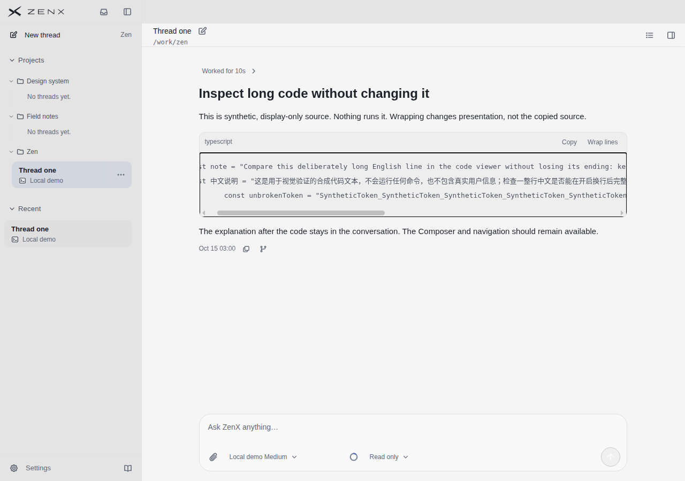
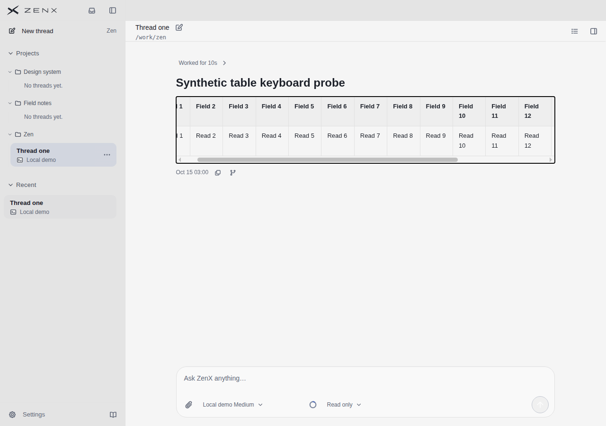
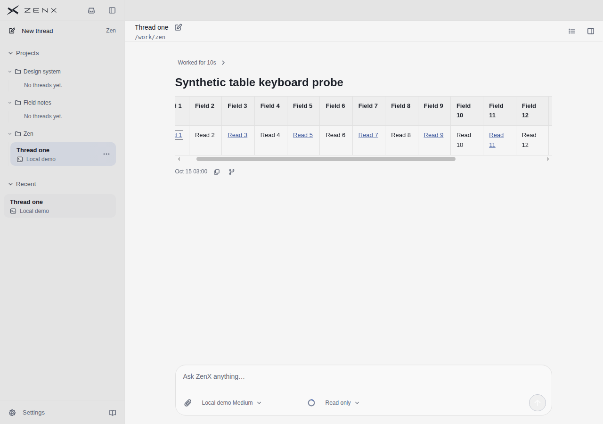
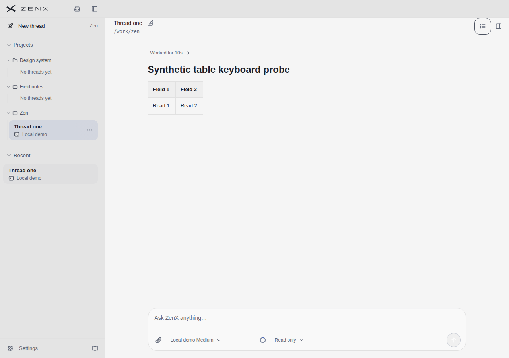
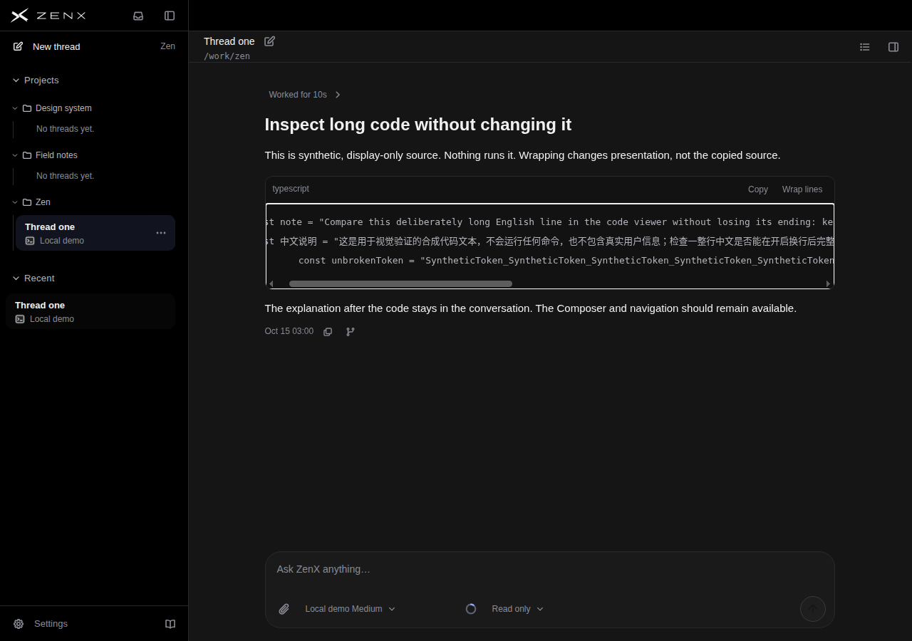
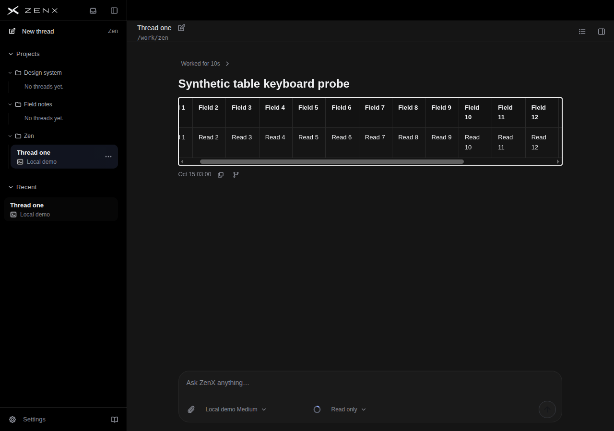
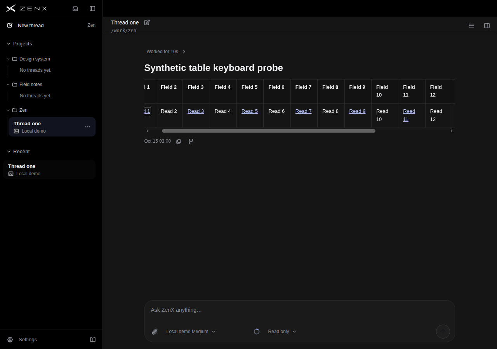
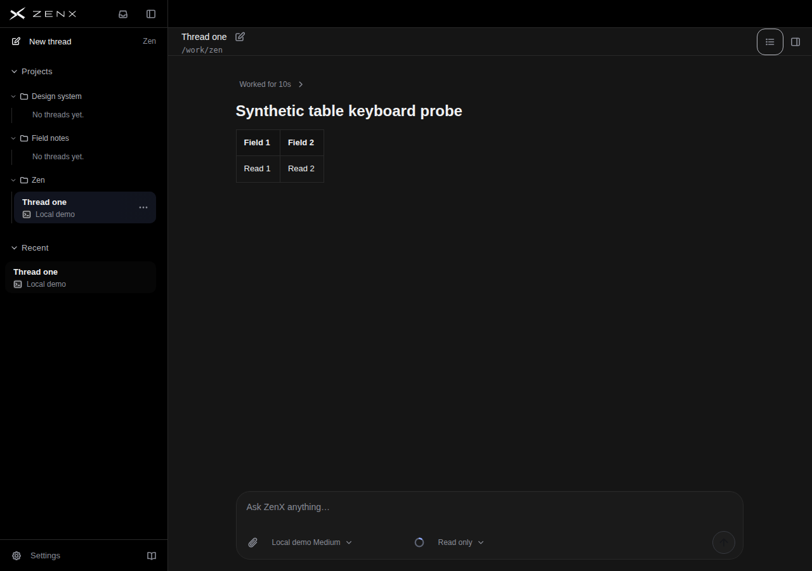

# 键盘横滚实证：这轮不新增产品改动

检查版本 `947bc226743d16cdd85b858da37c3c8b4bb6e775`。该版本与上一轮保留的 `de217959` 生产实现一致；新增内容只在合成预览场景、观察脚本和测试。不能因源码没有显式 tabIndex 就判定不可达，也不为增加提交而增加不必要的 Tab 停靠或焦点状态管理。

## 实际结果

| 场景（浅/深均一致）   | 内容宽 / 视口宽 | 原生 Tab 进入          | ArrowRight | 焦点                          | 页面/对话位置 |
| --------------------- | --------------: | ---------------------- | ---------- | ----------------------------- | ------------- |
| 长代码                |    1945 / 798px | pre，12次Tab           | 0→40px     | focus-visible且图中可见       | 保持0         |
| 16列无链接表          |    1111 / 800px | wrapper，10次Tab       | 0→40px     | focus-visible且图中可见       | 保持0         |
| 同文字16列、含8链接表 |    1111 / 800px | 表内链接，10次Tab      | 0→40px     | focus-visible，可见但左侧裁切 | 保持0         |
| 2列不溢出对照         |     800 / 800px | 完整有界循环无表格停靠 | 不需要横滚 | 未增加停靠                    | 保持0         |

[reading run 43244768629](https://github.com/albert-zen/zen/actions/runs/43244768629)实际捕获65.657秒，72张场景图；本页保存相关8张。8项定向mock测试通过。Chrome156合成生产组件，未执行任务、访问链接、修改产品DOM、JS强行focus或写scrollLeft。含链接表横滚后首链接的焦点框部分移出左边界，不能称焦点环始终完整可见。原生按键只移动一次40px，不证明已经到末端；不等于原生Electron、全部内容、全部表格、屏幕阅读器或其他浏览器验收。全部原始序列和尺寸见[receipt.json](receipt.json)。

## 为什么不改颜色或键盘行为

默认深色次要文字以实图及源码核对：主面5.44:1、Composer5.18:1、侧栏6.26:1、审批卡4.85:1；Copy/Wrap代码头5.58:1。不能因为看起来安静就全局提亮，disabled与有用信息也不能混为一谈。某些hover背景token组合的理论风险尚未被实际控件状态证实，未冒充缺陷。

键盘实证已显示原生可用路径，含链接表也能由聚焦链接驱动横滚，因此这轮不添加条件tabIndex/ResizeObserver hook、不改变主题或正文行距。不把仅观察到的正常行为宣称为修复或分数提升。

本轮没有A/B产品候选，**不生成虚假的新视觉评分**。最近一次实际产品前后评分及每家参考逐项分数仍见[上一轮完整盲评](../table-align-de217959/README.md)，不是本轮重新评分。长标识断行、右栏空间成本仍未解决。

## 实际产品截图

### light / code-keyboard-scroll-probe

### light / table-keyboard-plain

### light / table-keyboard-links

### light / table-keyboard-fit

### dark / code-keyboard-scroll-probe

### dark / table-keyboard-plain

### dark / table-keyboard-links

### dark / table-keyboard-fit

