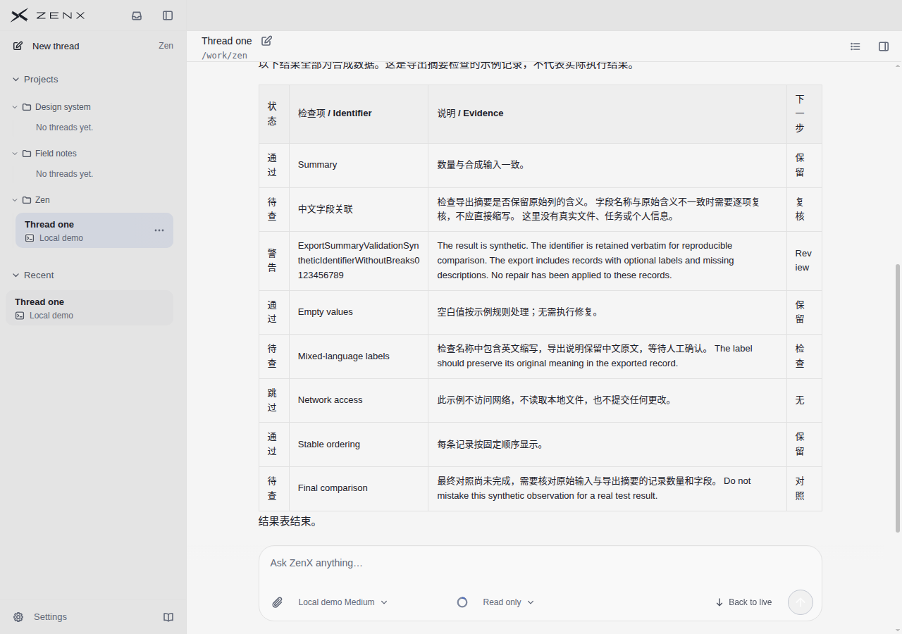
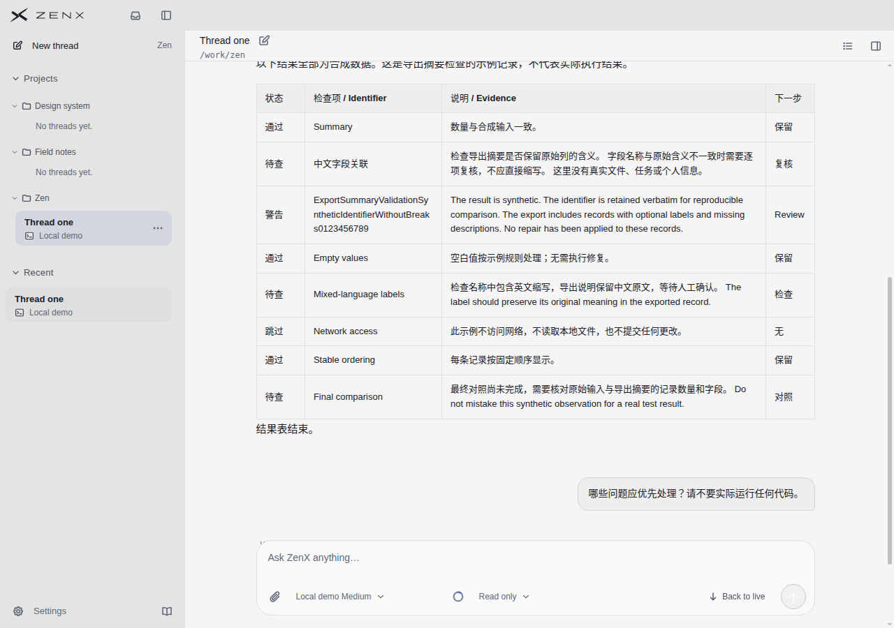
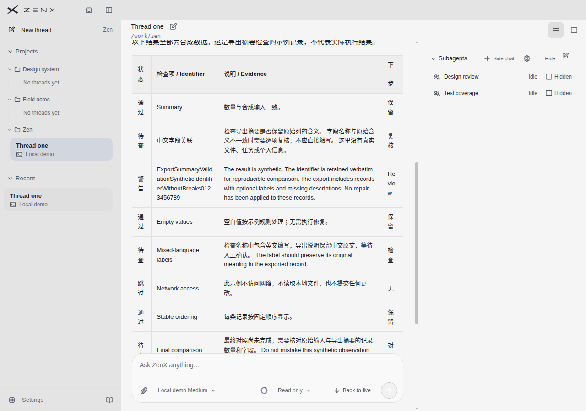
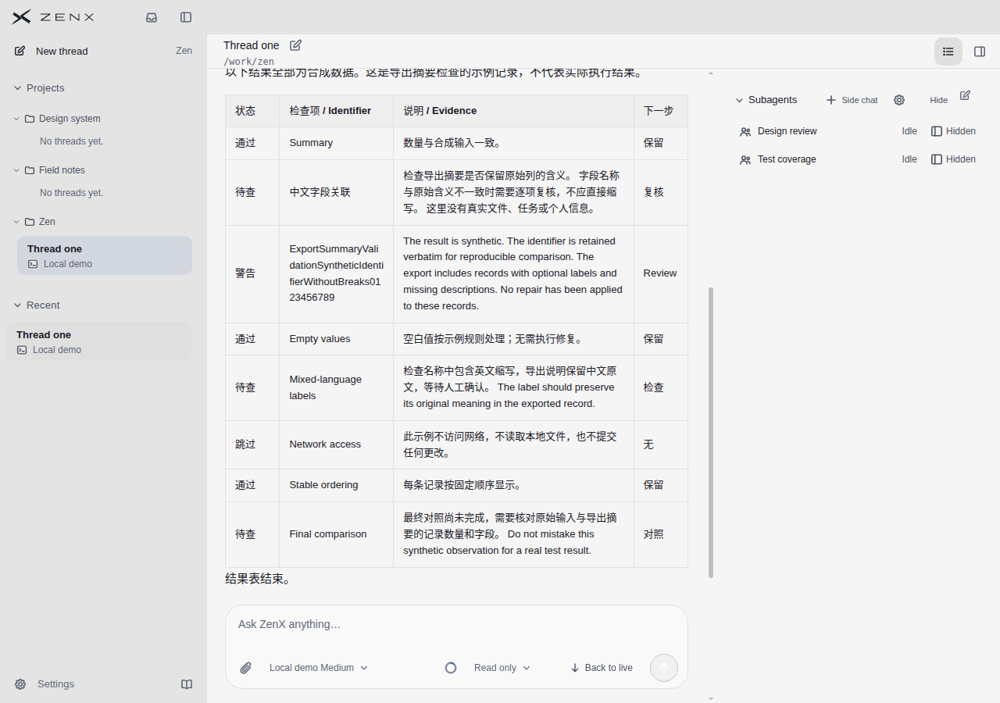
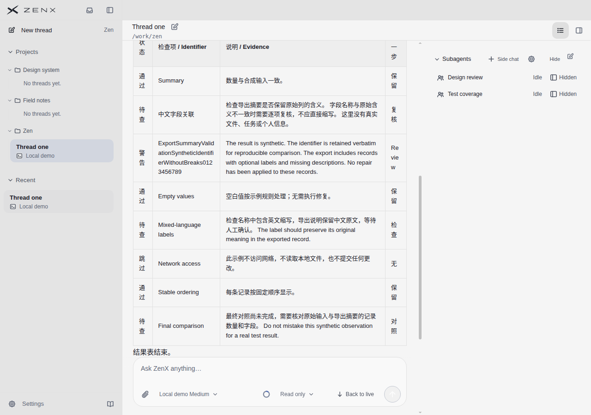
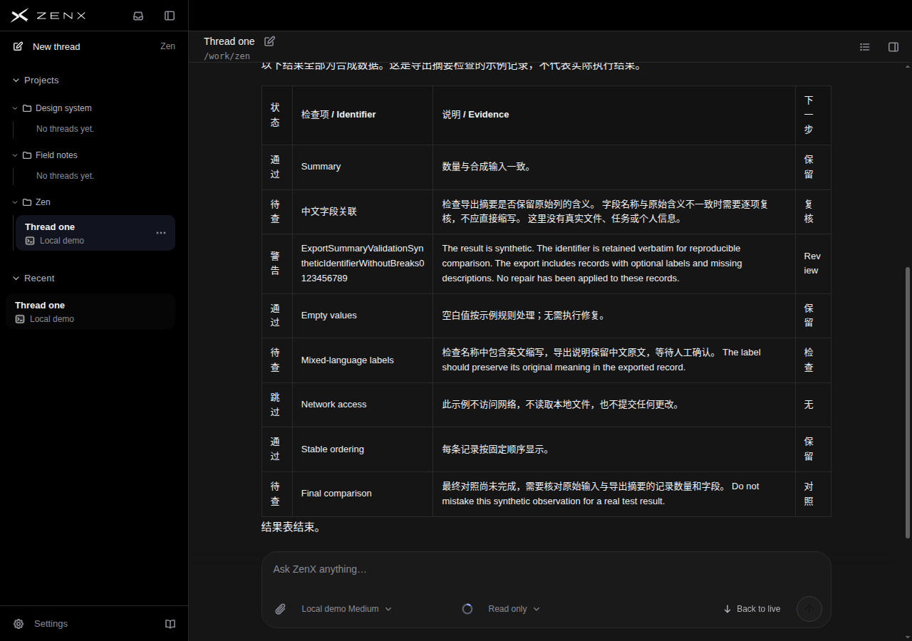
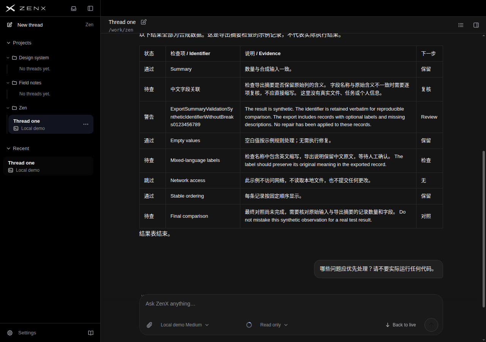
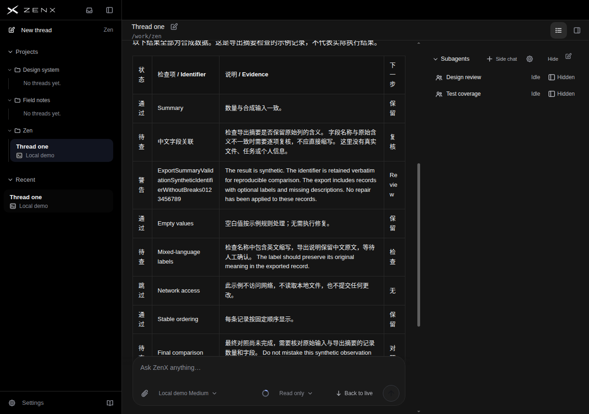
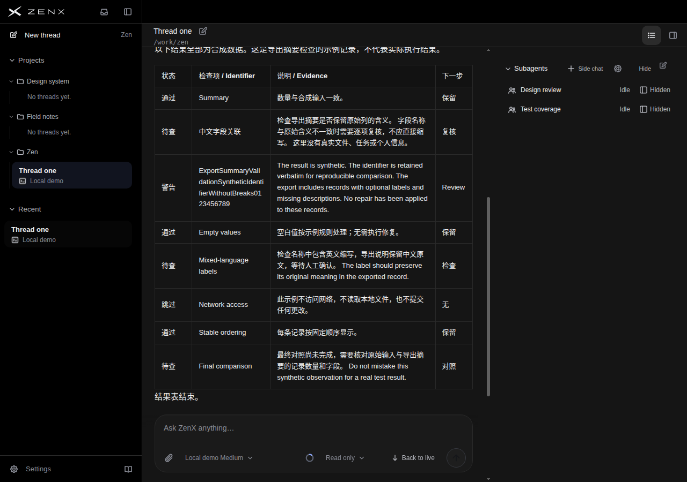
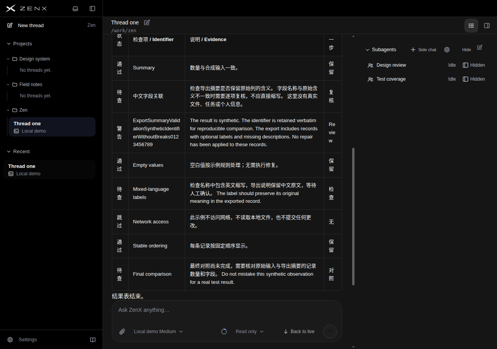

# 桌面结果表：保留短标签的完整阅读

本轮保留 `1e29ae3021d3b03b30668b31ce3988c4c7f1d70d` 的最小改动：桌面助手 Markdown 表格单元格保留约6ch内容宽，外加原padding与边框余量。不按列序或内容硬编码，不设nowrap，不改变正文27px行距、字号、表格自然宽度、原文、列序或垂直对齐。资料卡与主对话仍同一表面。

基线为 `c642547f0d63219faf5a345ae87d630d7cc7fae3`。真实生产组件承载三轮合成代码检查/结果表/追问，不代表执行过真实任务。P=基线，Q=候选；独立评审只见匿名原图及参考，未给目标分。

## 为什么保留

实际问题是短列被挤到中文逐字竖排、Review拆成Re/vie/w，不是泛泛嫌表格不够圆。候选保持短语横向完整；盲评判断有净收益，而不是因为表格更密。

| 桌面状态   | 基线状态/末列宽 | 候选状态/末列宽 | 基线→候选表高   | 表格可用宽 |
| ---------- | --------------- | --------------- | --------------- | ---------- |
| 资料卡关闭 | 43.25 / 49.95px | 69.38 / 69.39px | 605.94→481.16px | 800px不变  |
| 资料卡打开 | 41.56 / 46.16px | 69.38 / 69.39px | 689.13→605.94px | 593px不变  |

代价：说明列变窄，打开资料卡时长英文由约4行变5行，长标识符仍硬换行；不宣称改善所有表格。本组页面/消息横溢出为0，表格scrollWidth与clientWidth相等；末行原生滚动可达，候选截图下可同时辨识表头与表尾，不能把原版截图被遮挡误称原版不可访问。

## 验证与边界

- [候选短预览43226051398](https://github.com/albert-zen/zen/actions/runs/43226051398)成功，捕获60.3秒，基线69.8秒；未等待长CI。无rendererErrors/外部请求。
- 4项场景定向检查与目标fixture类型检查；2项新CSS合同测试。静态测试本身不证明视觉通过。
- 独立代码复核及发布前后全树验证：仅样式/规范2修改+测试1新增，其余文件SHA/mode/type不变。
- [原始来源、完整几何、原图SHA256与观测](receipt.json)。这是Chromium实际App/Markdown/资料卡/侧栏的合成场景，不是原生打包应用、真实账号任务或全产品验收。
- 此次不改侧栏/资料卡外观，不做窄屏适配；许多列、不同长文本比例、缩放、屏幕阅读器仍需额外覆盖。

## 每个状态的逐项10分制评分

| 方案 | 主题 | 资料卡/位置 | 文本可读 | 列/行关联 | 主对话层级 | 空间一致性 | 整体完成度 | 直接观察                                                           |
| ---- | ---- | ----------- | -------: | --------: | ---------: | ---------: | ---------: | ------------------------------------------------------------------ |
| P    | 浅色 | 关闭        |      6.5 |       6.5 |        7.0 |        6.5 |        6.5 | 状态、下一步被逐字拆行；正文栏较宽，长说明阅读尚顺                 |
| P    | 浅色 | 打开        |      5.5 |       6.0 |        6.5 |        6.0 |        5.5 | Review 拆为三段；末行落到输入框遮挡区；左右短列迫使视线转向        |
| P    | 浅色 | 末行        |      5.5 |       6.0 |        6.0 |        6.0 |        6.0 | 末行及结束语可见，但表头上部裁切；长标识符仍多处硬换行             |
| P    | 深色 | 关闭        |      6.5 |       6.5 |        7.0 |        6.5 |        6.5 | 高对比正文清晰，但同样存在短词竖排，深色不解决列宽问题             |
| P    | 深色 | 打开        |      5.5 |       6.0 |        6.5 |        6.0 |        5.5 | 主表与右栏分区明确；Review 破碎、末行被输入框遮挡                  |
| P    | 深色 | 末行        |      5.5 |       6.0 |        6.0 |        6.0 |        6.0 | 尾部可见、表头裁切；暗色输入区次级控制和发送图标较弱               |
| Q    | 浅色 | 关闭        |      8.0 |       8.0 |        7.5 |        8.0 |        7.5 | 短标签均横向完整；全表及结束语可见，后续用户消息进入视野           |
| Q    | 浅色 | 打开        |      7.5 |       8.0 |        7.0 |        7.5 |        7.5 | 列标题完整，末行和结束语不被输入框盖住；说明列变窄增加长段落折行   |
| Q    | 浅色 | 末行        |      7.5 |       8.0 |        7.0 |        7.5 |        7.5 | 与打开状态视觉近似，完整表头与末行可同时识别；不能据此证明滚动行为 |
| Q    | 深色 | 关闭        |      8.0 |       8.0 |        7.5 |        8.0 |        7.5 | 表格横向扫描顺畅；界线克制，正文清楚；输入区次级控件仍偏暗         |
| Q    | 深色 | 打开        |      7.5 |       8.0 |        7.0 |        7.5 |        7.5 | 完整短标签稳定行关联；长英文说明约五行，段落阅读成本上升           |
| Q    | 深色 | 末行        |      7.5 |       8.0 |        7.0 |        7.5 |        7.5 | 完整表尾与输入区分开；视觉同打开状态，静态证据不足以验证定位机制   |

## 每个参考对象的逐项评分

文件对应：main-conversation-dark=T3 Code；proactive-20s=Codex；product-demo-conversation=Claude Code；subagents-dark=DeepSeek Harness。Linear无图N/O；没有表格的参考在表格项N/O，不虚构分数。

| 参考对象/原图                 | 表格文本可读 | 列/行关联 | 主对话层级 | 空间一致性 | 整体完成度 | 依据与限制                                                                                                                                          |
| ----------------------------- | -----------: | --------: | ---------: | ---------: | ---------: | --------------------------------------------------------------------------------------------------------------------------------------------------- |
| main-conversation-dark.jpg    |          8.5 |       8.5 |        8.5 |        8.5 |        8.0 | 三列短表头、短行内容无需破词；Done、列表、代码块、表格顺序清楚，内容与输入区有充足分隔；侧栏纹理略增噪声。表格远比 P/Q 简单，不能当作长内容压力测试 |
| proactive-20s.png             |          N/O |       N/O |        8.5 |        8.5 |        8.5 | 浅色主对话以摘要、要点、产物、注意事项组织，链接与代码样式可区分，留白支持阅读；无表格，不能证明它能容纳同样的四列混合长文本                        |
| product-demo-conversation.jpg |          N/O |       N/O |        7.5 |        8.0 |        7.5 | 代码变更、操作摘要、完成说明、底部任务卡顺序可辨；展示网页外壳与缩小的产品画面干扰对比，代码与次级字较淡，部分侧栏标题裁切。无可比结果表            |
| subagents-dark.jpg            |          N/O |       N/O |        8.0 |        8.0 |        8.0 | 完成标题、段落、链接、反馈、任务条层级明确；顶部子代理浮层与对话同屏略拥挤，输入提示对比低；无结果表                                                |
| Linear（未提供原图）          |          N/O |       N/O |        N/O |        N/O |        N/O | 没有图像证据，不评分、不补想象                                                                                                                      |

不同内容/任务不可公平总排名；完整理由和限制见[未改写的独立盲评](BLIND-REVIEW.md)。

## 产品前后原图

### light / dock-closed

### light / dock-open

### light / last-row

### dark / dock-closed

### dark / dock-open

### dark / last-row

## 实际参考原图

