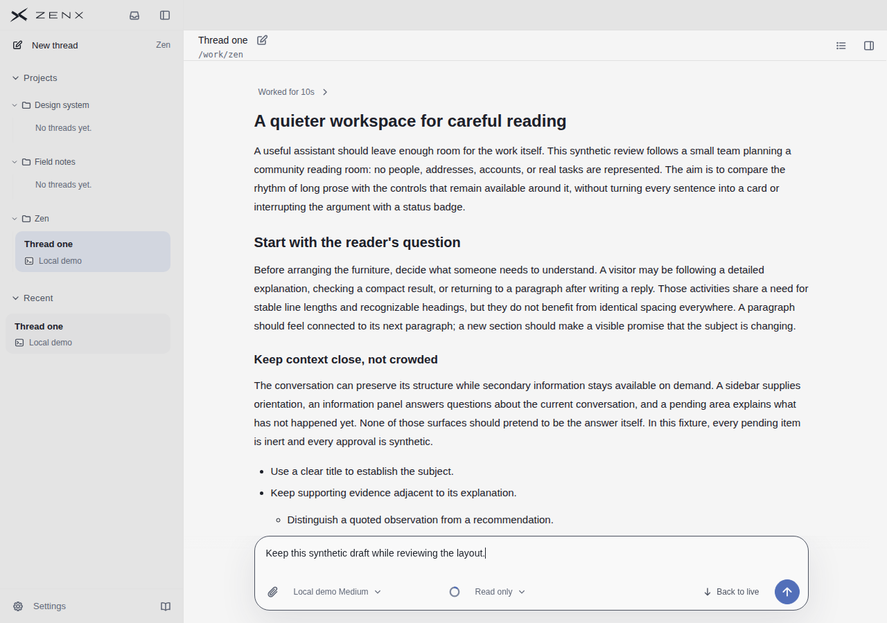
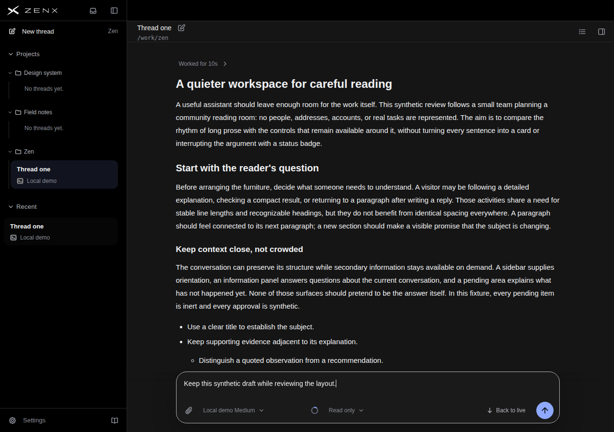
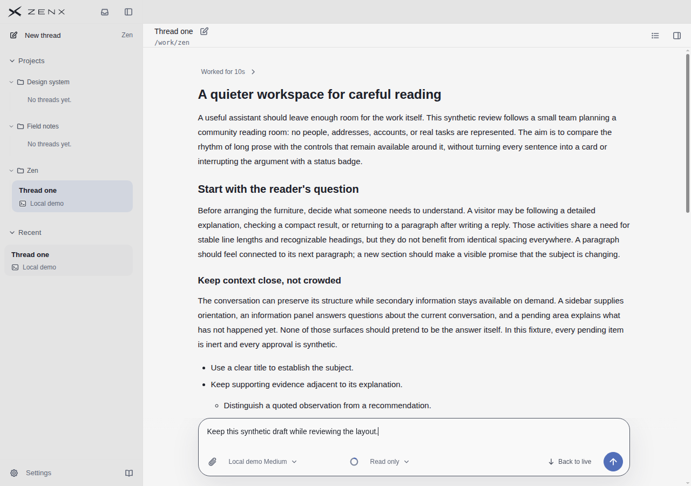
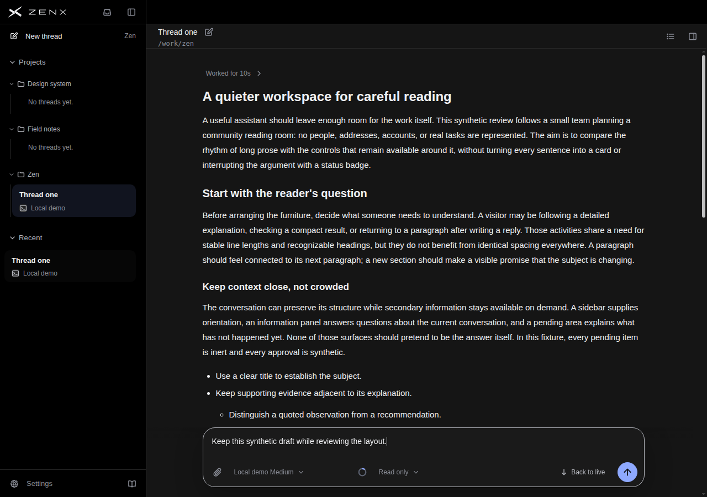
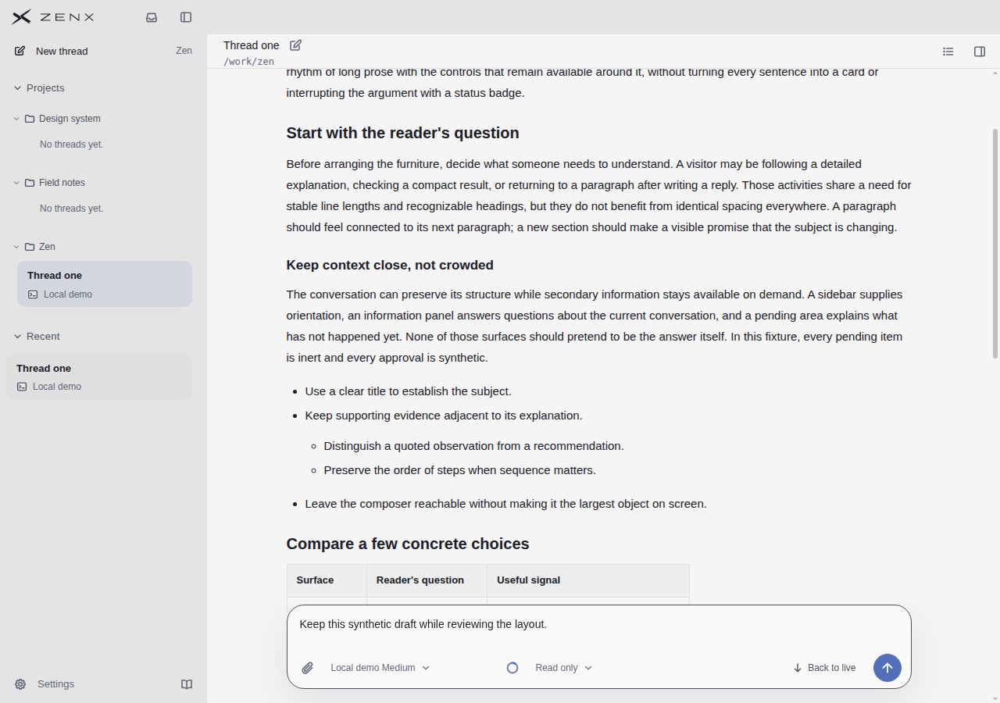
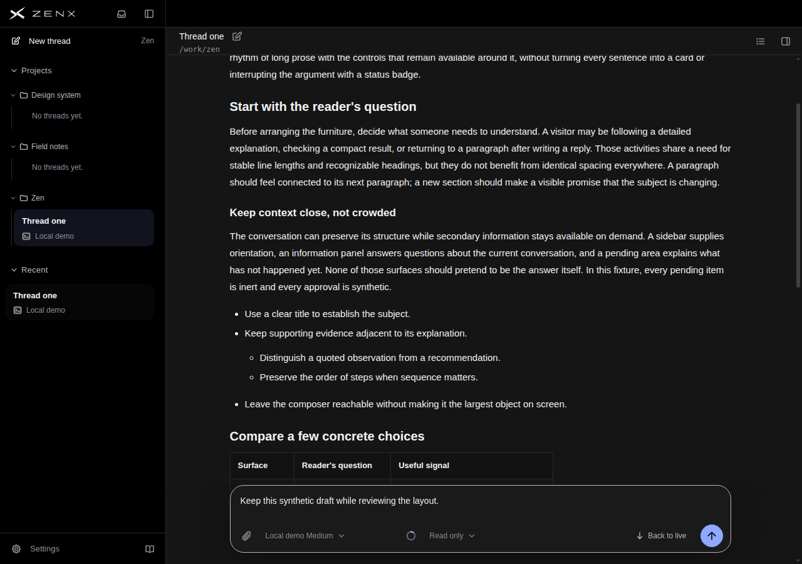
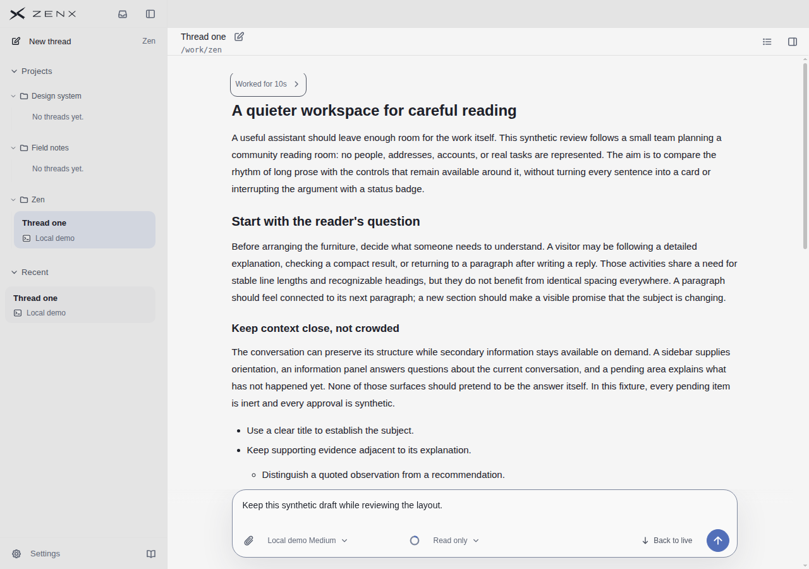
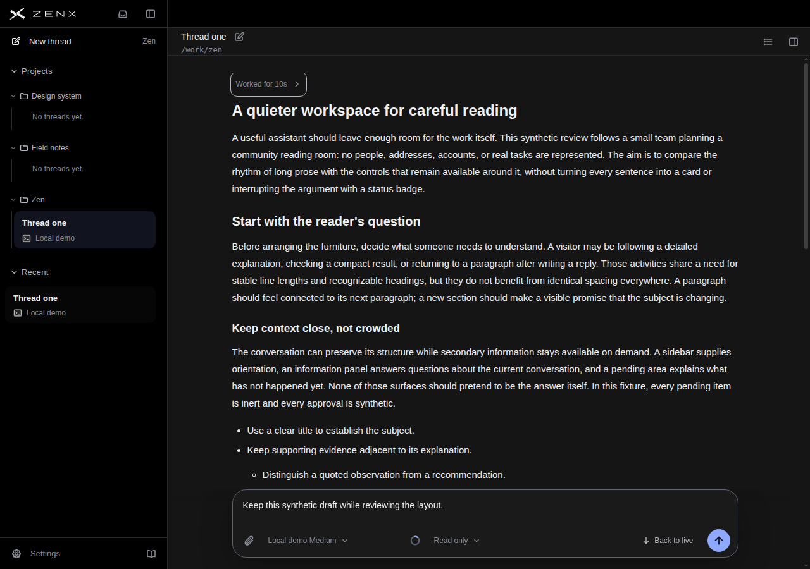
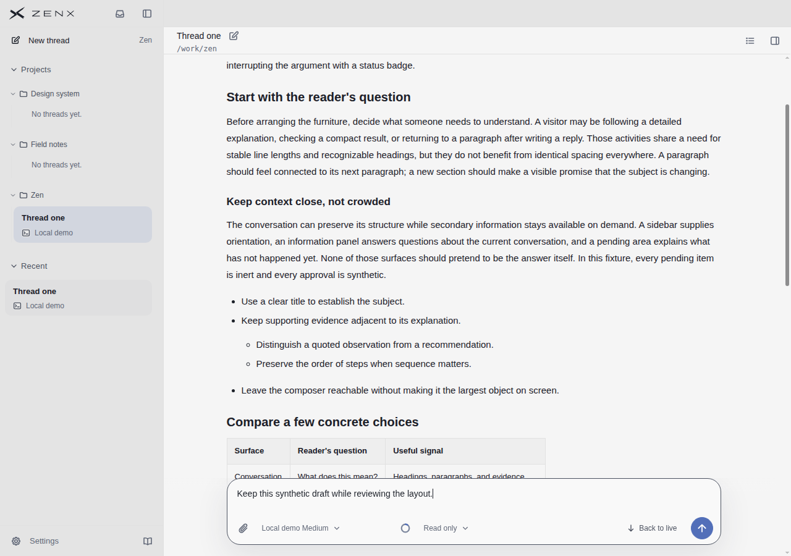
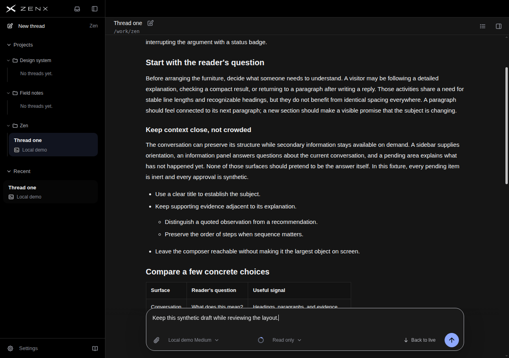

# Scrollbar state evidence — 2320c804

## Provenance and scope

- Rendered source: `2320c804e3edb091e5f3cc98c1187b4f5a23989a`.
- [Short workflow run](https://github.com/albert-zen/zen/actions/runs/43165366120), artifact 13919881350.
- Production components with synthetic conversation and services; Chrome 156, 1280×900, fine pointer. Not native Electron, OS capture, live Host or full end-to-end acceptance.
- Build: 5.468 seconds; capture: 43.835 seconds. Sixteen scrollbar-state images plus eighteen reading scenes; all 34 hashes verified. No renderer errors or external requests.
- This is the assessed 2320 state, not evidence for later theme changes. No new score is assigned to the entire product or references.

## Independent visual review

All sixteen state images were visually inspected. Idle, wheel-settled, drag-released and keyboard-focus-exit hide the rail and leave prose primary. Edge hover and native dragging are clear in both themes without observed horizontal content jumps. Light wheel feedback is readable. Dark wheel and held keyboard-focus thumbs are present but visually weak: active=true is not a sufficient visibility verdict. The focused “Worked for 10s” control has an outline; its focus ring must not be confused with the scrollbar thumb.

Recorded native drag moves scrollTop from 0 to 193 in each theme and remains active while held; the release image preserves position and hides the rail. The held keyboard state remains active beyond 1.2 seconds. These sampled inputs do not prove long-duration dragging, all hit regions or platform-native behavior.

Computed thumbColor is not a reliable substitute for final native pixels: dark drag can appear bright even when its pseudo-style reports a low-alpha base color. The review uses images and input/scrollTop records together.

## Representative original screenshots

| State | Light | Dark |
| --- | --- | --- |
| Idle |  |  |
| Edge hover held |  |  |
| Wheel |  |  |
| Keyboard focus held |  |  |
| Native thumb drag |  |  |

## Unverified boundaries

No fresh T3 matching-state A/B was captured. Existing T3 reference pictures and scores remain tied to their own versions and conditions. This evidence does not cover touch, other scaling, forced colors, nested scroll containers, sustained timing, low-vision usability, or native Electron/OS appearance. The principal remaining issue in this 2320 review is dark wheel and keyboard-focus visibility.

See [verification summary](verification-summary.json) for exact state records, source and artifact digest.
