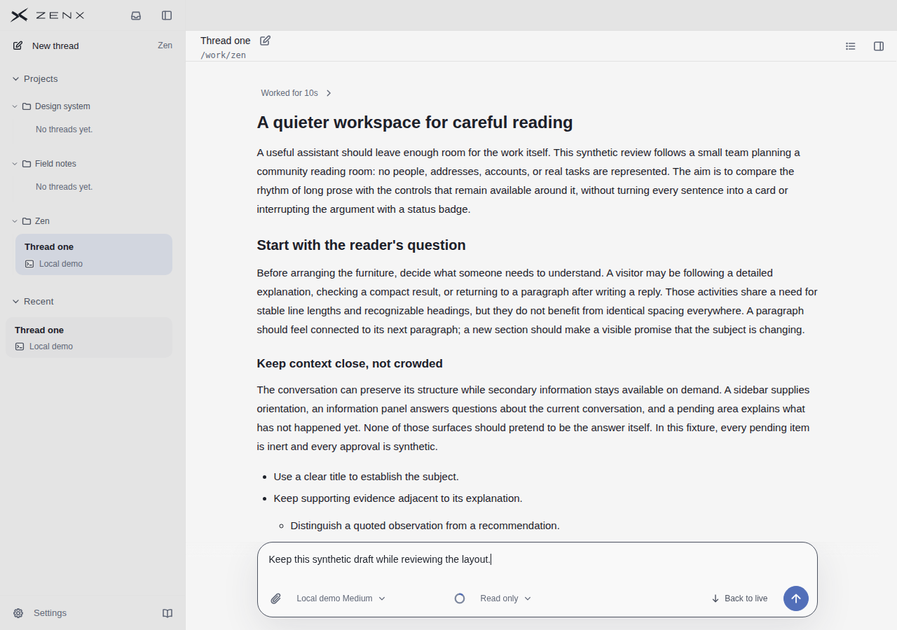
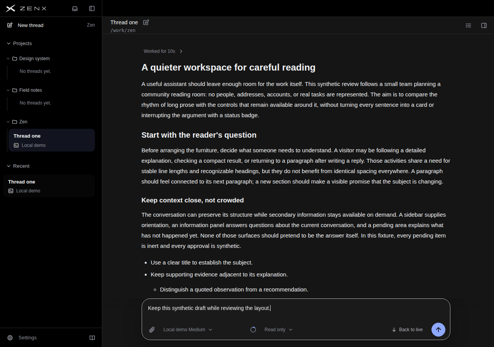
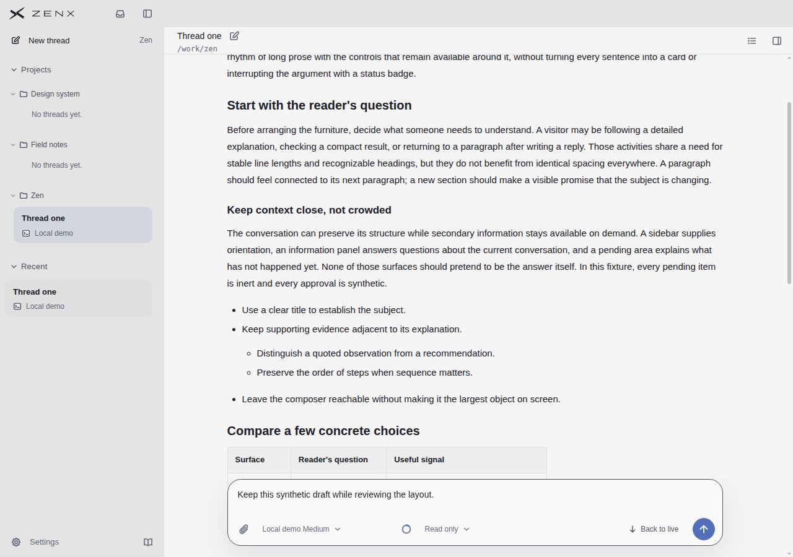
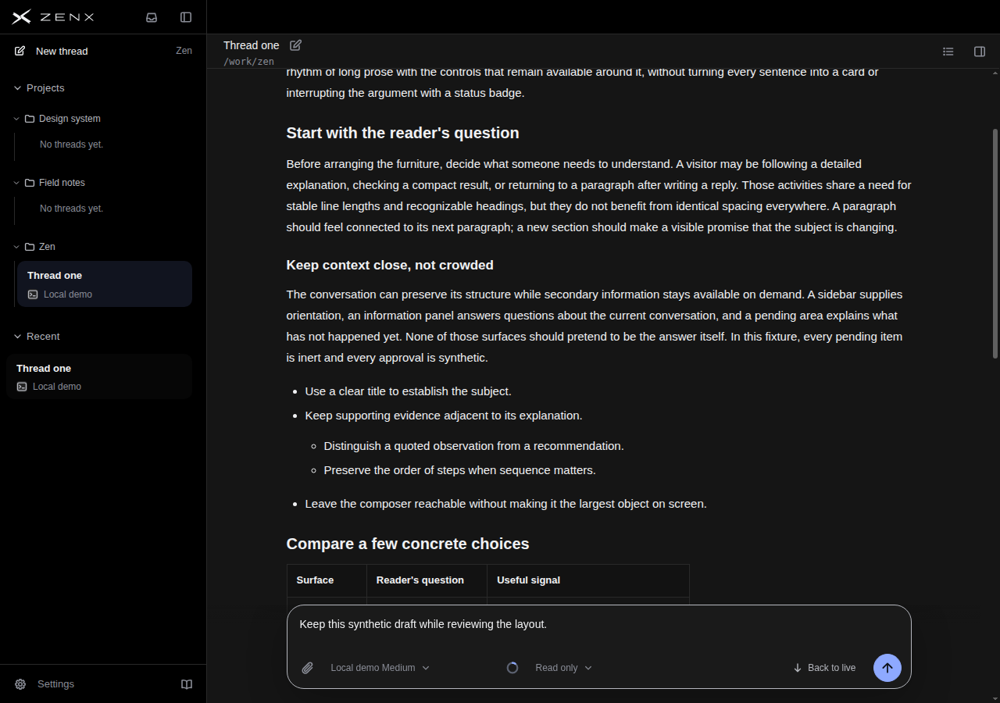
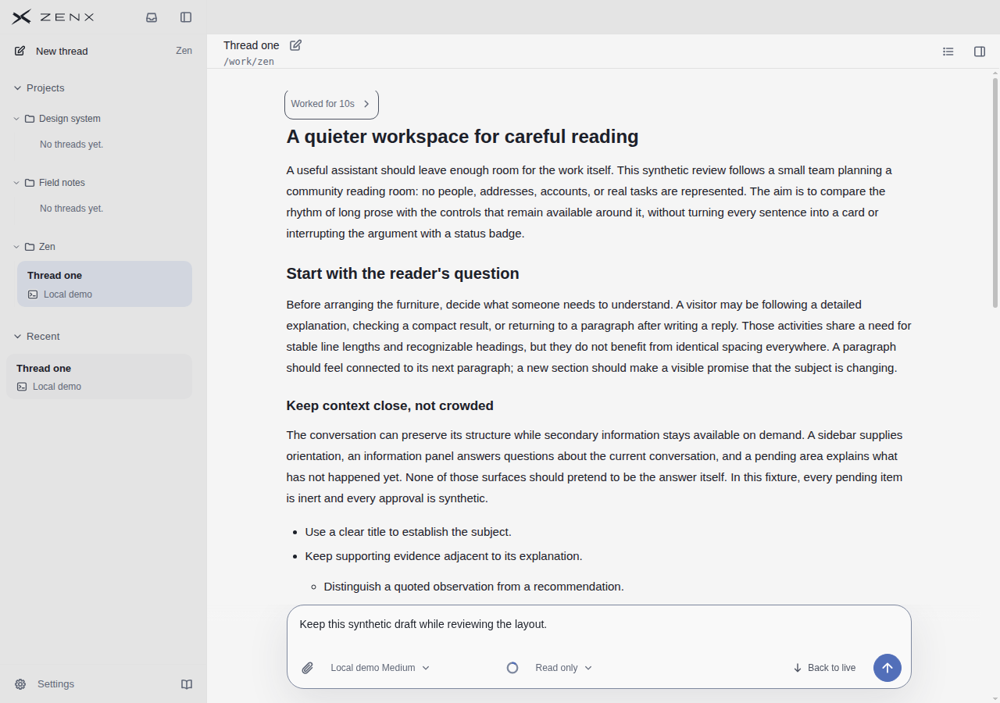
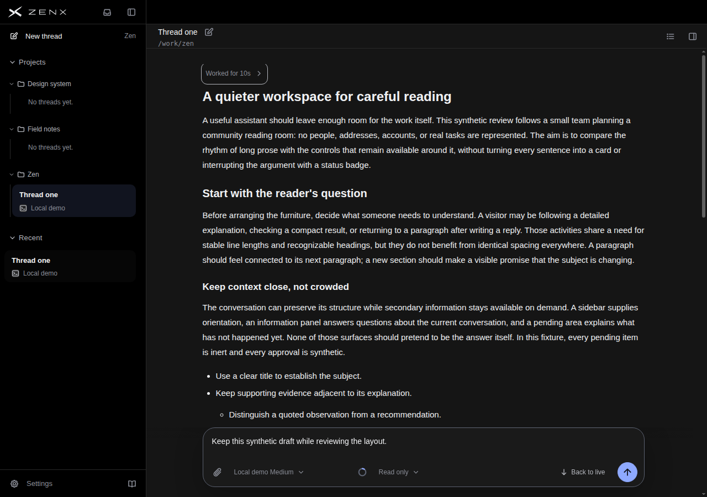

# Scrollbar visibility follow-up — 7815c84e

## Evidence

- Source `7815c84ec2142cdea8e3c94d7a7b96b5f3809812`, clean working tree.
- [Short workflow](https://github.com/albert-zen/zen/actions/runs/43166275908), artifact 13920660822.
- Chromium 156 production components with synthetic desktop data, 1280×900 fine pointer; not a native Electron or live Host session.
- [Previous 2320 independent review and images](../scrollbar-states-2320c804/REVIEW.md). This follow-up addresses its dark wheel/keyboard visibility weakness, not a width change.

## Independent visual review

The independent reviewer compared all sixteen 7815 state pictures with the corresponding 2320 pictures. Dark wheel and held keyboard-focus thumbs are visibly brighter while remaining restrained. Idle stays hidden; hover and dragging remain clear; exit/release returns to hidden. No visible regression was found in the light pictures.

The sampled dark wheel/focus thumb RGB changes from approximately (63,63,63) to (96,96,96). The rail remains 6px; this is visibility/contrast improvement, not thinning. Computed CSS thumbColor alone is not a final-pixel measurement. No new overall product score or reference re-score is assigned from this narrow change.

## Representative originals

| State               | Light                                                           | Dark                                                          |
| ------------------- | --------------------------------------------------------------- | ------------------------------------------------------------- |
| Idle                |                  |                  |
| Wheel               |                |                |
| Held keyboard focus |  |  |

## Limits

Native Electron/OS appearance, fade timing in live use, low-vision usability and scaling remain unverified. Still images do not establish complete keyboard navigation. The prior run supplies hover/native-thumb-drag input records and representative pictures; this run is not a new T3 matching-state A/B. Existing five reference scores stay attached to their original screenshot versions and review scope.

See [verification summary](verification-summary.json) for artifact digest and sampled pixel comparisons.
