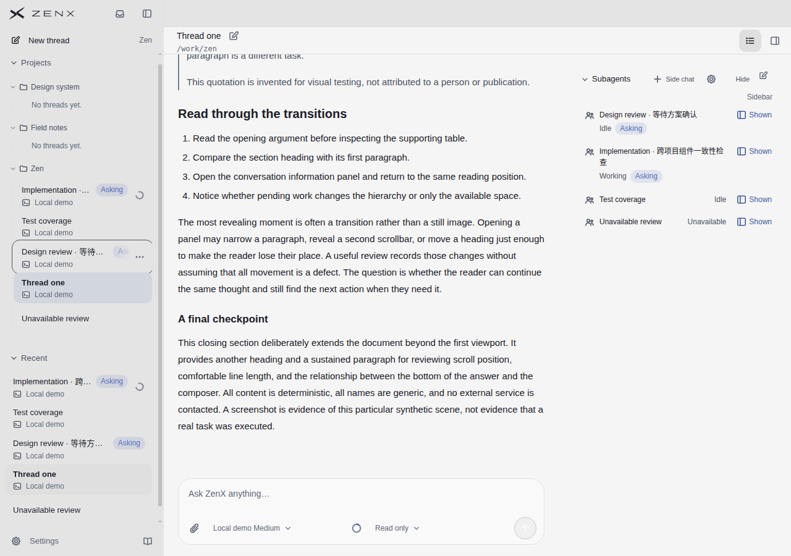
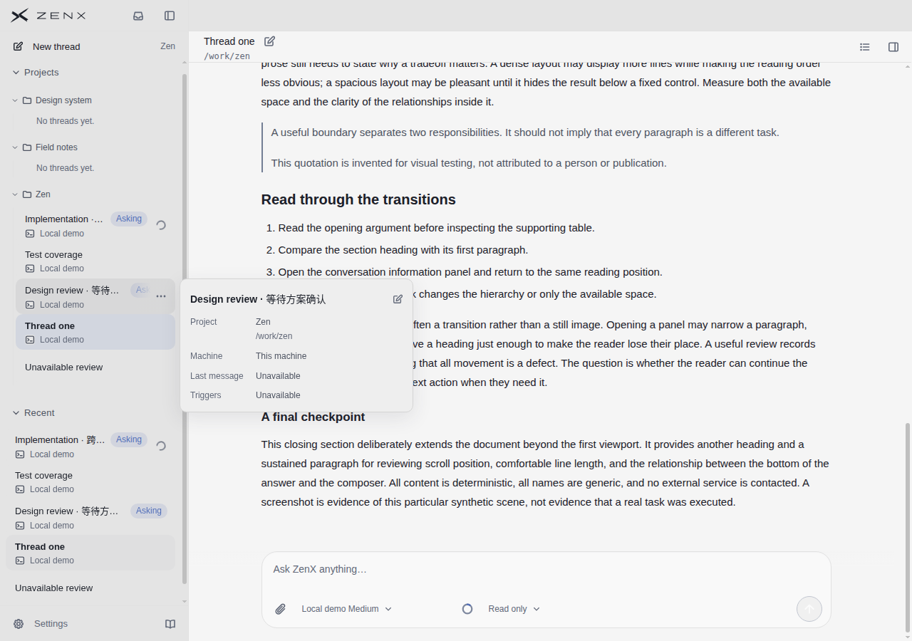
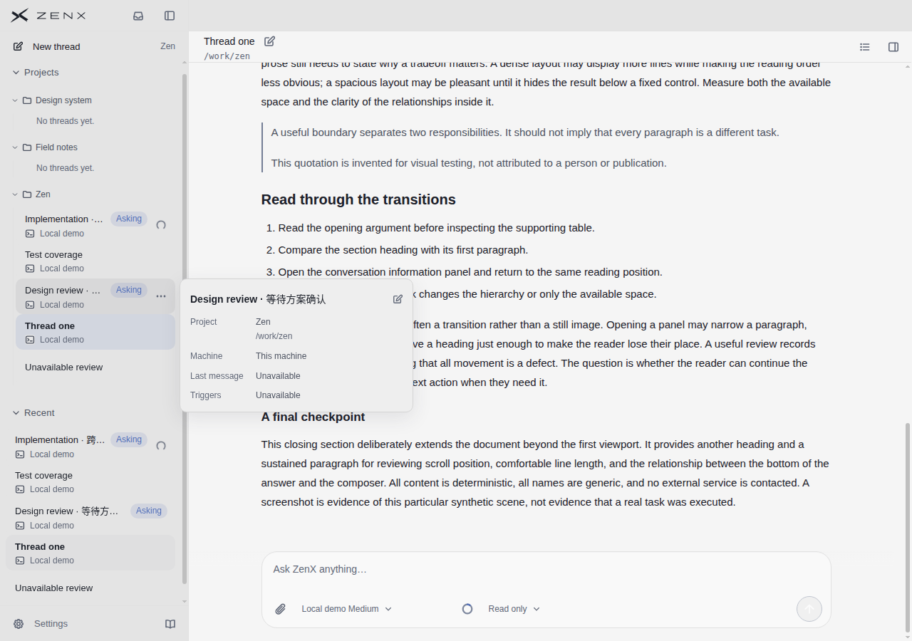
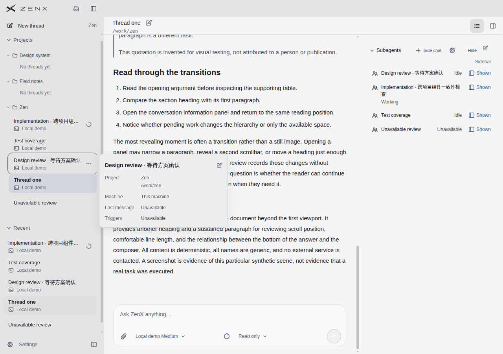
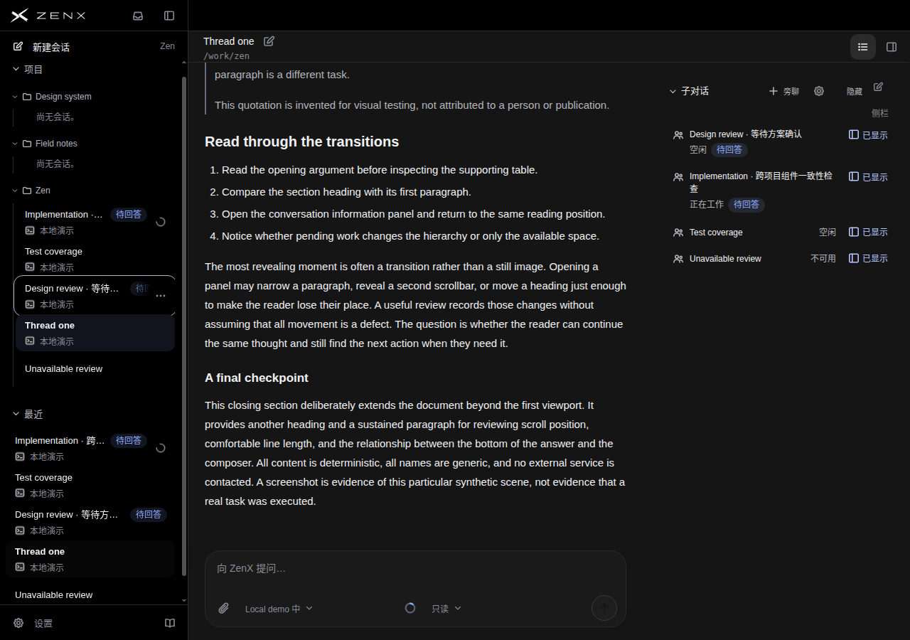
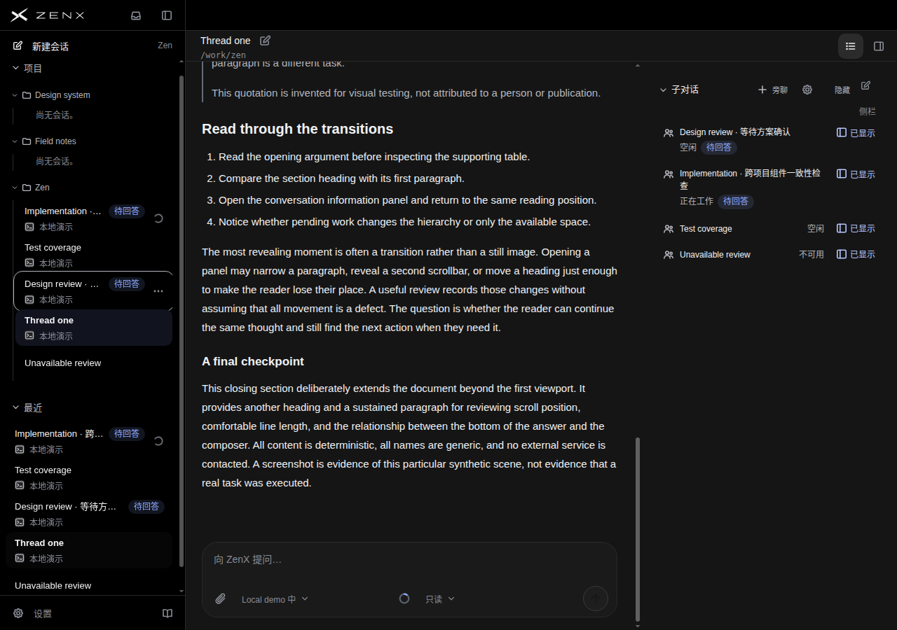
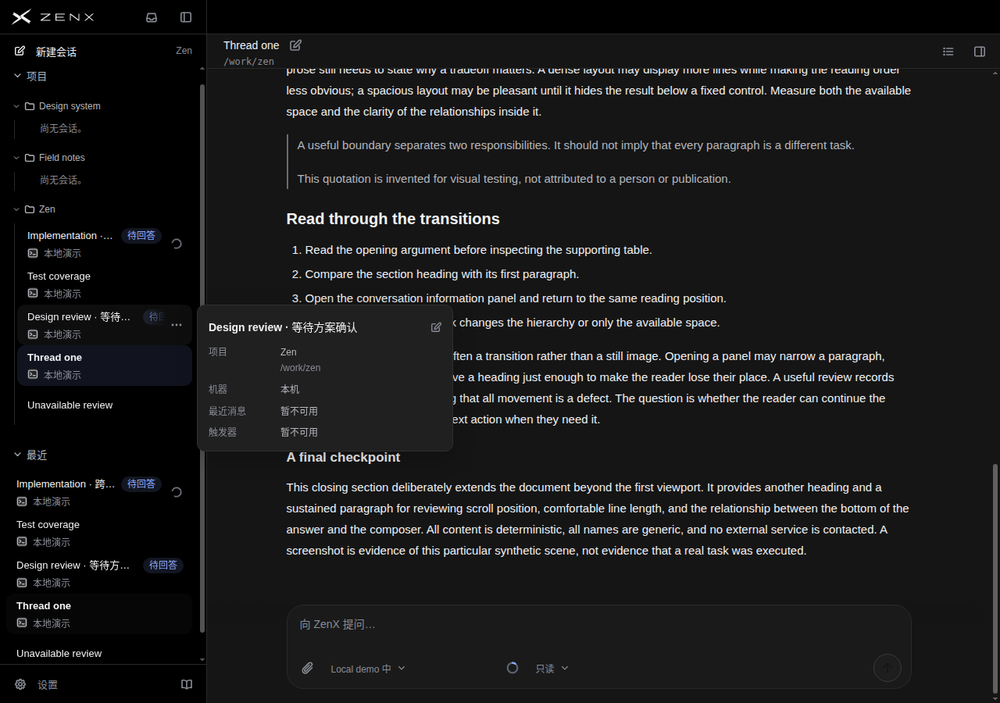
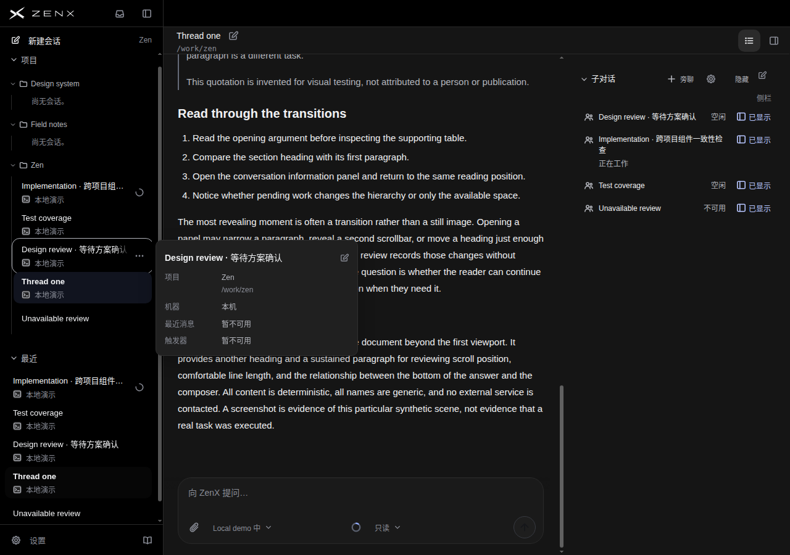

# 左栏待回答状态不再被三点菜单遮住

比较 `77a1fab6` → `b096d43e`。真实生产组件、合成内容，英文浅色及中文深色，1280×900桌面。不是设计稿或原生应用验收。

## 为什么做这轮

上一轮把资料卡待回答提示与左栏统一后，整体复查没有发现需要重做三栏或压缩资料卡的证据。但左栏同一子会话在hover/键盘焦点时，三点菜单会盖住Asking／待回答。资料卡关闭仍复现，预览浮卡也不显示待回答状态，不能补足该信息。

先发布只读快速探针确认，不依据截图猜测：原徽标右缘235px，菜单212–240px；文字与按钮相交浅色184.45px²、深色162.19px²，徽标右侧采样命中菜单。这不是只有渐变变淡。

## 实现和取舍

只对有待回答徽标的桌面精细指针交互态，预留现有菜单的28px宽度，并移除该行不再需要的32px渐变区。菜单宽度变量为单一来源。静息、清零、没有徽标及触屏规则保留；强制颜色模式保留Canvas背景。没有改字号、徽标文本、导航、查询、状态更新或用z-index盖住按钮。

**代价：交互态名称更早省略。** 徽标实测左移28px，源码分配多28px；未单独采名称bbox，不能说名称宽度独立测得减少28px。原完整名称预览仍可用。是否值得保留以独立评审及下方证据为准，不称整体产品全面升级。

## 决策：有限保留，不重做整体布局

独立评审小幅偏好候选四个有徽标/操作的场景；清零两组平局。待回答注意状态浅色5.5→7、深色6→7.5；操作分隔6→7，总体6.5→7。**名称可辨识下降0.5分**：Escape两组6.5→6，浮卡可见两组7→6.5；主对话、右栏和空间没有提高。

保留理由是正在检查会话时能完整看见需要回答的状态，并让操作按钮保持独立；完整名称入口不删。不是为了更密或更多徽标。多个同名前缀长会话是否更难分辨未验证，因此不把这个局部取舍推广为全局紧凑布局。评审建议与原始限制完整保留，不选择性只报涨分。

## 实测

- 两主题各5步（Tab、Escape、纯hover、资料卡关闭hover、恢复Tab）：徽标/文字与菜单、徽标与操作栏相交均归零；菜单位置和中心命中保留。
- Escape关闭预览并保留原会话焦点、选中项和当前运行内的正文滚动位置。纯hover记录无会话行焦点，不冒充键盘态。
- 清零后左右栏行测量对象与基线相同，四个主场景的资料卡、输入框几何相同。
- 40/88张RGB完全相同；其余差异包含动画、光标和采集滚动位置。深色初始场景滚动1607→1622，不说所有主对话像素不变，也不把采集差异当提升。

基线[快速预览43292657835](https://github.com/albert-zen/zen/actions/runs/43292657835)：88图约92秒；候选[快速预览43294497133](https://github.com/albert-zen/zen/actions/runs/43294497133)：88图约81.5秒，精确clean head，无renderer错误和外部请求。候选45项短测试、2项中英DOM测试及[快速检查43294496912](https://github.com/albert-zen/zen/actions/runs/43294496912)成功。新增4项CSS契约测试本地通过，不在远端reading短名单中，不混报为远端通过。

[完整机器收据](receipt.json)记录源码、编译HTML/CSS哈希、原始测量和88张图对比。未单独测试鼠标移出关闭、菜单打开选择、最小侧栏宽度、高问题数量、读屏、触屏、强制颜色实际画面或原生Electron；CSS契约检查不是这些验收。不代表全部CI通过。

## 产品原图：相同场景前后

下面是原始PNG，未裁剪或重绘。Escape图保留会话焦点但撤去详情浮卡；关闭资料卡hover图仍有既有详情浮卡遮挡主区，不能冒称无遮挡全景。

### 浅色 / English · 键盘焦点，Escape关预览

| 基线77a1fab6                                                                                                 | 候选b096d43e                                                                                                |
| ------------------------------------------------------------------------------------------------------------ | ----------------------------------------------------------------------------------------------------------- |
|  |  |

### 浅色 / English · 关闭资料卡，纯hover

| 基线77a1fab6                                                                                                   | 候选b096d43e                                                                                                  |
| -------------------------------------------------------------------------------------------------------------- | ------------------------------------------------------------------------------------------------------------- |
|  |  |

### 浅色 / English · 待回答清零

| 基线77a1fab6                                                                              | 候选b096d43e                                                                             |
| ----------------------------------------------------------------------------------------- | ---------------------------------------------------------------------------------------- |
|  |  |

### 深色 / 中文 · 键盘焦点，Escape关预览

| 基线77a1fab6                                                                                             | 候选b096d43e                                                                                            |
| -------------------------------------------------------------------------------------------------------- | ------------------------------------------------------------------------------------------------------- |
|  |  |

### 深色 / 中文 · 关闭资料卡，纯hover

| 基线77a1fab6                                                                                               | 候选b096d43e                                                                                              |
| ---------------------------------------------------------------------------------------------------------- | --------------------------------------------------------------------------------------------------------- |
|  |  |

### 深色 / 中文 · 待回答清零

| 基线77a1fab6                                                                          | 候选b096d43e                                                                         |
| ------------------------------------------------------------------------------------- | ------------------------------------------------------------------------------------ |
|  |  |

## 独立逐项评审

[完整盲评、每场景与每家参考10分制评分](BLIND-REVIEW.md)。评审员仅看匿名A/B原图与参考，不看新旧映射、源码、历史分或目标分。A为基线，B为候选。静态图片不证明交互测试通过。

## 本轮实际使用的参考原图

不同任务、视口和结构，不做跨产品排名；没有对应状态证据标N/O。Linear本轮没有可核验图，全部N/O。

### T3 Code

.jpg>)

### Codex

### Claude Code

### DeepSeek Harness

