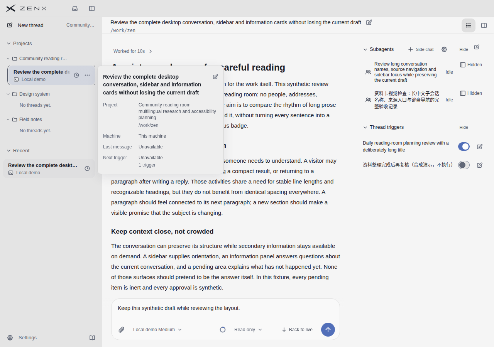
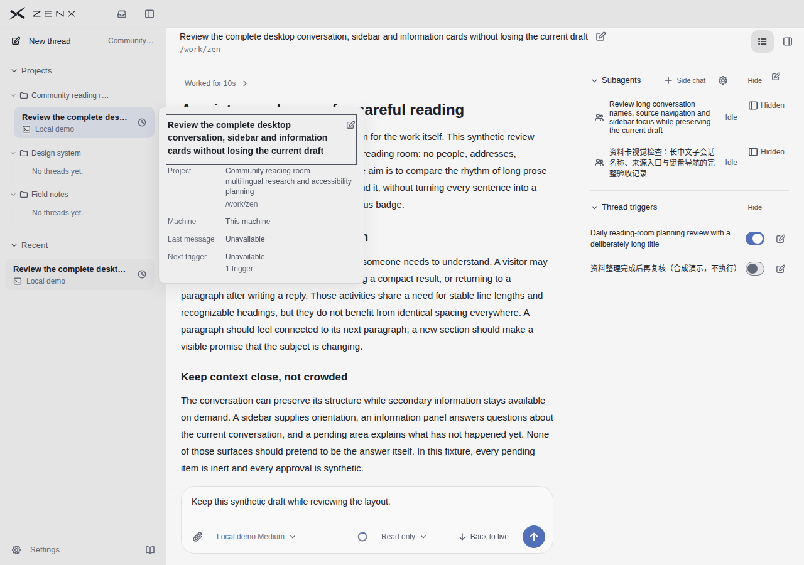
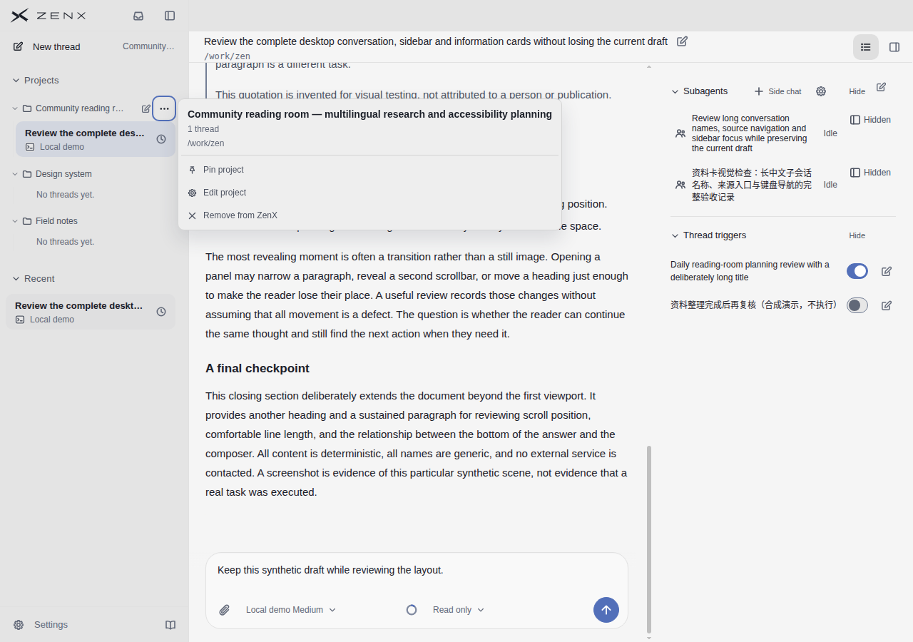
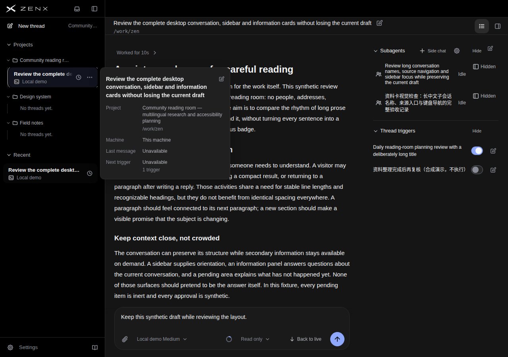
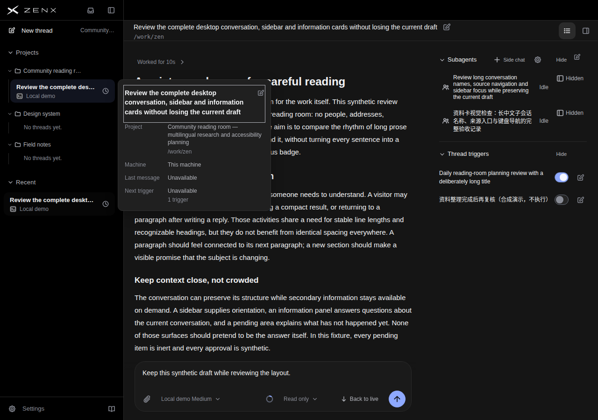
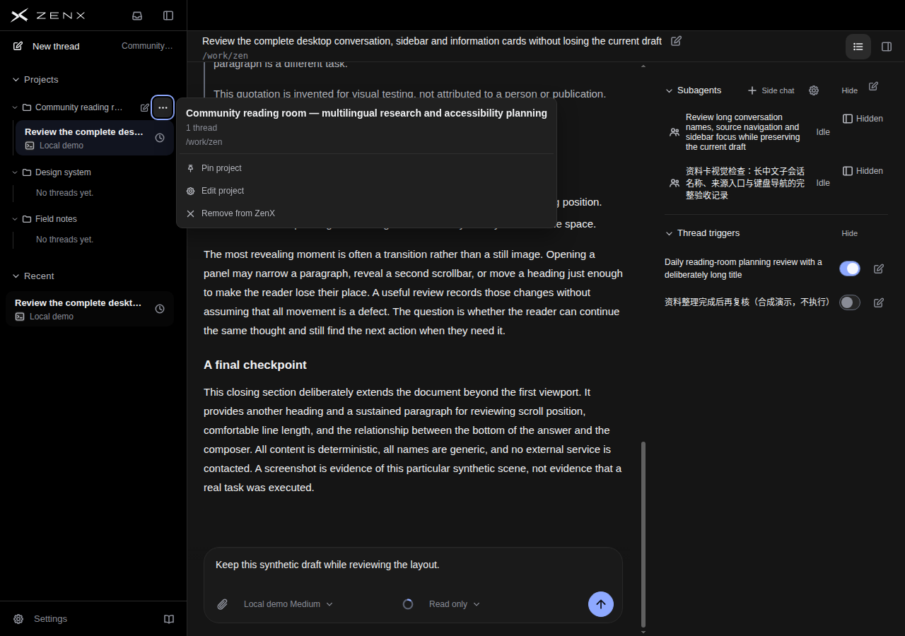

# 长名称访问与 Escape 焦点回归：ea3fcca6

## 本轮改变与证据

源码 `ea3fcca62600b3edeb74561e34c59af1548c3205`。产品修复在 `b0a8c2c2`：关闭会话详情后，Escape 将焦点返回原会话行，而不是错误的更多按钮。`ea3fcca6` 仅修正截图探针，选择拥有目标会话的项目。

[成功截图运行](https://github.com/albert-zen/zen/actions/runs/43183615712)，artifact `13927083128`；截图阶段 58.523 秒。来源及八张截图的 SHA256 见 [receipt.json](receipt.json)。原始完整 evidence.json、source.json 和 reading.html 在该运行 artifact 中；receipt 保留其哈希。

## 独立复核

独立评审员检查了浅深两主题的八张图及探针记录，未获知目标分数，也未重新运行测试。本轮是定向交互验证和焦点缺陷修复，不冒充新的整体视觉评分；已有产品和五个参考对象的逐项评分、原图继续保留于 PR。

- 会话行 hover、键盘聚焦、进入详情标题三个状态均可读取完整长名称；标题换为三行，编辑按钮没有覆盖文字。
- 项目菜单可读取完整项目名；1280×900 视口内没有标题裁切、越界或与菜单控件重叠。
- 会话行、详情标题、项目菜单触发器均可见焦点；会话行的细焦点环比其他两者弱，这是仍待改进的可见性问题。
- 详情浮层临时覆盖主对话约左侧三分之一文字宽度，项目菜单更宽；不是页面重排，也不是标题被截断。不可据此声称所有位置或更长名称均不遮挡重要内容。
- 侧栏列表仍会省略长名称。通过详情或项目菜单恢复全文，不等于列表内直接展示全文。

## 交互与验证边界

实际 CDP 输入覆盖鼠标、Tab、ArrowRight、Enter、Escape；探针检查全文、视口内矩形、无内容溢出、`:focus-visible`、当前会话仍为 `thread-1`，并等待 Escape 关闭详情及焦点返回。图像及 reading.html 的 SHA256 已对照清单。

`visible` 矩形检查不等于遮挡命中测试，`:focus-visible` 不等于对比度测量。项目截图焦点仍在更多菜单触发器，不是第一个菜单项；Tab 遍历正文时主阅读区发生滚动，因此不声称全程保留 scrollTop。

真实生产组件使用合成数据和服务，在 Chrome 渲染，不是原生 Electron、操作系统或真实 Host 端到端验收。无 rendererErrors 和 externalRequests。本轮未证明全部焦点顺序、缩放、compact 模式、所有超长名称或完整回归。自动化与人工检查只支持两主题、给定两个名称和这些截图状态。

## 浅色

## 深色

