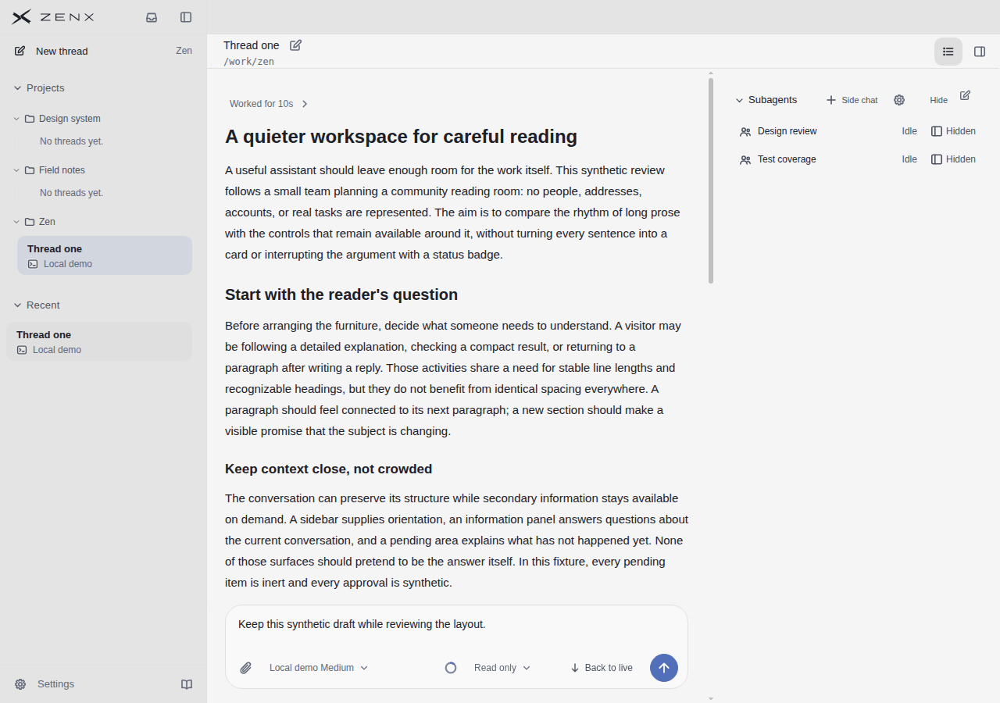
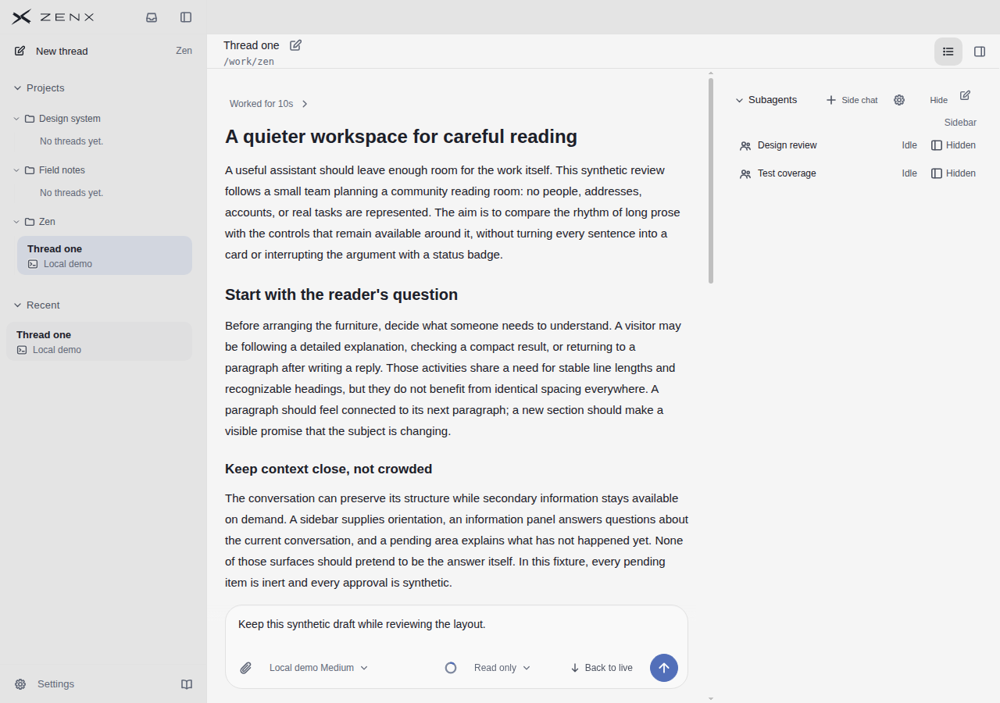
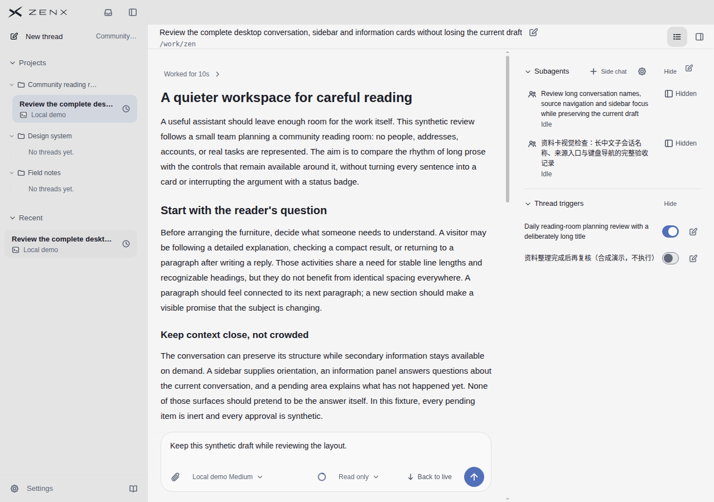
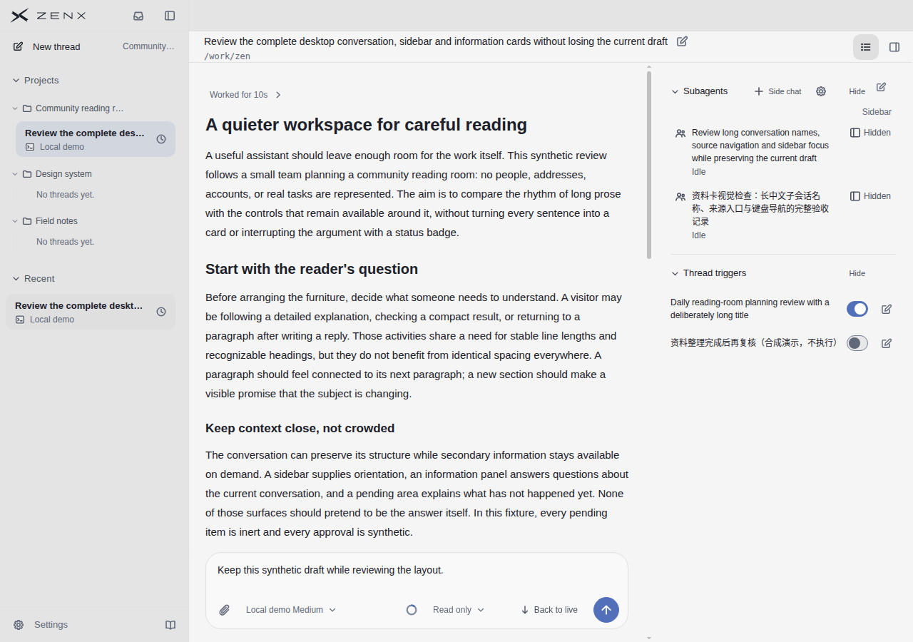
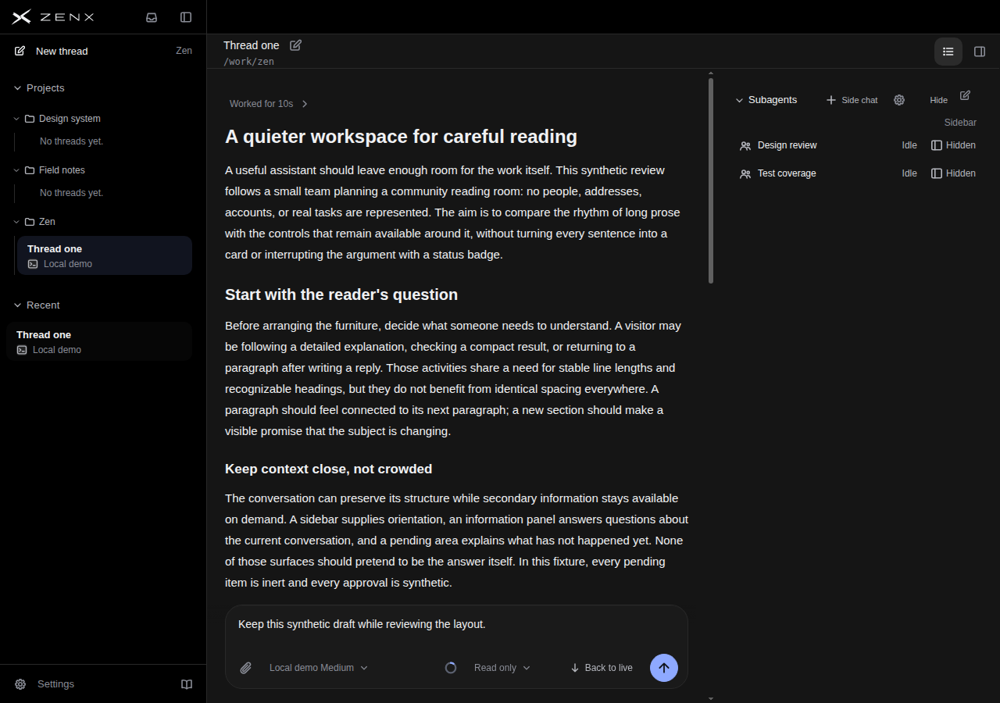
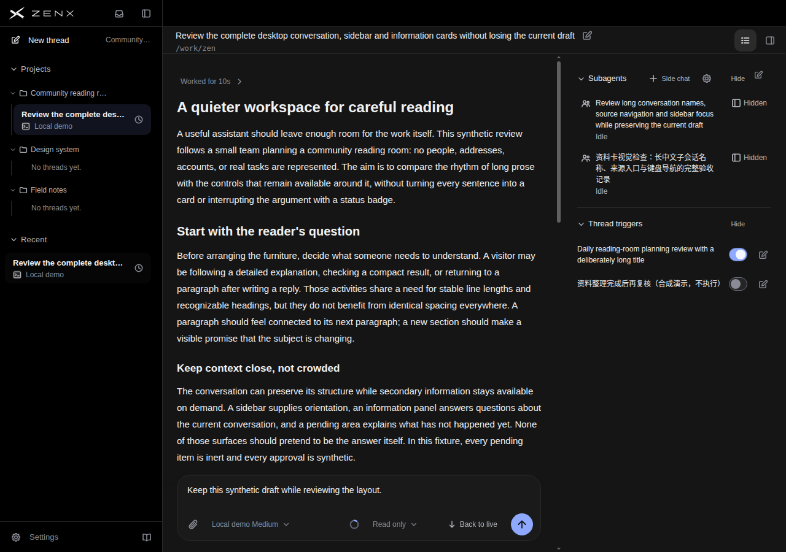
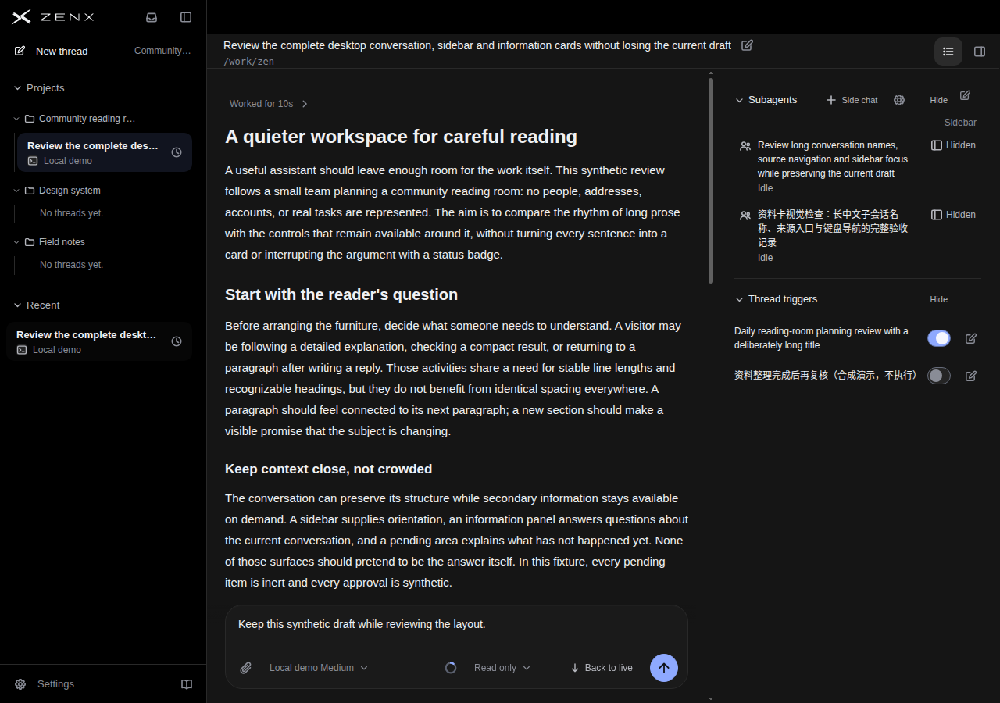

# 资料卡行开关的作用范围：小幅语境恢复

保留 `dd1416b90dd4d517c9a29ff198cffc79962dae00`。仅桌面 Information dock 恢复已有一次性 Sidebar 列标题，让行里的 Shown/Hidden 有可见控制对象，区别于卡片 Hide。未修改 JSX、事件、switch/aria、任务状态或保存行为，不改 standalone、popover及小窗口。

基线 `947bc226` 与 `829dfef1` 生产实现完全一致；前者只补了预览探针。P=基线，Q=候选。独立盲评轻微偏向Q：四个状态控制含义6→7、整体7→7.5，其余持平；**不是整体UI升级或用户操作成功率结论**。不同评审者的绝对分不能拼成连续产品总分。

## 实证与代价

- [reading快速预览43252213961](https://github.com/albert-zen/zen/actions/runs/43252213961)：69.6秒、72图、无渲染错误/外部请求；[快速静态检查43252214037](https://github.com/albert-zen/zen/actions/runs/43252214037)成功，本地2定向测试及格式检查通过。没有等待长CI，也不称全CI通过。
- 浅深短名dock高144→162px、长名409→427px，均多18px，位置和340px宽度不变。原文、名称、Idle/Hidden与两个触发器开关保留；后续资料内容下移18px。
- 四张配对图中主对话与Composer区域像素完全一致，相关几何也不变。没有声称多了阅读空间或提高密度。
- 当前仅证明合成桌面组件的静态效果。英语界面包含中英长名称，不等于中文界面、很多项目、触控、屏幕阅读器或原生应用验收。
- 标签仍不能完整解释哪一侧栏、卡片Hide与折叠的区别；更熟练用户可能更偏好少一行的版本。保留的是有限上下文，不扩展标签体系、不把小分差夸成全局提升。
- [原始盲评](BLIND-REVIEW.md)与[版本、图片哈希和几何收据](receipt.json)。

## 控制对象核对

独立源码追踪确认 Sidebar 指左侧会话列表：`SubagentSidebarVisibility` 调用单线程 `setVisible`；`App` 经设置IPC更新 Host profile 的 `visibleSubagentThreadIds`，随后传给左侧 `Sidebar`，由 `deriveSidebarThreads` 过滤子会话。它不修改右信息卡隐藏状态。

来源：[subagents-ui.tsx](https://github.com/albert-zen/zen/blob/829dfef1c9b59cf1c30c90e4df800143de25063f/apps/zenx/src/renderer/src/subagents-ui.tsx)、[App.tsx](https://github.com/albert-zen/zen/blob/829dfef1c9b59cf1c30c90e4df800143de25063f/apps/zenx/src/renderer/src/App.tsx)、[thread-list.ts](https://github.com/albert-zen/zen/blob/829dfef1c9b59cf1c30c90e4df800143de25063f/apps/zenx/src/renderer/src/thread-list.ts)。这是本轮只读源码核对，不把已有测试内容当成本轮真实开关操作验收。

## 产品前后原图

### light / information-reading

P（基线）

Q（候选）

### light / supporting-rails-long

P（基线）

Q（候选）

### dark / information-reading

P（基线）

Q（候选）

### dark / supporting-rails-long

P（基线）

Q（候选）

## 本轮实际参照原图

不同内容/尺度不能作为公平产品排名；各参考没有与这组行开关等价的交互证据。

### T3 Code runtime 6f13f36f

.jpg>)

### Codex 官网演示

### Claude 官网演示

### DeepSeek Harness runtime fcc0ad4

## 完整逐状态及逐参考评分

# 匿名桌面截图独立评审

## 范围与结论

已逐张通过 view_image 实看 P/Q 的全部 8 张截图，以及指定 4 张参考。未读源码、其他线程、实现说明或开发目标；未运行界面交互。以下为截图启发式判断，不是用户测试、无障碍审计或交互验收。分数是相对粗粒度视觉评价，无预定目标分。

**若只能保留一版，轻微偏向 Q。** Q 在 Hidden 控件上方加入 Sidebar 列标题，让“隐藏的是显示位置，而不是子代理停止/删除”的解释更容易成立，代价仅是右区约 18 px 的额外高度，主阅读区与左侧导航不受挤压。但这是很小的净益，并未完整解决控制范围：页面本身左右都有侧栏，Sidebar 没说是哪边；标题行的 Hide、齿轮和末尾编辑图标仍需猜测。因此不把 Q 视为显著胜出，亦不能凭此宣布新用户已能准确使用。

## 逐状态评分（10 分制，越高越好）

“空间一致性”综合空间代价、对齐及同类控件一致性；不是越紧凑越高。整体为判断值，不机械平均。

| 版本与状态                          | 可读性 | 控制含义清晰 | 层级 | 空间一致性 | 整体 |
| ----------------------------------- | -----: | -----------: | ---: | ---------: | ---: |
| P 浅色 / information-reading 短名   |      8 |            6 |    8 |          8 |    7 |
| P 深色 / information-reading 短名   |      8 |            6 |    8 |          8 |    7 |
| P 浅色 / supporting-rails-long 长名 |      7 |            6 |    7 |          8 |    7 |
| P 深色 / supporting-rails-long 长名 |      7 |            6 |    7 |          8 |    7 |
| Q 浅色 / information-reading 短名   |      8 |            7 |    8 |          8 |  7.5 |
| Q 深色 / information-reading 短名   |      8 |            7 |    8 |          8 |  7.5 |
| Q 浅色 / supporting-rails-long 长名 |      7 |            7 |    7 |          8 |  7.5 |
| Q 深色 / supporting-rails-long 长名 |      7 |            7 |    7 |          8 |  7.5 |

### 主对话与左侧栏：两版基本相同

- 主对话标题、二级标题、正文和输入框层级清楚。宽度与行距适于这段英文长文，右区没有卡片边框争夺注意力。相邻大标题与小标题能区分，但正文和右区文字尺度落差较大。
- 左栏项目与 Recent 的分组易辨认，选中项有底色，深色项目树细线更可见。重复出现同一线程可理解为两种入口，但截图本身不说明其关系。
- 长名状态左栏大量省略，顶部完整会话名有帮助；同一线程在项目和 Recent 中截断位置不同，找线程仍依赖开头而非完整意思。两版均没有改善这个问题。
- 浅色辅助文字偏淡，深色辅助文字也有弱化；未测对比值，不宣称达标或不达标。两个主题的视觉秩序总体一致，不因主题给虚假的大幅差分。

### 右资料区：能推断什么，不能推断什么

- 子代理名字与 Idle 的配对明确：短名时 Idle 独立靠右，长名时移到名称下方。空间分配合理，但跨状态扫描状态列的位置会改变。
- 每行 Hidden 紧邻该子代理，可推断属于该行；P 缺少对象说明，可能被理解为隐藏子代理、隐藏其输出或隐藏入口。Q 的 Sidebar 提供“显示位置”线索，确有语义收益，而非单纯多一个字。
- Sidebar 只对齐最右列，未误作整个右栏大标题，视觉权重低。它并没有给 Idle 加标题，这种不对称不严重，因为 Idle 自身较自解释。
- Subagents 旁边折叠箭头看似作用于整个分组；Hide 也在分组标题行，疑似隐藏分组。两个隐藏层级共存但未明示，Q 只缓解行级控件歧义，不能消除组级 Hide 与折叠的重叠解释。
- Side chat 的加号与文字暗示新增旁支聊天，但是否属于当前会话仍主要依赖位置推断。齿轮可能是子代理设置，也可能是该区域设置。最右编辑图标所编辑的对象不明确。
- Thread triggers 的两行开关与名称距离近，行级归属清楚；开启/关闭可从颜色与圆点位置区分。编辑图标在行尾能较自然解释为编辑对应触发器。组级 Hide 不应被误认作停用所有触发器，但截图无法证明用户会这样理解。
- 长中文名称没有溢出或被控件遮挡，英语长名也完整换行。Q 增加的高度把第二组向下推约一行，但当前视口仍有充足留白，不影响主文或输入区；不可据此推断几十项时无滚动成本。

## 参考截图：同维评价，但不是公平排名

参考的任务、截图分辨率、信息密度、界面裁剪和主题均不同。它们可用于观察信息架构，不可把分数横向当成“产品谁更好”。控制清晰评分仅覆盖图中实际可见的控制；与本次右资料区对应的 Sidebar/Hidden 行为均未展示，故对应项 N/O。

| 参考                          | 可读性 | 控制含义清晰（可见控件） | 层级 | 空间一致性 | 整体（该截图任务） | 本次右区等价控制 |
| ----------------------------- | -----: | -----------------------: | ---: | ---------: | -----------------: | ---------------- |
| main-conversation-dark.jpg    |      7 |                        6 |    8 |          8 |                7.5 | N/O              |
| proactive-20s.png             |      8 |                        8 |    8 |          8 |                  8 | N/O              |
| product-demo-conversation.jpg |      6 |                        7 |    7 |          7 |                  7 | N/O              |
| subagents-dark.jpg            |      7 |                        7 |    8 |          8 |                7.5 | N/O              |
| Linear（未提供截图）          |    N/O |                      N/O |  N/O |        N/O |                N/O | N/O              |

### 逐参考观察

- **main-conversation-dark**：正文、代码、结果表格分层明确，阅读区被留白集中起来。侧栏网格背景有额外视觉纹理，浅灰辅助字偏弱。底部 Full access 有文字，顶部若干纯图标仍难仅靠截图分辨作用；没有右资料区，不能证明省掉标题更优。
- **proactive-20s**：导航 New chat / Search / Plugins / Automations 等为图标加文字，主要入口含义直接；Pinned 与 Threads 分组、时间、选中态清楚。正文结果与产物链接区分清晰。视口更大、无需持续右资料区，留白条件优于 P/Q，不能把其清爽全部归因于视觉设计。顶部纯图标依然需经验。
- **product-demo-conversation**：属于营销网页内嵌产品演示，非同尺度原生桌面图。代码块、修改文件、完成说明、分支/CI 和输入区层级可辨；低对比辅助字与裁剪后的长名称使阅读较费力。页面外层导航与产品内层同时出现，不能据此惩罚真实产品布局；右预览被文字提到但未展示，因此右区 N/O。
- **subagents-dark**：顶栏“2 个子智能体”和浮层两项给出明确集合关系，标题加次级标识清楚；任务完成/进行状态另有汇总条。浮层会占据当前对话上方内容，但无需永久右栏。此图证明另一种呈现策略存在，不证明其发现性或切换成本优于 P/Q。纯图标与底部模式含义仍部分依赖经验。

## 反例、风险与下一步验证边界

1. 熟练用户已知道 Hidden 的含义，P 的紧凑反而更合适；因此“加标签必然更好”不成立。
2. 首次用户看到左栏也叫 sidebar，可能把 Q 的 Hidden 理解为从左侧会话列表隐藏，而实际对象可能完全不同；Q 的改善取决于真实行为与词汇吻合。
3. 若列表只有一行且常驻空间不足，单独列标题的高度可能不值得；若有很多行，列标题的语义收益可能更大，但应考虑滚动后标题是否仍可见，截图无法回答。
4. 标题行 Hide 和行内 Hidden 的词形接近，新增 Sidebar 没有解释折叠、隐藏、停用的区别。应验证用户能否预测每项点击后的结果，而非询问“看起来是否更清楚”。
5. 长名与暗色已在本批静态状态下可读，但键盘焦点、hover 提示、屏幕阅读器名称、最小宽度、触控目标、真实开关状态、持久化、撤销与草稿保护全部未检验。

最终建议：**保留 Q 作为轻量语义改进候选，不扩大标签体系；优先验证 Sidebar 到底指哪一侧及 Hide/Hidden 的行为边界。** 如真实行为不能支持“侧栏可见性”的解释，则这次新增词无净益，宁可保留 P 并另拟准确措辞。未做任何仓库发布或改动。
