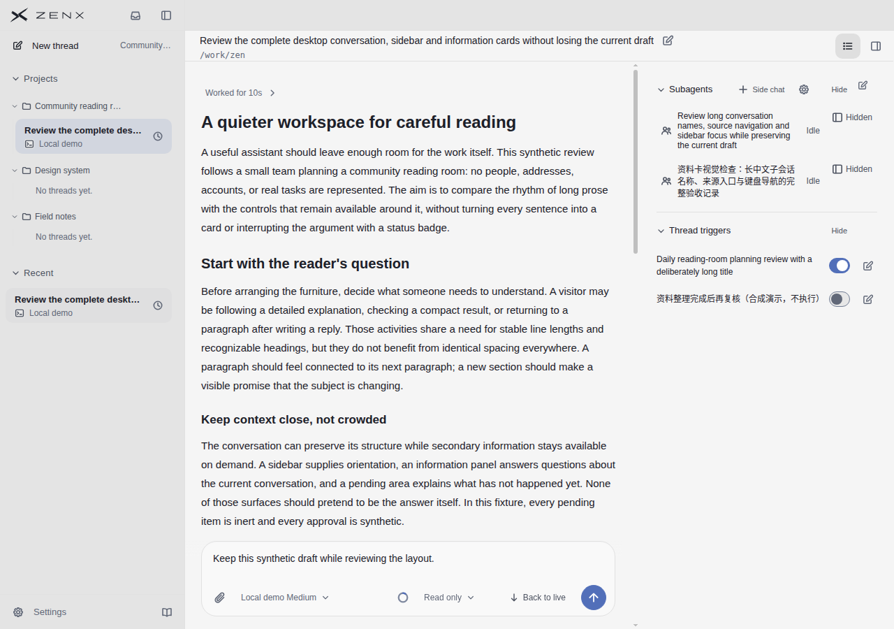
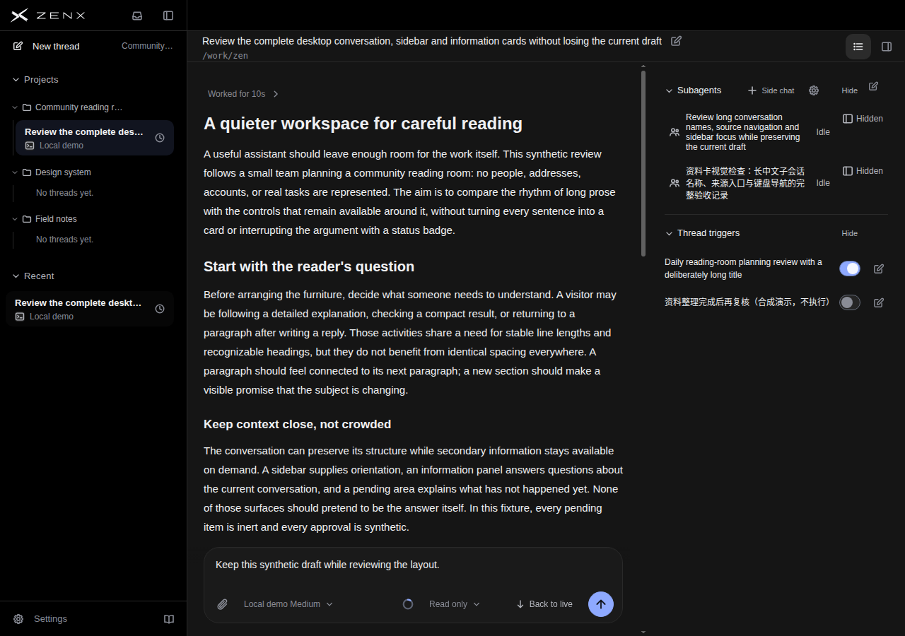
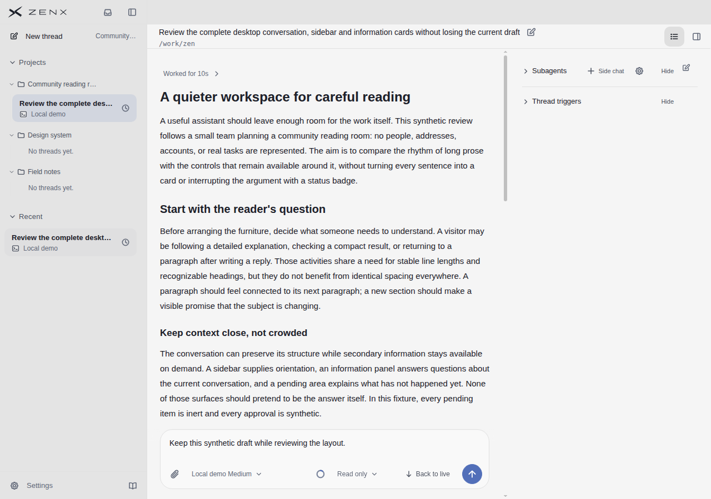
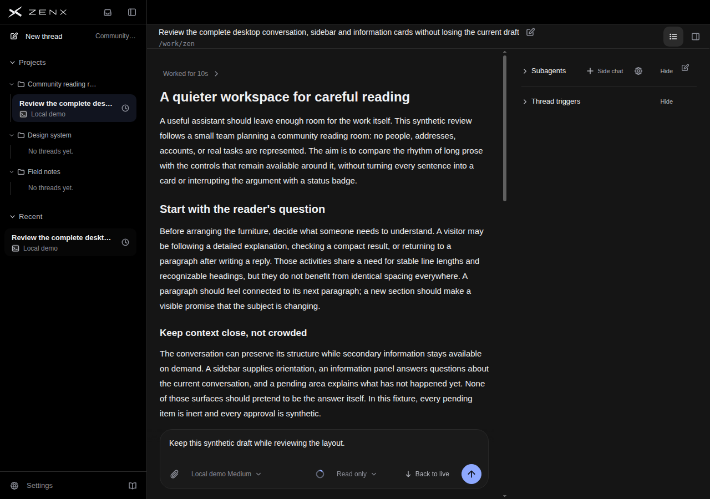

# Desktop supporting rails: long names and two cards

Source: `153b1d8715d8bf44f3763c007538cba4c478d89e`.

These are actual production components rendered with synthetic, read-only fixture data, not native application acceptance. This round extends test coverage; it does not change product UI or justify a score increase. Existing product and five-reference assessments remain historical assessments, not a new rescore.

## Independent visual review

An independent reviewer inspected all four PNGs without a target score and compared them with the earlier `31ba5d93` capture.

- Light and dark expanded scenes visibly contain both Subagents and Thread triggers, with two rows in each. This corrects the earlier fixture that had two DOM widgets but only one visible card kind.
- Long English and Chinese subagent names wrap and remain readable. The English trigger title wraps to two lines, and the Chinese title is complete on one line. Statuses and action controls are not obscured in these captures.
- Trigger switches distinguish their current states with both colour and thumb position. Switches and edit controls align; this is state visibility evidence, not evidence of successful toggling or editing.
- Card group separators and title spacing distinguish the groups in both themes without text collisions.
- In the collapsed fixtures, both groups hide their content while retaining titles, arrows and Hide. The board height decreases from 374 to 121 px; the main conversation and composer remain stable.
- Collapsing the cards does not close the right rail or reclaim its reading width. These are separately initialized fixture states, not a verified click sequence.

## Limits and remaining coverage

- No visible keyboard-focus evidence for the collapse, trigger-switch or edit controls. The Information board focus record has `focusVisible=false`; this does not establish a pass or failure for those controls.
- No real switch toggle, edit interaction or collapse/expand interaction sequence was exercised here.
- Sidebar names are ellipsized; recovering their full text via hover or keyboard is not verified.
- More cards causing overflow, zoom, narrower desktop widths and long unbreakable words remain unverified. No narrow-screen adaptation is claimed.
- The Chinese trigger title sits close to its switch but does not collide in these images. This is an observation, not a proven defect.

## Capture and validation

[Short screenshot workflow](https://github.com/albert-zen/zen/actions/runs/43177478567), artifact `13924742033`. Source receipt matches the source commit above. Build: 6543 ms; capture approximately 44 s; 38 PNGs total, with the four supporting-rail scenes published here. No renderer errors or external requests were recorded. Focused fixture tests: 4/4 passed after the visible-card/filter correction. This is not a full CI or native application acceptance claim.

## Images

### Light: expanded long names

### Dark: expanded long names

### Light: cards collapsed, right rail retained

### Dark: cards collapsed, right rail retained

