# 桌面结果表：从同一行首开始读

保留 `de2179590ee13ab42eef038971078c343a8f121e` 的桌面表格顶对齐。基线 `1e29ae30` 与 `0a5b1496` 的生产文件完全一致，后者仅添加上一轮证据；P=基线，Q=候选。

仅改变桌面助手 Markdown 单元格 `vertical-align: top`；宽度、行高、文字、正文27px行距、侧栏与资料卡表面不变。独立盲评支持小幅保留，行列关联在资料卡开时7→8、关时7.5→8.5；短表/代码与侧栏/资料卡本身持平。**这不是整套UI升级或效率计时结论。** 不同评审者的绝对分不能拼接成连续产品总分趋势。

## 实际验证和取舍

- [快速reading预览43236715092](https://github.com/albert-zen/zen/actions/runs/43236715092)：实际组件、合成三轮内容，捕获54.833秒、64图，无渲染错误/外部请求；不是原生应用或真实任务验收。
- [快速静态检查43236715116](https://github.com/albert-zen/zen/actions/runs/43236715116)成功；本地2定向测试、格式检查通过。不等长CI，不宣称所有CI通过。
- 长表首行位置差最高41.59px→0；每格宽、每行高和文字逐项不变。资料卡关800×481.15625、开593×605.9375，页面/消息横溢出0。
- 原短文本表两主题的实际表区域像素完全相同；这不是新增数值表、多行表头或复杂嵌套单元格验收。
- 代价/反例：只纵向扫状态时，原居中也有合理视觉中心；顶对齐不是所有任务的绝对最优。长标识断行、深色次要文字、右栏空间成本均未改善。
- 本地浏览器与命令环境localhost不通，因此本轮使用既有短预览，而非绕过浏览器权限。未新增键盘横滚验证；缺tabIndex并不能证明当前Chrome不可达。
- [原始盲评](BLIND-REVIEW.md)和[版本/哈希/完整几何收据](receipt.json)。发布前后递归完整树独立比对，生产实验仅3预期文件变化，无新增/删除。

## 产品前后原图

以下未裁剪原图均1280×900。前四张基线复用已公开原图，短表基线及全部候选本轮保存。

### light：长结果，资料卡关

P（基线）

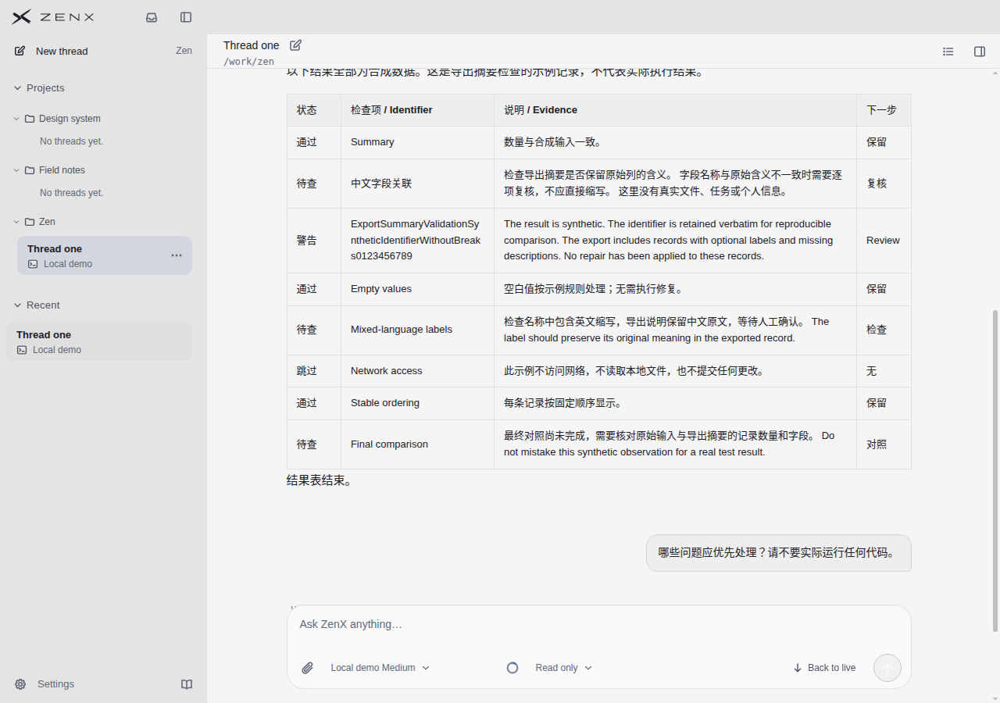

Q（候选）

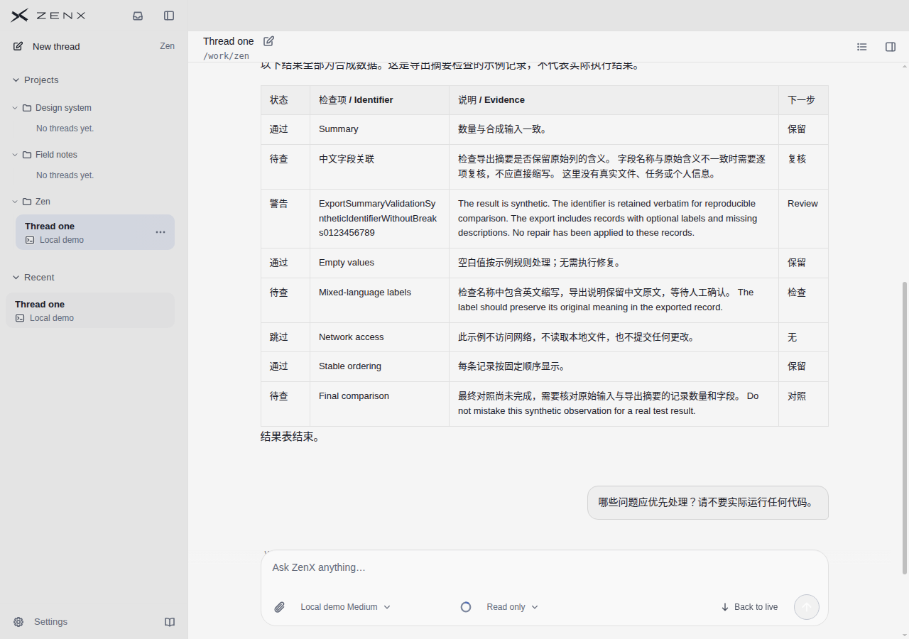

### light：长结果，资料卡开

P（基线）

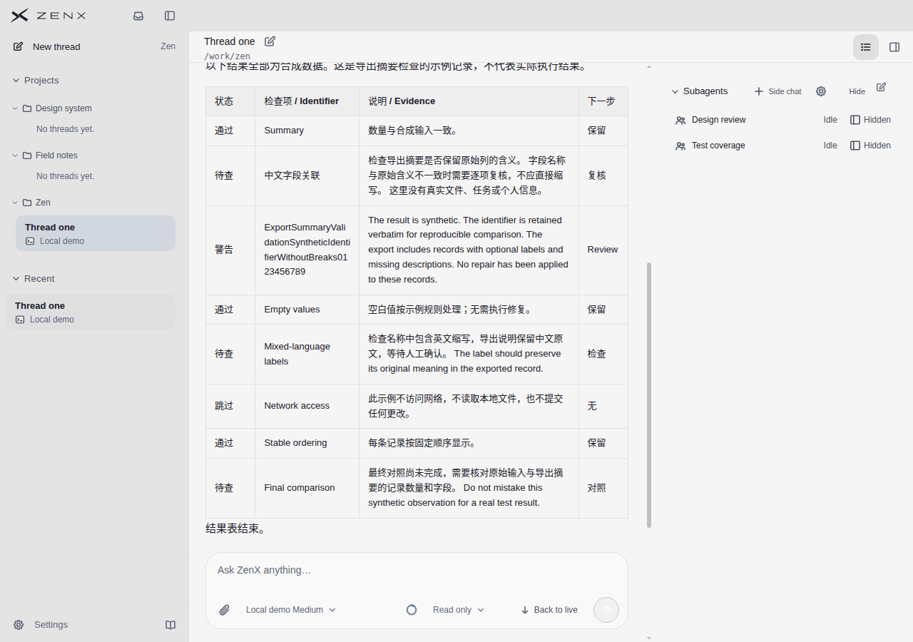

Q（候选）

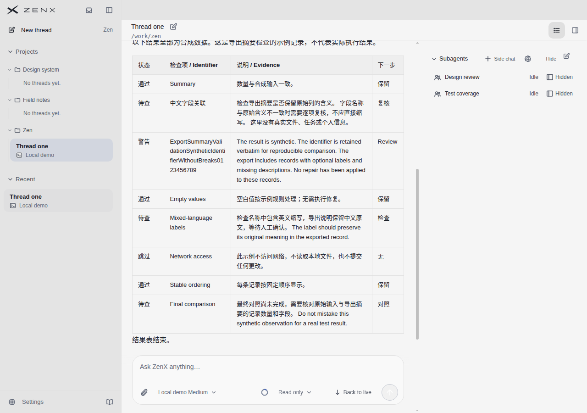

### light：短表与代码

P（基线）

Q（候选）

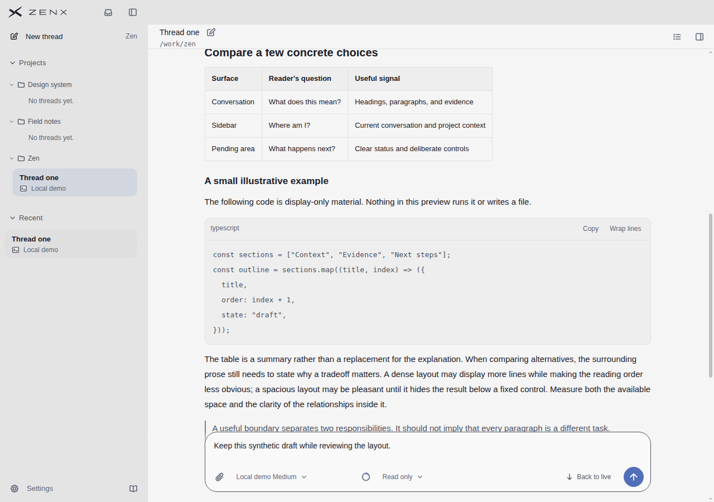

### dark：长结果，资料卡关

P（基线）

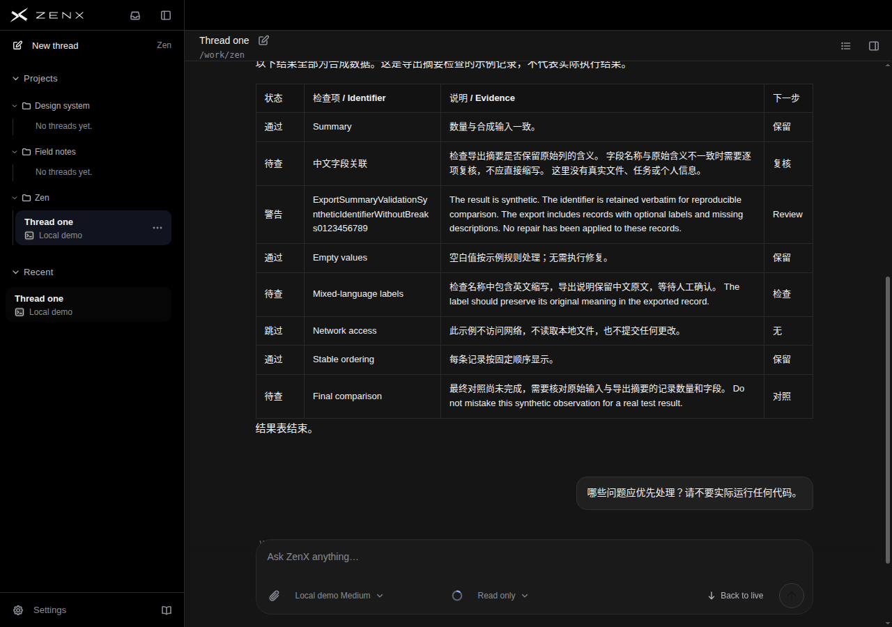

Q（候选）

### dark：长结果，资料卡开

P（基线）

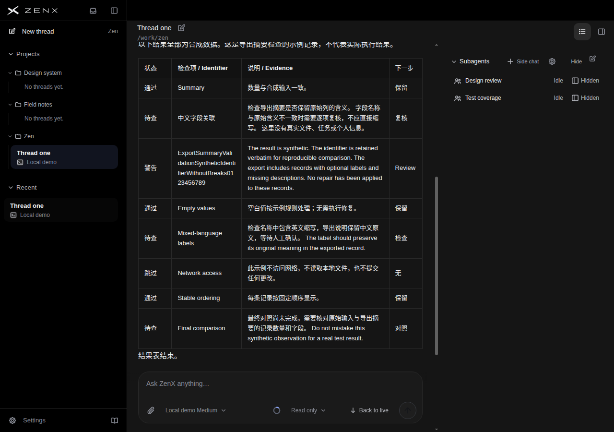

Q（候选）

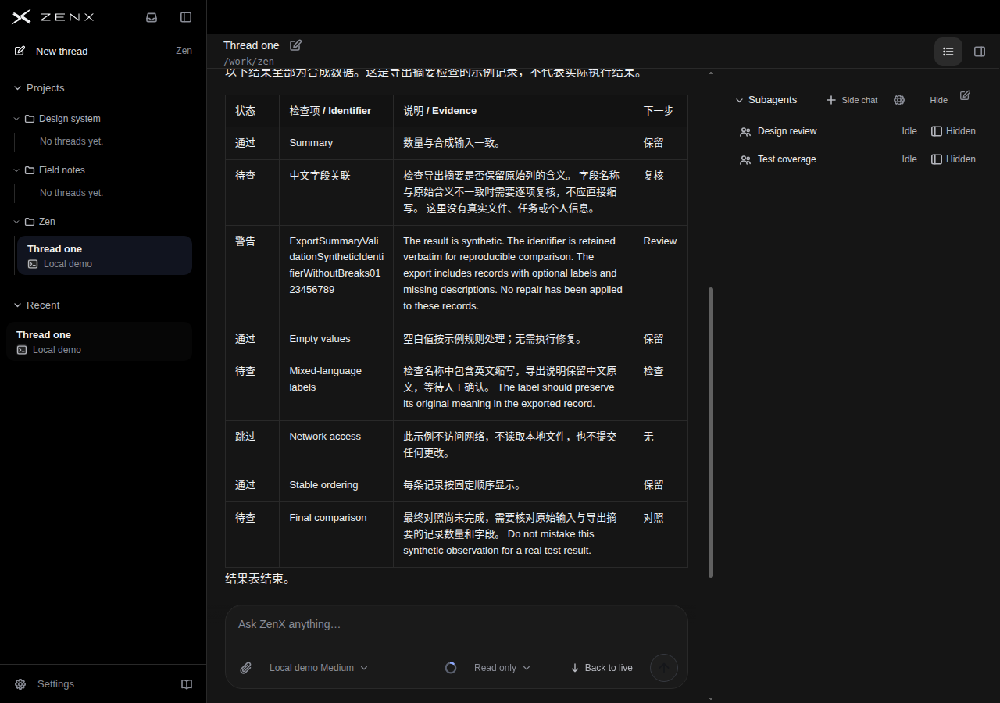

### dark：短表与代码

P（基线）

Q（候选）

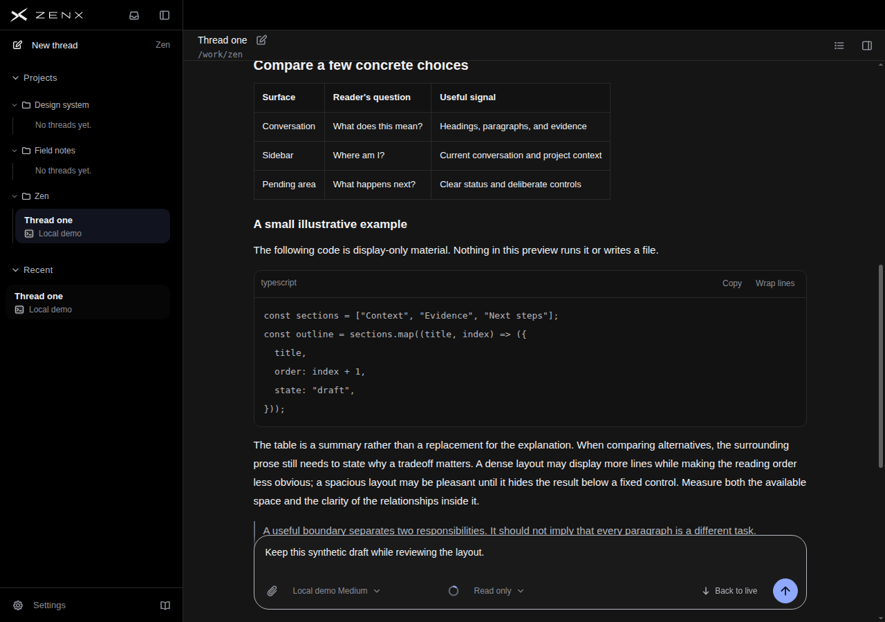

## 本轮实际参照原图

来源仍为既有已核验参考，不是为本轮生成的仿图。任务不同，不作公平产品排名。

### T3 Code runtime 6f13f36f

.jpg>)

### Codex 官网演示

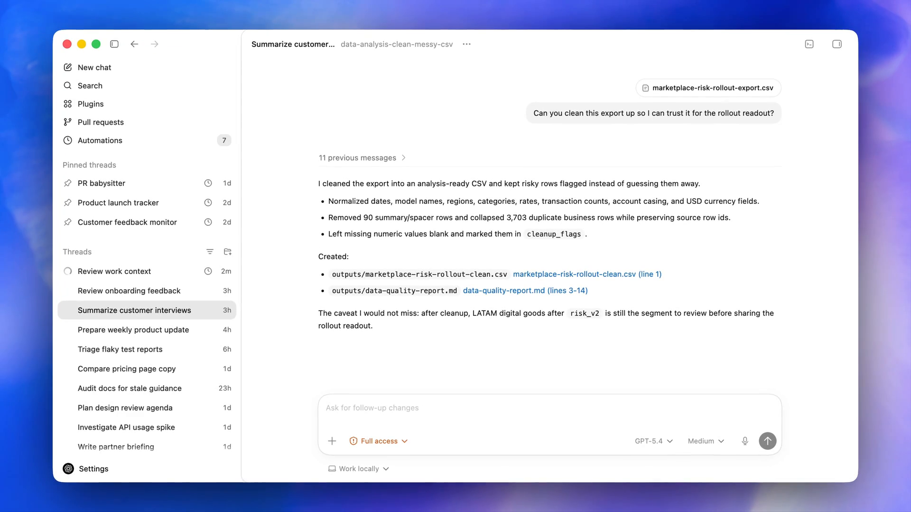

### Claude 官网演示

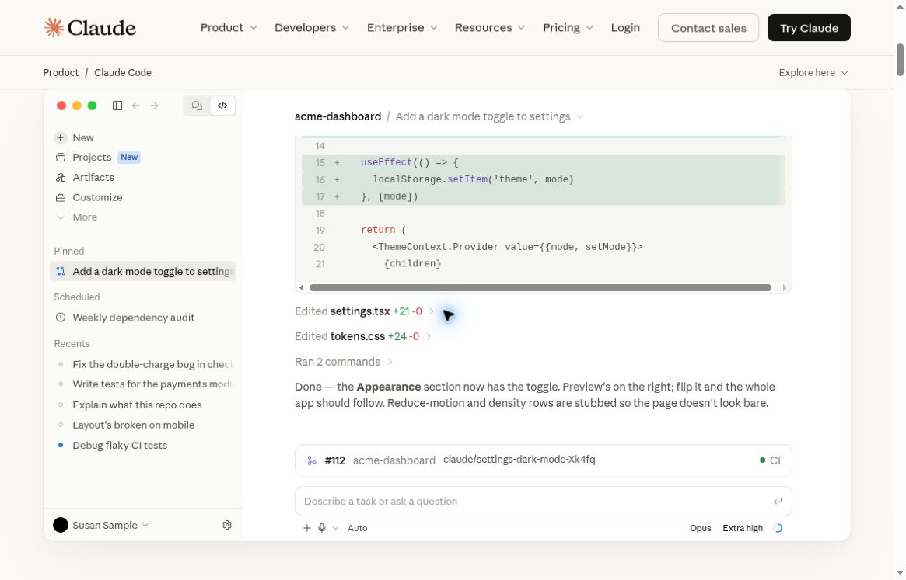

### DeepSeek Harness runtime fcc0ad4

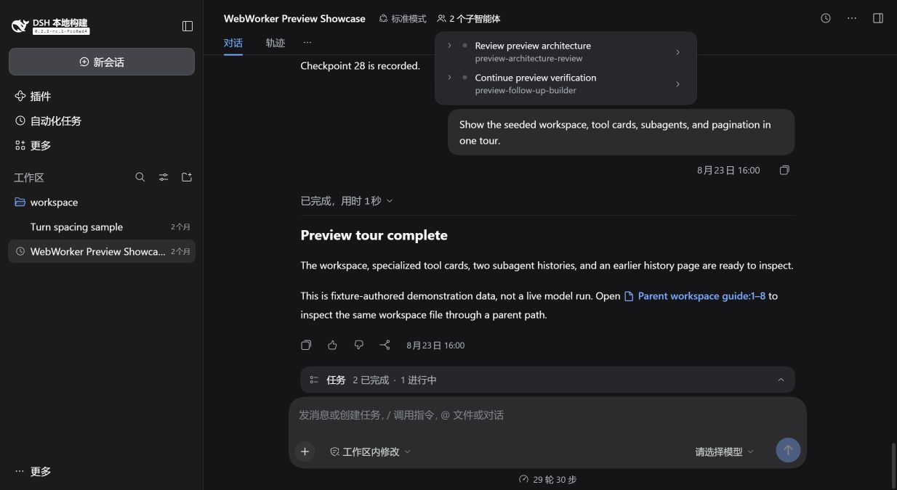

## 完整逐状态与逐参考评分

# P / Q 独立截图盲评

## 范围与方法

实际使用 view_image 查看了 P、Q 各六张原始截图，共十二张；另查看 T3 的 main-conversation-dark.jpg、Codex 的 proactive-20s.png、Claude 的 product-demo-conversation.jpg、DSH 的 subagents-dark.jpg。未读源码、开发目标、先前分数或其他线程，也未修改或发布仓库。以下是静态视觉判断，不是计时可用性实验。

五项顺序为：文本可读、行列关联、层级、空间一致性、整体。10 分为此截图任务下几乎没有可见阻碍；分数不是产品综合排名，也不以内容密度越大越好。整体是判断而非四项算术平均。0.5 的差异仅表达小幅倾向。

## 结论

建议保留 Q 的长文本表格对齐方式。Q 把状态、标识、说明、下一步的起始位置放在同一横向阅读线上，在资料卡打开、说明多行时最有价值。P 的短单元格垂直居中，使“警告”和“Review”落在长标识及说明中段，读者从状态找本行说明开头时需要向上回找。Q 没有增加可见行数，也没有缩小文本；优势是关联路径更稳定，不是更密。

这是局部、小幅且清楚的改进，不是整套界面升级。短表/代码两组看不出收益；侧栏、主对话框架、资料卡本身也看不出版本差异。不建议据此声称整体产品已追平或超过任一参考。

## 逐状态评分

| 状态                   | 版本 | 文本可读 | 行列关联 | 层级 | 空间一致性 | 整体 |
| ---------------------- | ---- | -------: | -------: | ---: | ---------: | ---: |
| 浅色，长结果，资料卡关 | P    |        8 |      7.5 |  7.5 |        7.5 |  7.5 |
| 浅色，长结果，资料卡关 | Q    |        8 |      8.5 |  7.5 |          8 |    8 |
| 浅色，长结果，资料卡开 | P    |      7.5 |        7 |    7 |          7 |    7 |
| 浅色，长结果，资料卡开 | Q    |      7.5 |        8 |    7 |        7.5 |  7.5 |
| 浅色，短表与代码       | P    |        8 |      8.5 |    8 |        7.5 |  7.5 |
| 浅色，短表与代码       | Q    |        8 |      8.5 |    8 |        7.5 |  7.5 |
| 深色，长结果，资料卡关 | P    |      7.5 |      7.5 |  7.5 |        7.5 |  7.5 |
| 深色，长结果，资料卡关 | Q    |      7.5 |      8.5 |  7.5 |          8 |    8 |
| 深色，长结果，资料卡开 | P    |        7 |        7 |    7 |          7 |    7 |
| 深色，长结果，资料卡开 | Q    |        7 |        8 |    7 |        7.5 |  7.5 |
| 深色，短表与代码       | P    |      7.5 |      8.5 |    8 |        7.5 |  7.5 |
| 深色，短表与代码       | Q    |      7.5 |      8.5 |    8 |        7.5 |  7.5 |

### 观察依据与反例

- 长结果，卡关：Q 的“待查 / 中文字段关联 / 检查导出摘要… / 复核”四项首行对齐，警告行也一样。P 的边框已经把行分得很清楚，所以不是 P 无法用，只是起读位置不一致。
- 长结果，卡开：Q 的价值最大。P 的警告与 Review 位于五行说明的中部；Q 从同一首行读过去即可确认对象。中英混合行与最后对照行也更容易定位。
- 开卡后两版都把无空格长标识拆成多行片段，辨认完整标识仍费力。对齐不能解决列宽不足。资料卡内容仅两项，却占据约一侧的宽度；现有截图中它对正文挤压明显，而自身留下大片空白。
- 反例：Summary、Empty values、Stable ordering 等全部单行的行，两版没有可见差别。短表/代码也是持平，不能外推 Q 对所有表格更好。
- 反例：如果任务是只纵向扫状态列，P 居中的状态在高行中也有明确的视觉中心；在已经有网格线的条件下，Q 的优势不是绝对的。没有计时实验，不能给出效率提高百分比。
- 两版左侧同一个 Thread one 同时出现在项目和 Recent，结构可理解，但占用空间且选中背景略有竞争；两版一样，没有改善。
- 两版主对话标题、表头、代码标题层级可辨。深色的次要按钮、路径和占位文字较暗；这一限制不因 Q 而改变。
- 两版短表/代码底部都有引用文字落到固定输入框上沿附近，继续内容被其遮住；截图只能证明此视口状态，不足以断言滚动后无法阅读。长结果顶部介绍也被头部裁去一部分。这些未被 Q 解决。
- P、Q 短表宽度均小于代码及段落宽度，短内容无需被强行拉满；这本身不是缺点。长表行高没有因 Q 变小，不能把它描述成密度优化。

## 参考截图：同维度单独评分

N/O = 此截图没有可对应观察对象；不以 N/O 作零分，不计算跨产品总排名。

| 参考                                  | 文本可读 | 行列关联 | 层级 | 空间一致性 | 整体 |
| ------------------------------------- | -------: | -------: | ---: | ---------: | ---: |
| T3，main-conversation-dark.jpg        |      7.5 |      8.5 |    8 |          8 |    8 |
| Codex，proactive-20s.png              |      8.5 |      N/O |  8.5 |        8.5 |  8.5 |
| Claude，product-demo-conversation.jpg |        7 |      N/O |    8 |          8 |  7.5 |
| DSH，subagents-dark.jpg               |        8 |      N/O |    8 |          8 |    8 |
| Linear，未提供截图                    |      N/O |      N/O |  N/O |        N/O |  N/O |

- T3：短三列表中 Step、Tool、Result 的关联明确，标题、正文、代码、表和结语之间停顿清楚。但表内都是短单行，无法检验长标识/多行证据条件下的行关联；不据此判定其长表强于 Q。暗色次要文字偏低对比，左侧装饰网格也稍分散注意力。
- Codex：主对话和左侧导航有稳定分隔，段落、项目符号、文件链接有自然阅读顺序，输入区没有压住此次可见结果。没有结果表或打开的资料卡，所以不能给它表格行关联或资料卡效果分。截图分辨率/窗口尺度不同也会影响文字观感。
- Claude：代码差异、已编辑文件、完成解释、分支/CI 卡片、输入框的工作流程层级明确。但这是官网页面里的嵌入演示，整体缩放、外围导航、代码横向滚动和截断侧栏标题降低可读判断的确定性；没有对应结果表，不能用代码行号冒充四列表评价。
- DSH：任务状态条与输入框贴近，标题和完成解释的层级清楚，子智能体弹层紧凑。但它是覆盖式弹层，不是 P/Q 的固定右侧资料卡，不能公平比较其正文宽度成本；没有结果表，行列关联记 N/O。

## 局限与保留条件

只覆盖桌面 1280×900 的 P/Q 静态状态、有限合成文本；没有真实滚动、交互、选取长标识、键盘导航、窄窗、超长表或辅助技术检查。参考任务内容、尺度和页面来源不同，分数只描述各自画面。没有发现 Q 在此组图中的明显退步，但这不证明其他组件无回归。

保留建议限定为：保留 Q 所呈现的多行表格起始对齐，短单行表维持现状；不要借此继续压缩字号/行距，也不要把对齐改动当作侧栏、资料卡宽度及固定输入框遮挡问题的解决方案。
