## 当前重点：桌面主对话、Sidebar、队列与资料卡

### 最新：a770fe74 统一画布与同行操作

已评源码a770fe74，证据提交b8c4aa72；非未发布的3df。1280×900英文合成数据，真实生产组件明暗图，非原生App验收。[独立评审和来源](https://github.com/albert-zen/zen/blob/b8c4aa725ebda1c9a70e09320cc8540a2e3bfdf3/docs/ui-quality/evidence/desktop-reading-a770fe74/REVIEW.md)。

与0b同轮对照五维/10（层级／可读／注意／一致／交互）：**8→7.5／7.5→7.5／7.5→8.5／8→8／7.5→6.5**。统一画布和Side chat同行有效；孤立编辑图标、标题拥挤、Sidebar名单单行仍存在。滚动条两版均6px，只颜色变淡，未变细。长名称、多卡、键盘／拖拽未验；T3静止隐、悬停／滚动显的实际对照未验。五家参考本轮未重评，逐轮参考打分仍待补，下面保留原图及原版本分数，不造数。

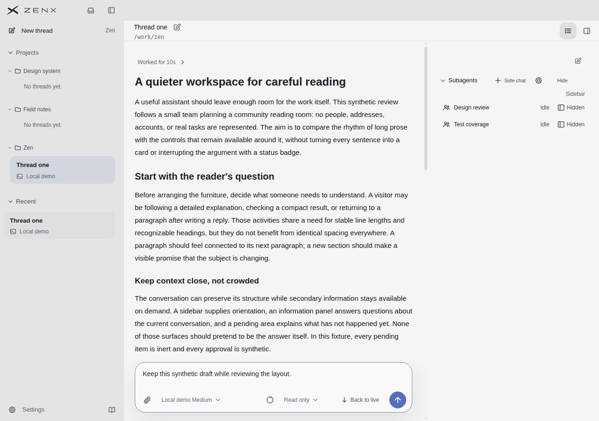
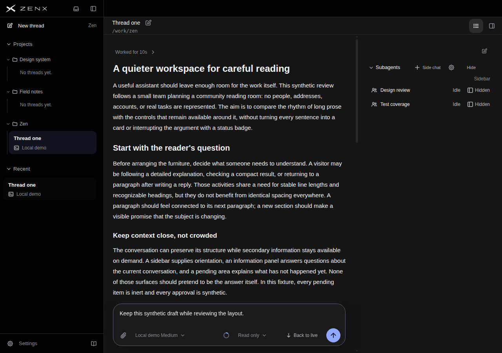

此前0b同次Info对照2a：6.5→8／7→7.5／8→7.5／7.5→8／7→7.5，标题变清楚但双层边框抢眼；[原评审](https://github.com/albert-zen/zen/blob/38b3bd4018dab3467c5e39326dc9be73d2578412/docs/ui-quality/evidence/desktop-reading-0b1666ab/REVIEW.md)。历史图保留：
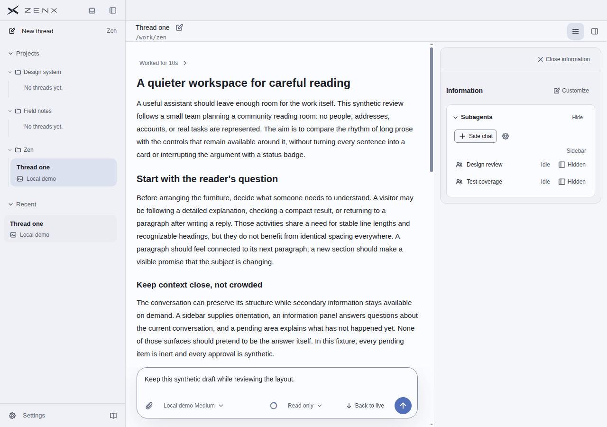
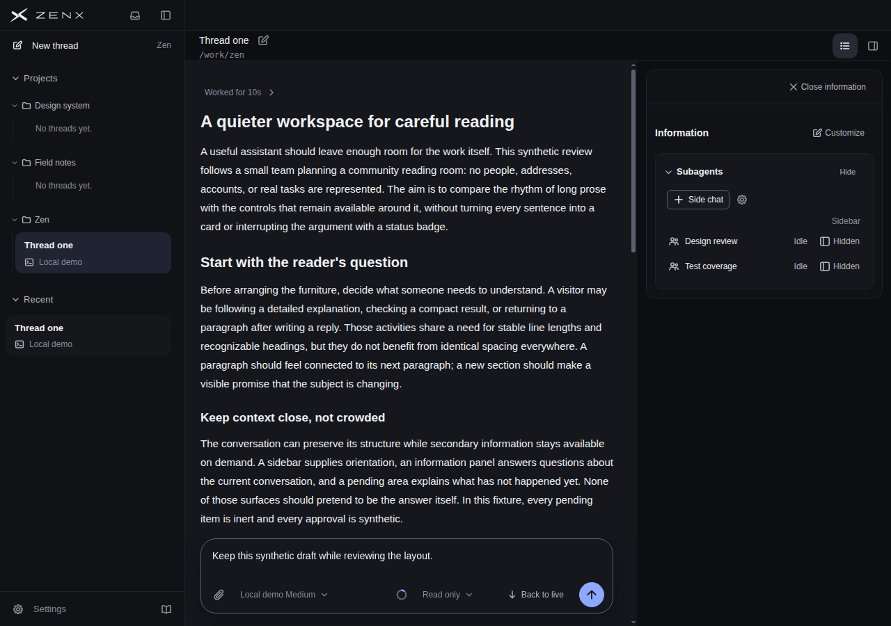

按最新要求，**不再把窄屏适配作为本轮推进目标**。以下桌面图是 Zen 生产组件＋合成数据，不是设计稿或完整原生 App 验收。

上一轮回读分支 head 为 [`d4891477`](https://github.com/albert-zen/zen/commit/d489147722b382b14dd424f6ef20d9f440439a6c)（后续仅fixture TS修复；本节已评产品源码2a4d938f）。最新独立阅读评审绑定 `2a4d938f` 的18张图；2a已含摘要Request／请求权限措辞与失败恢复测试修复，[新阅读43039529428](https://github.com/albert-zen/zen/actions/runs/43039529428)已成功，18图已完成独立评审，**不把新head自动当作已评源码**。普通阅读八图与b4逐像素相同；只有用户主动切换审批摘要才释放阅读空间，默认完整审批不变。下方历史评分与各参考对象原图保留准确版本。

已评生产 Send 关闭焦点修复为 `2e9396d7`；[首次 navigation 43014523256](https://github.com/albert-zen/zen/actions/runs/43014523256) 已成功，16 张亮／暗图及 Projects 键盘恢复证据已完成独立评审，**与 376 匹配的七张浅色图逐像素相同、评分不涨**；新增深色与恢复图是验证范围扩展，分项见下方。60ddca31 历史检查中的 [Fullscreen 43015295187](https://github.com/albert-zen/zen/actions/runs/43015295187) 已通过，包含 macOS 与 Chromium；旧失败根因仍未明，单次通过不等于已解释或根治旧问题。

[队列阅读专项 43009644920](https://github.com/albert-zen/zen/actions/runs/43009644920) 成功，**12 张浅／深色实际图已逐张独立评审并核验 SHA**。d332→446b 的 pending 构建相同，**本轮是此前未拍行为的补证，不是声称生产版本又涨分**。[12 张原图、来源和行为记录](https://github.com/albert-zen/zen/actions/runs/43009644920/artifacts/13850565488)（可能需登录，保留至 2026-11-18）。

### 2a4d938f：请求性文案修复，18状态分与acf相同

[2a18张实际原图与记录](https://github.com/albert-zen/zen/actions/runs/43039529428/artifacts/13863918651) · [acf匹配基线](https://github.com/albert-zen/zen/actions/runs/43037594276/artifacts/13862779659)。当前评分源码 `2a4d938f81711fe644df9cdbc8645c6207462237`，1280×900、en、生产组件＋只读合成数据，非真实Host／权限授予。以下18状态五维与acf各自同名图一致，无整数跨档；字体探针不计产品状态。

| 实际场景                 | 层级 | 可读性 | 注意力 | 一致性 | 交互线索 |
| ------------------------ | ---: | -----: | -----: | -----: | -------: |
| 浅色长文顶部             |    8 |      8 |      8 |      8 |        8 |
| 浅色标题／列表           |    8 |      8 |      8 |      8 |        8 |
| 浅色表格／代码           |    8 |      8 |      8 |      8 |        8 |
| 浅色资料打开             |    7 |      8 |      8 |      8 |        8 |
| 浅色默认审批＋队列       |    7 |      7 |      7 |      8 |        8 |
| 浅色默认审批＋队列＋资料 |    7 |      7 |      7 |      8 |        8 |
| 浅色主动摘要＋队列＋资料 |    8 |      8 |      8 |      8 |        8 |
| 浅色恢复完整审批         |    7 |      7 |      7 |      8 |        8 |
| 浅色新请求完整审批       |    7 |      7 |      7 |      8 |        8 |
| 深色长文顶部             |    8 |      7 |      8 |      8 |        8 |
| 深色标题／列表           |    8 |      7 |      8 |      8 |        8 |
| 深色表格／代码           |    8 |      7 |      8 |      8 |        8 |
| 深色资料打开             |    7 |      7 |      8 |      8 |        8 |
| 深色默认审批＋队列       |    7 |      7 |      7 |      8 |        8 |
| 深色默认审批＋队列＋资料 |    7 |      7 |      7 |      8 |        8 |
| 深色主动摘要＋队列＋资料 |    8 |      7 |      8 |      8 |        8 |
| 深色恢复完整审批         |    7 |      7 |      7 |      8 |        8 |
| 深色新请求完整审批       |    7 |      7 |      7 |      8 |        8 |

**实际收益只在主动模式：**审批卡266.17→112px，阅读净区257.64→411.81px，两条队列、108px Composer及草稿保留。默认代码／路径／权限范围／Allow-Deny完整；用户进入摘要后不再有Allow/Deny，只有Review request、Full request与“No decision has been made”。Enter进入／恢复、新合成请求回到完整卡有记录，没有作允许或拒绝决定。

**不伪造版本涨分：**前四场景两主题共八图与b4像素相同；默认审批空间不变。主动／恢复／新请求是新增操作状态，b4没有相同操作图。默认scrollTop0，主动与恢复1851，不能按露出的末段做逐行同位比较；恢复完整卡又截断末段。新请求scope更短产生17.39px差，不算布局提升。

**已修与边界：**2a浅深摘要已改为“Request to remember permission”，与未决定提示一致，消除acf旧英文的已授权暗示；文字完整、卡高112px及阅读区411.81px不变，不虚构新空间收益或涨分。前12匹配图逐像素相同；恢复／新请求仅顶栏1像素差，主动图变化限文案。中文／一次性权限摘要／长工具名仍未有实图，不因i18n源码改动就验收。42次Tab完整环路只证明此路径可达，不是高效导航；Full request打开、真实权限行为、多审批与完整无障碍未验。固定CJK仅环境补证，主图仍en。Sidebar浅8/8/8/8/7、深8/7/8/8/7，Information局部浅7/8/8/8/7、深7/7/8/8/7，不随摘要加分。

五家参考分项与实评原图继续保留，不用内容／任务摘要替代权限审批证据。**2a实际评分图：请求性文案已修复，整屏分与acf持平。**

**主动摘要，浅／深。**

| 浅色                                                                                                                                                                                                             | 深色                                                                                                                                                                                                            |
| ---------------------------------------------------------------------------------------------------------------------------------------------------------------------------------------------------------------- | --------------------------------------------------------------------------------------------------------------------------------------------------------------------------------------------------------------- |
| 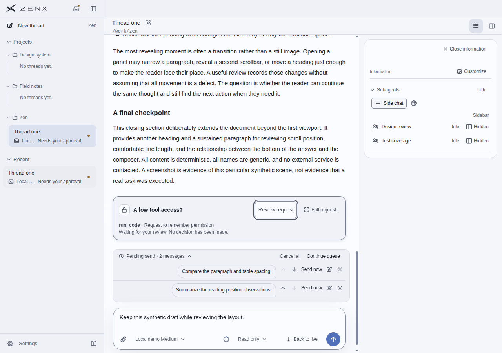 | 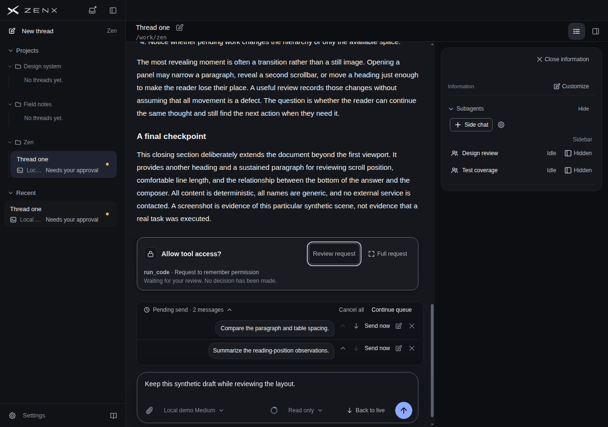 |

**恢复完整，浅／深。**

| 浅色                                                                                                                                                                                                     | 深色                                                                                                                                                                                                    |
| -------------------------------------------------------------------------------------------------------------------------------------------------------------------------------------------------------- | ------------------------------------------------------------------------------------------------------------------------------------------------------------------------------------------------------- |
|  | 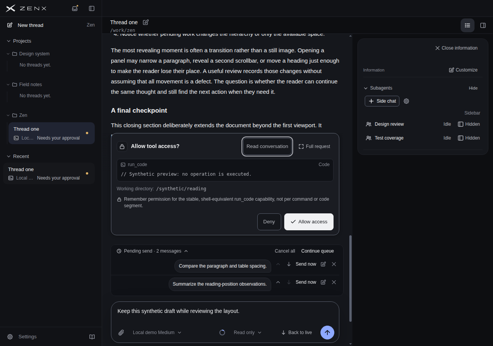 |

**新请求完整，浅／深。**

| 浅色                                                                                                                                                                                                          | 深色                                                                                                                                                                                                         |
| ------------------------------------------------------------------------------------------------------------------------------------------------------------------------------------------------------------- | ------------------------------------------------------------------------------------------------------------------------------------------------------------------------------------------------------------ |
| 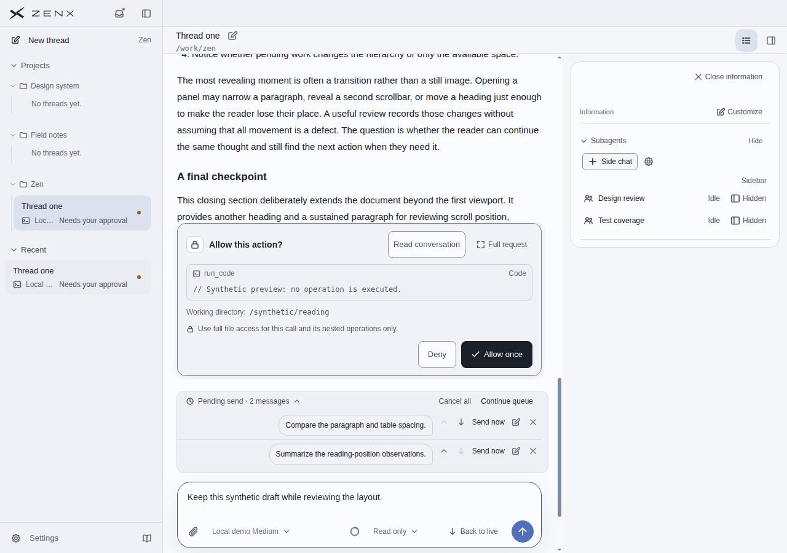 | 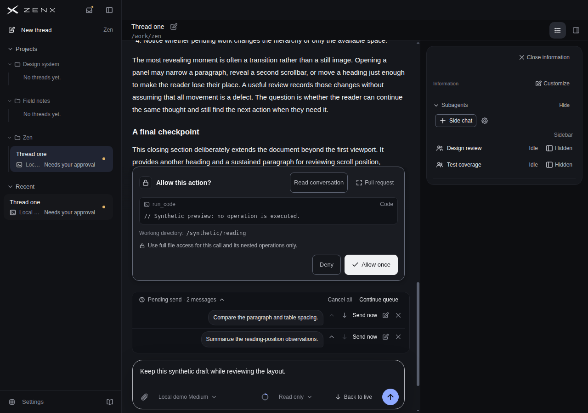 |

[2a源码、run与六图SHA清单](https://github.com/albert-zen/zen/blob/042c623927f1ebca3069ce9e8ec6748f239e7a9b/docs/ui-quality/evidence/desktop-reading-2a4d938f/manifest.json)。图仅合成生产组件；主动摘要无Allow/Deny，返回完整卡才有决策入口，未执行真实授权。中文和一次性权限摘要仍N/O。

**acf历史八图不删除：**[固定版本八图目录](https://github.com/albert-zen/zen/blob/0385fb72c1824494629c633569f9858e8eba3dcf/docs/ui-quality/evidence/desktop-reading-acf67b8c/) · [来源清单](https://github.com/albert-zen/zen/blob/0385fb72c1824494629c633569f9858e8eba3dcf/docs/ui-quality/evidence/desktop-reading-acf67b8c/manifest.json)。文件 reading-desktop-{light,dark}-{pending-information,approval-explicit-reading,approval-restored,approval-new-request}.png；旧“Remembered permission”歧义只属于acf，不能把其原图改标签冒充2a。acf逐项分与上表一致，模式收益和限制如上。

### b4c769df 已评丰富阅读：回收47px，保留组合场景限制

[12 张实际原图、源码与行为记录](https://github.com/albert-zen/zen/actions/runs/43031268875/artifacts/13860808850)（可能需登录，保留至2026-11-18）。准确源码 `b4c769df4b85692814f666fdc6c40db1db161a16`；1280×900，生产组件＋只读合成内容。评分来自实际图，不以捕获通过替代独立判断。

**相对750的实际变化：**返回控件移入原有元信息／工具栏，Composer回收47px；750表代码帧被切的解释末行、资料打开场景第三段、全组合第一段恢复完整。全组合阅读净区 **210.64→257.64px**，仍然有限，长文依然有正常底部边界，不能说所有内容同屏无遮挡。

| 实际场景             | 层级 | 可读性 | 注意力 | 一致性 | 交互线索 |
| -------------------- | ---: | -----: | -----: | -----: | -------: |
| 浅色长文顶部         |    8 |      8 |      8 |      8 |        8 |
| 浅色标题／列表       |    8 |      8 |      8 |      8 |        8 |
| 浅色表格／代码       |    8 |      8 |      8 |      8 |        8 |
| 浅色资料打开整屏     |    7 |      8 |      8 |      8 |        8 |
| 浅色审批＋队列       |    7 |      7 |      7 |      8 |        8 |
| 浅色审批＋队列＋资料 |    7 |      7 |      7 |      8 |        8 |
| 深色长文顶部         |    8 |      7 |      8 |      8 |        8 |
| 深色标题／列表       |    8 |      7 |      8 |      8 |        8 |
| 深色表格／代码       |    8 |      7 |      8 |      8 |        8 |
| 深色资料打开整屏     |    7 |      7 |      8 |      8 |        8 |
| 深色审批＋队列       |    7 |      7 |      7 |      8 |        8 |
| 深色审批＋队列＋资料 |    7 |      7 |      7 |      8 |        8 |

对照750：浅色表代码可读性7→8、浅色资料整屏可读性7→8；浅深全组合可读性／注意力6→7。其余分项持平，不将新增空间机械换成各项涨分。五家参考对象的逐项分数与实际原图保留于下方，各自场景不同，不拼总排名。

**取舍与未测：**返回移入元信息行后，状态说明消失、视觉显著性下降；当前800／593px列宽标签无重叠，但没有验证返回控件命中、Tab可达或实际激活。发送／审批决策／真实Host仍不在本轮范围。最新六张关键原图已公开，直接展示如下；其余六张在上方完整原图包。**以下是b4实际评分图，不是750旧图。**

**长文顶部：浅色／深色。**

| 浅色                                                                                                                                                                                                        | 深色                                                                                                                                                                                                       |
| ----------------------------------------------------------------------------------------------------------------------------------------------------------------------------------------------------------- | ---------------------------------------------------------------------------------------------------------------------------------------------------------------------------------------------------------- |
| 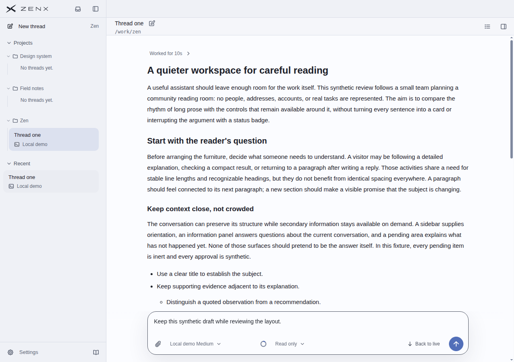 | 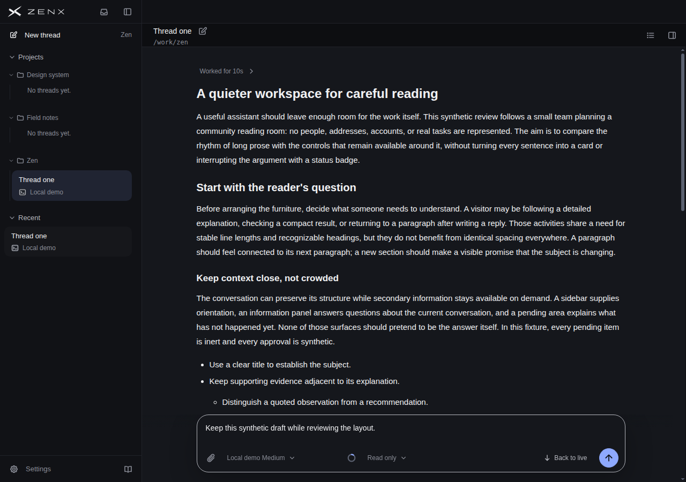 |

**表格／代码：浅色／深色。**

| 浅色                                                                                                                                                                                                           | 深色                                                                                                                                                                                                          |
| -------------------------------------------------------------------------------------------------------------------------------------------------------------------------------------------------------------- | ------------------------------------------------------------------------------------------------------------------------------------------------------------------------------------------------------------- |
| 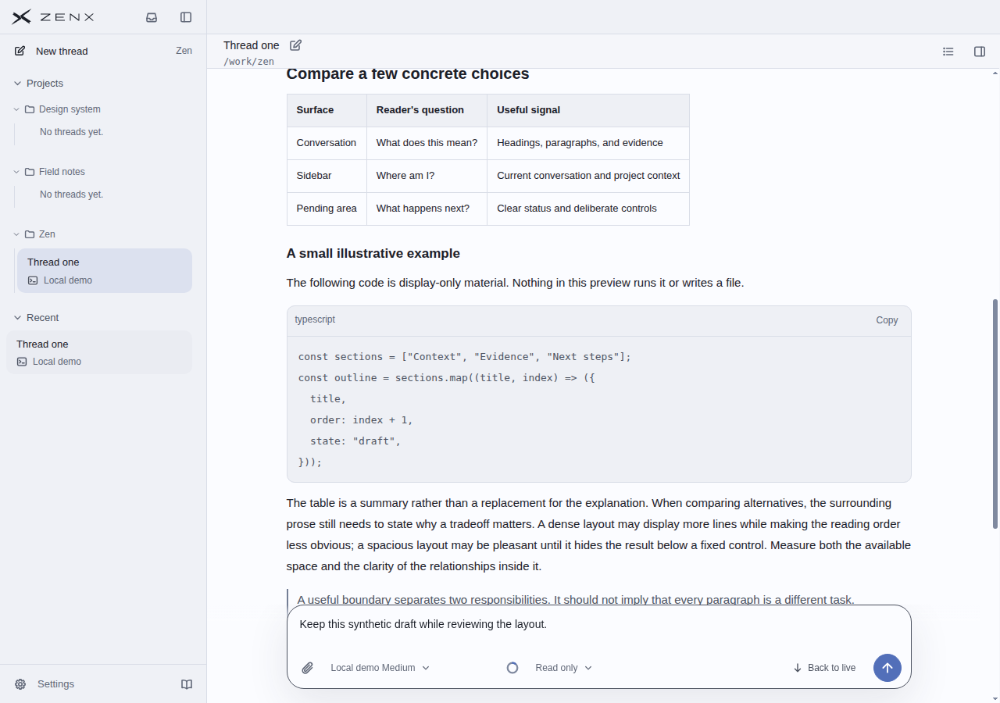 | 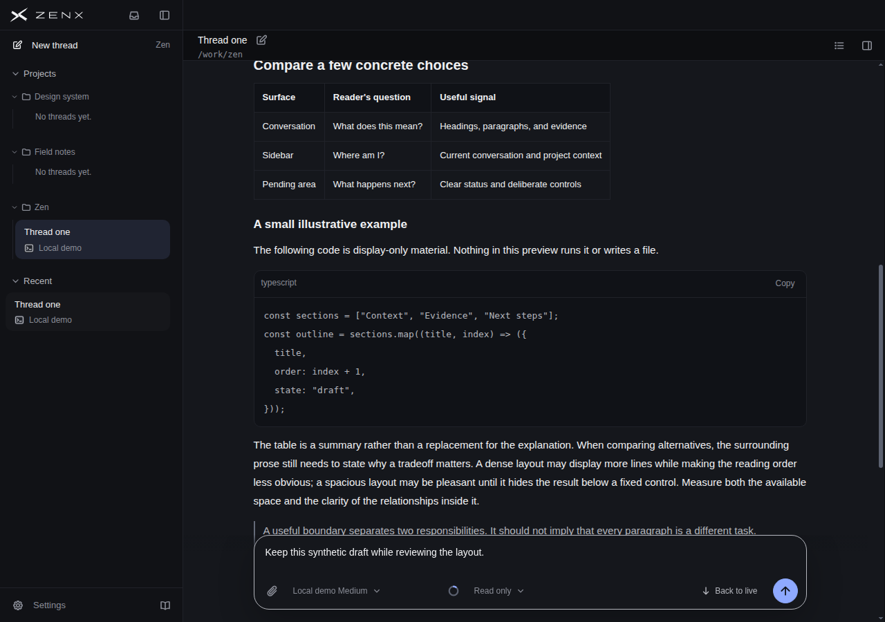 |

**审批＋队列＋资料全组合：浅色／深色。**

| 浅色                                                                                                                                                                                                                                | 深色                                                                                                                                                                                                                               |
| ----------------------------------------------------------------------------------------------------------------------------------------------------------------------------------------------------------------------------------- | ---------------------------------------------------------------------------------------------------------------------------------------------------------------------------------------------------------------------------------- |
| 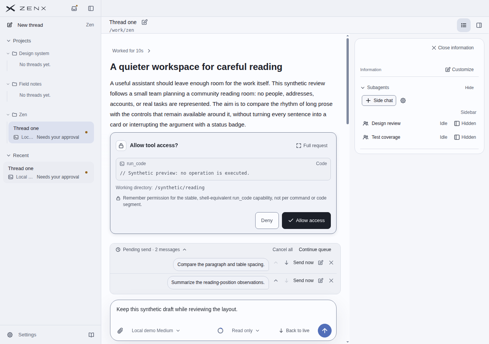 | 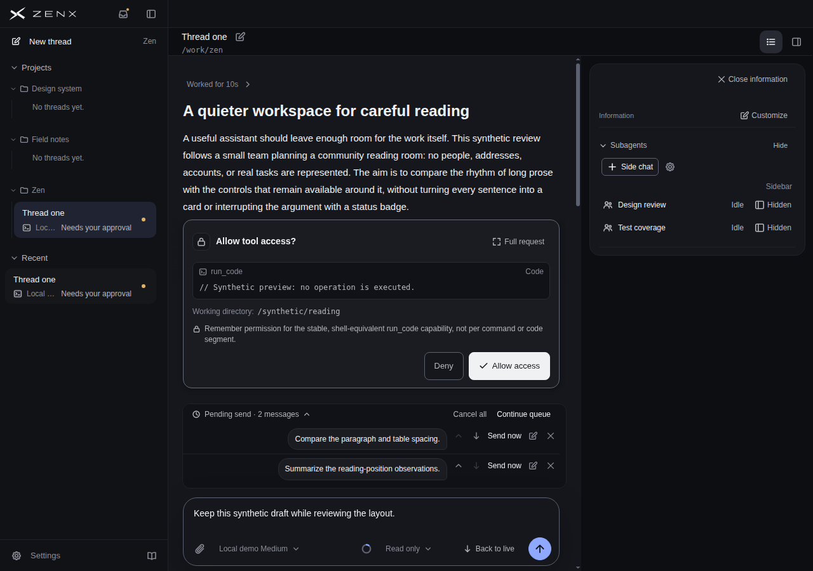 |

[准确源码、run、逐图SHA与范围清单](https://github.com/albert-zen/zen/blob/ddac6e2b00012681128f7572638513c3eb327112/docs/ui-quality/evidence/desktop-reading-b4c769df/manifest.json)。12状态与750的fixture、捕获脚本、视口、输入模式、主题和滚动位置匹配；六张公开图均为已独立评阅的生产组件＋合成内容原图。全组合只余257.64px阅读净区，返回实际激活／Tab仍未测，不能把直显截图当全交互验收。

### 75015cdc 历史完整浅深六场景：修复与空间代价同时保留

[12 张实际原图、源码和行为证据](https://github.com/albert-zen/zen/actions/runs/43030048948/artifacts/13860097846) · [专项 43030048948](https://github.com/albert-zen/zen/actions/runs/43030048948)。准确源码 `75015cdcebe4e8ecc771113feecfbc1398a222a6`，1280×900、生产组件＋只读合成数据。六步×两主题捕获 passed，不等于真实 Host／发送／审批／全部键盘通过。

**真实修复：**Back to live 已从正文浮钮移到 Composer 内，原句中压字消除；approval 与正文／输入同列，5px 偏轴修复。**真实代价：**返回区使 Composer 高108→155，增加47px；普通阅读净区686→639、审批共存275→228px。表代码帧解释末行新被 Composer 上缘切到；审批＋队列＋资料全开只余210.64px阅读净区。不能写“所有文字无遮挡”。

| 实际场景             | 层级 | 可读性 | 注意力 | 一致性 | 交互线索 |
| -------------------- | ---: | -----: | -----: | -----: | -------: |
| 浅色长文顶部         |    8 |      8 |      8 |      8 |        8 |
| 浅色标题／列表       |    8 |      8 |      8 |      8 |        8 |
| 浅色表格／代码       |    8 |      7 |      8 |      8 |        8 |
| 浅色资料打开整屏     |    7 |      7 |      8 |      8 |        8 |
| 浅色审批＋队列       |    7 |      7 |      7 |      8 |        8 |
| 浅色审批＋队列＋资料 |    7 |      6 |      6 |      8 |        8 |
| 深色长文顶部         |    8 |      7 |      8 |      8 |        8 |
| 深色标题／列表       |    8 |      7 |      8 |      8 |        8 |
| 深色表格／代码       |    8 |      7 |      8 |      8 |        8 |
| 深色资料打开整屏     |    7 |      7 |      8 |      8 |        8 |
| 深色审批＋队列       |    7 |      7 |      7 |      8 |        8 |
| 深色审批＋队列＋资料 |    7 |      6 |      6 |      8 |        8 |

浅色前5图与 ef67 同 fixture／脚本／输入／滚动位置匹配：顶部和列表原8/7/7/8/7→8/8/8/8/8；表代码原8/8/8/8/7→8/7/8/8/8，**保留可读性退步**；资料整屏原7/7/7/8/7→7/7/8/8/8；审批队列不变。深色6图及浅色全组合共7个新增状态无旧图，只评现状。Information卡本身浅7/8/8/8/7、深7/7/8/8/7，不给卡因外部返回行涨分。

保留内嵌返回方向，后续处理47px代价与底部阅读边界，不退回句中浮钮。Back to live实际激活、发送／审批决策、Copy／Edit、完整键盘均未由本专项执行。五参考图、各自分项和来源保留，不拿不同任务拼排行榜。

**750历史六张匹配原图索引（保留47px代价，不是b4修复图）：** [固定版本目录与六图](https://github.com/albert-zen/zen/blob/3fe1636f2e8931e43758a321254f9c9577a4e368/docs/ui-quality/evidence/desktop-reading-75015cdc/) · [源码／SHA清单](https://github.com/albert-zen/zen/blob/3fe1636f2e8931e43758a321254f9c9577a4e368/docs/ui-quality/evidence/desktop-reading-75015cdc/manifest.json)。文件为 reading-desktop-{light,dark}-{prose-top,table-code,pending-information}.png；上方750逐项分与空间回归说明保留，图未删除。

### ef67bc32 历史匹配阅读：5 个浅色场景已独立评审，整体仍失败

精确源码 `ef67bc320b54a4e1c19c2e23b3787b78675f0d4f`。[实际原图及来源包](https://github.com/albert-zen/zen/actions/runs/43028901963/artifacts/13859017562)，对应 [run 43028901963](https://github.com/albert-zen/zen/actions/runs/43028901963)。这不是完整版通过：第五个 approval 宽度断言失败，**深色未覆盖**。

| 实际浅色场景／范围      | 信息层级 | 可读性 | 注意力 | 一致性 | 交互线索 |
| ----------------------- | -------: | -----: | -----: | -----: | -------: |
| 长文顶部整屏            |        8 |      7 |      7 |      8 |        7 |
| 标题与列表整屏          |        8 |      7 |      7 |      8 |        7 |
| 表格与代码整屏          |        8 |      8 |      8 |      8 |        7 |
| Information 打开整屏    |        7 |      7 |      7 |      8 |        7 |
| 同图 Information 卡局部 |        7 |      8 |      8 |      8 |        7 |
| pending＋approval 整屏  |        7 |      7 |      7 |      8 |        8 |

**已观察变化：**正文与输入框现已对齐；表格与代码有真实像素证据，不再一概 N/O。**仍存在：**Back to live 浮钮遮字；审批条相对共享列仍右偏5px。后续修复在推进，未拿新修复预期替代此版本实图。Information 局部与打开后的整个对话空间是不同评分范围，不混算。

这组图分与 a2 单首帧、715c 短答分开，缺同场景基线的项目只评现状。五个参考对象的既有实际图、分项和准确来源保留；不因新增 Zen 内容就改写竞品分。原图现已按准确版本公开，见下方五张；不是750修复后的图。

ef67五张已评匹配基线原图（历史failed，保留遮挡与偏轴）

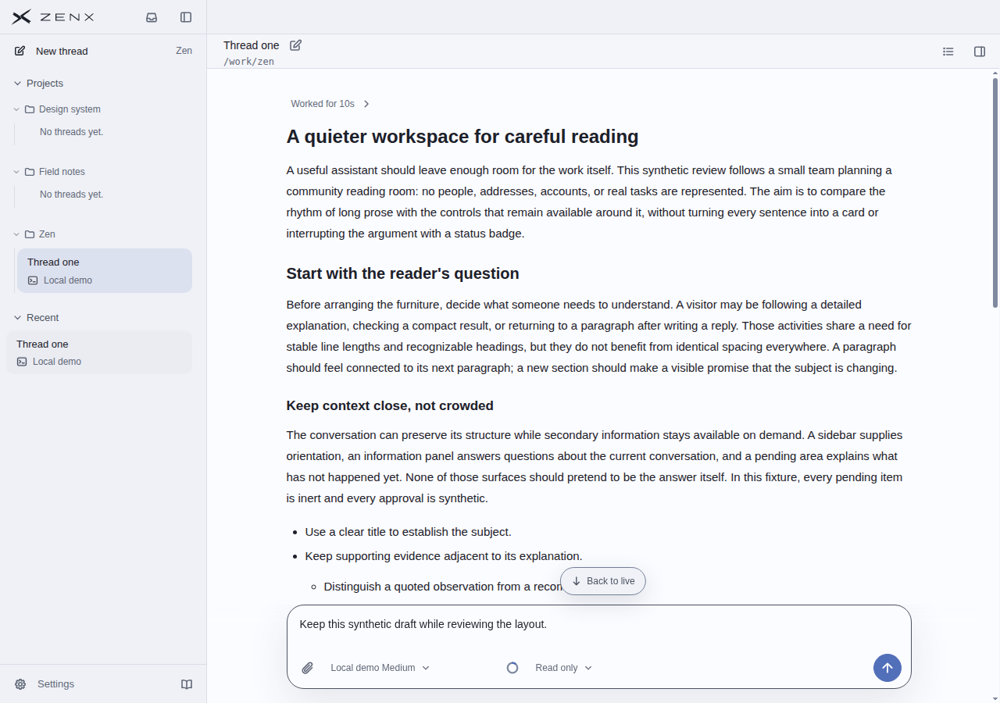

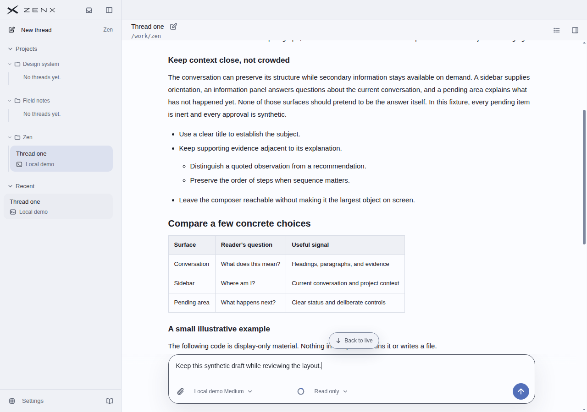

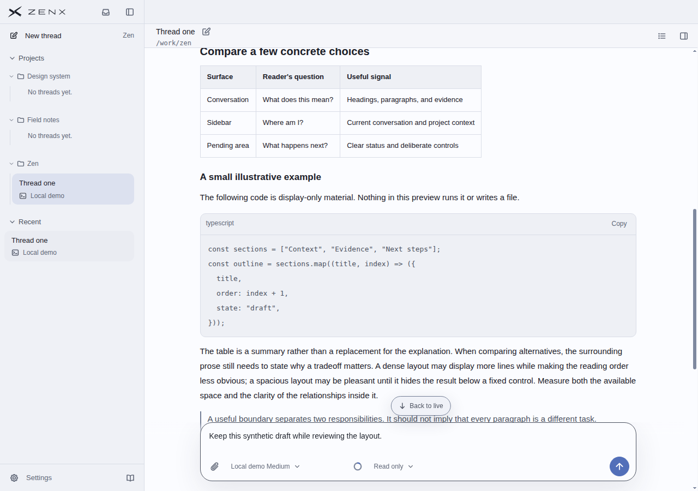

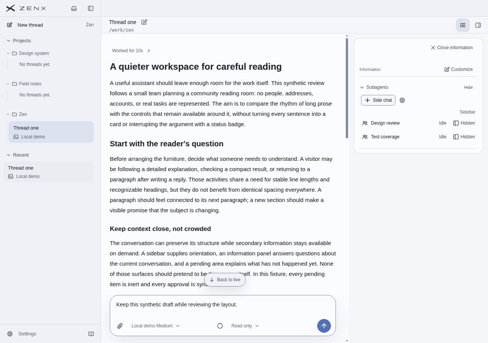

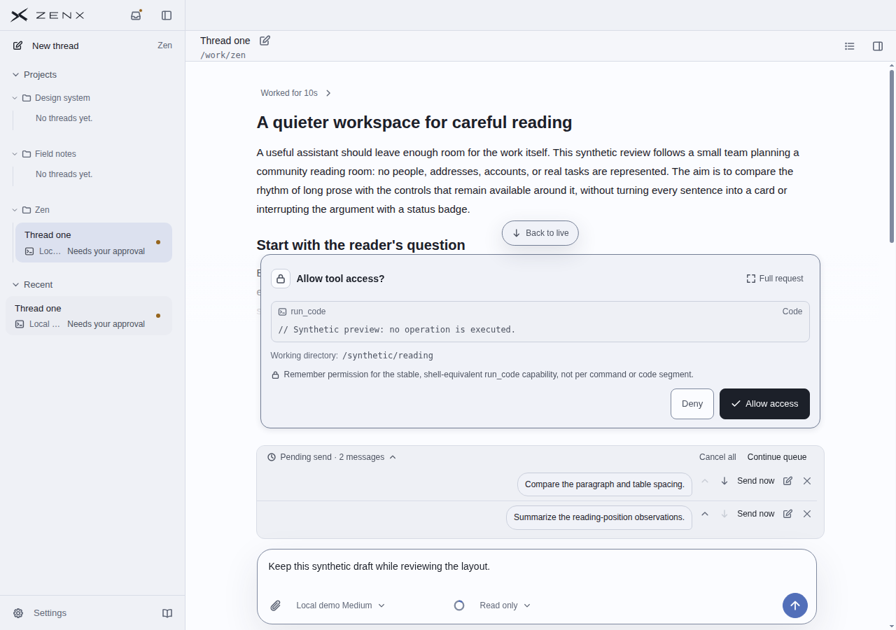

[来源与失败边界](https://github.com/albert-zen/zen/blob/d537e9a16fd85391cdb32002042ba84a2f4e9201/docs/ui-quality/evidence/desktop-reading-ef67bc32/manifest.json)

### 长文首帧实证：a2b10efe，只有一个独立状态

[实际原图与证据](https://github.com/albert-zen/zen/actions/runs/43027899464/artifacts/13857802353)，文件 `reading-desktop-light-prose-top.png`。与 `reading-desktop-light-failed.png` 字节／SHA 相同，**不把失败快照算第二个覆盖状态**。1280×900、浅色、生产 App／Markdown／Composer＋只读合成内容；未执行代码、发送或审批。

| 实际场景／区域                                | 信息层级 | 可读性 | 注意力 | 一致性 | 交互线索 |
| --------------------------------------------- | -------: | -----: | -----: | -----: | -------: |
| 长文顶部＋Sidebar＋已填Composer＋Back to live |        8 |      7 |      7 |      8 |        7 |
| 同图 Sidebar 局部                             |        8 |      8 |      8 |      8 |        7 |

**实际用于上述评分的 a2 首帧（不是后续 ef67 修复图）：**

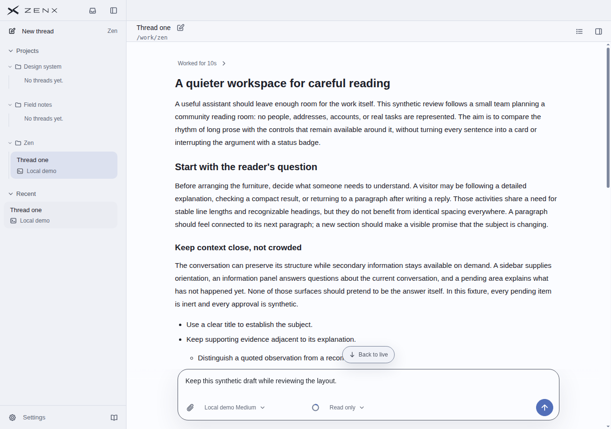

[准确源码、单一状态与哈希清单](https://github.com/albert-zen/zen/blob/6a29fc9001d268bcbc2120b1a2789da4db5ab17d/docs/ui-quality/evidence/desktop-reading-a2b10efe/manifest.json)。原样展示已发现的问题，不裁剪遮挡，也不重复发布 failed 同字节图片增加覆盖数。

**可见优点：**标题与段落层级明确，正文 15px／27px、H1／H2／H3 有分层，草稿和 Composer 完整可见。

**实际问题：**Back to live 浮钮盖住底部嵌套列表的句子，不能说全文完整可读。正文和 Composer 均 800px 宽，但 x 分别 366.5／371.5，**相差 5px，同宽不等于同轴**。这是 a2 当时的实际问题。后续 ef67 已有正文／Composer 对齐记录，但 approval 仍偏5px、Back to live 遮字仍在修，对应 ef67 五场景已独立复评并单列，不能把本 a2 旧图改标为修复后。

**失败边界：**观察器选择 `.messages-inner` 得到 column:null，触发列宽断言；实际正文与 Composer 都为800px、无横向溢出，不能把脚本失败解释成列消失／超宽。只有本首帧有像素证据，dark、长文中末段、表格／代码／复杂内容均 N/O。旧 715c 丰富专项0图的状态与本次1状态分开记录；不是用预期 HTML 补评分。

五参考对象继续使用各自已实看图与下方同维分项，非相同长文任务排行榜；没有匹配旧长文首帧，不能给这张图虚构改善幅度。

### 已评短答主对话：08559406 → 715c140a，真实排版变化但整屏分持平

[715c 浅／深主图及来源](https://github.com/albert-zen/zen/actions/runs/43025546958/artifacts/13855999050) · [085 精确匹配基线原图](https://github.com/albert-zen/zen/actions/runs/43021443268/artifacts/13854274049)。两版均 1280×900、相同主题／浏览器／输入模式、相同可见合成对话与空 Composer；可见文本哈希相同，但 fixture 源文件有变化，不声称整个夹具相同。085 已补齐并实际查看，不用源码推测截图。

| 实际场景／区域       | 信息层级 | 可读性 | 注意力 | 一致性 | 交互线索 |
| -------------------- | -------- | ------ | ------ | ------ | -------- |
| 整屏浅色，085→715c   | 8→8      | 8→8    | 8→8    | 8→8    | 6→6      |
| 整屏深色，085→715c   | 8→8      | 7→7    | 8→8    | 8→8    | 6→6      |
| 715c Sidebar浅色局部 | 8        | 8      | 8      | 8      | 7        |
| 715c Sidebar深色局部 | 8        | 7      | 8      | 8      | 7        |

### 主对话实际配对图：同场景 085 → 715c

以下就是上表独立评分使用的原图，不是设计稿，未用旧图冒充新版本。

**浅色，1280×900，短答与空 Composer。**

| 08559406 基线                                                                                                                                                                                | 715c140a 本轮                                                                                                                                                                                 |
| -------------------------------------------------------------------------------------------------------------------------------------------------------------------------------------------- | --------------------------------------------------------------------------------------------------------------------------------------------------------------------------------------------- |
|  | 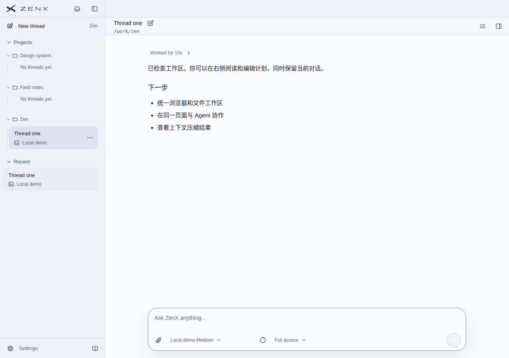 |

**深色，1280×900，短答与空 Composer。**

| 08559406 基线                                                                                                                                                                               | 715c140a 本轮                                                                                                                                                                                |
| ------------------------------------------------------------------------------------------------------------------------------------------------------------------------------------------- | -------------------------------------------------------------------------------------------------------------------------------------------------------------------------------------------- |
|  | 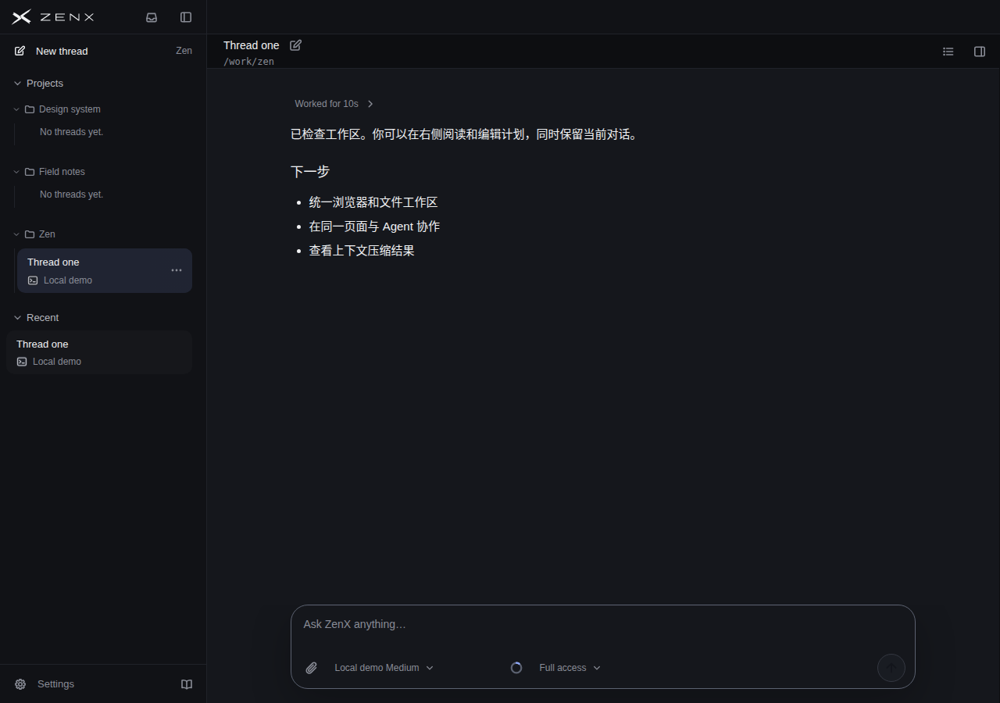 |

[精确源码、匹配条件与四图 SHA256 清单](https://github.com/albert-zen/zen/blob/6be7f7c6853c71684b6acc0877df59620615581f/docs/ui-quality/evidence/main-reading-715c140a/comparison-manifest.json)。生产组件＋合成对话；两主题整屏整数分未跨档，长文／代码／表格仍未证，不因截图成功推定完整交互通过。

**看见的变化：**正文和标题更大、段落与列表更舒展；浅色画布 `#f5f6fa→#fbfcff`，深色 `#0d0e11→#15171c`，阅读面更明确。Composer 宽 **840→800px**，左右各收20px，正文也移入同列；当前短答无额外换行、横向滚动或遮挡。Sidebar 与顶部区域逐像素相同。

**代价／未证：**Composer 与画布现同色，更依赖边框／阴影；松排版消耗纵向空间。当前只有短标题和三条列表，不能证明长文、代码、表格、复杂任务链、长草稿或焦点效果通过。暗色小元信息、图标含义及静息不可见消息操作仍限制整屏评分；不因无整数跨档而否认真实排版变化，也不为了涨分无限放大字号。

715c 丰富长文专项当时 **failed、0 PNG、1 renderer error**，不从 HTML 或预期用例补评分，也不能当作已经观察到产品长文失败。当时 b4ad 捕获 fixture 修正后仍遇到 workspaceBrowser.command 失败；后续丰富阅读新证据见顶部各准确源码节，不把这段历史失败当当前状态。

本轮五家参考原图已重新实看；下方保留可直接查看的原图及完整分项。主对话／Composer 同维参考：Codex视频20秒 **8/8/8/8/8**；Claude解释演示 **8/8/8/8/7**；Linear无对应对话场景 **N/O**；T3 #28840 实跑完成态 **8/7/8/8/7**；DSH fcc0ad4 生产预览 **8/8/8/8/7**。这是各自实际场景，不是同条件排名，且不拿 T3 Question 侧栏分套进单会话主图。

### 历史队列回程：32e12d51，相对 446b 的收益与代价

[本轮 12 张原图及源码／行为证据](https://github.com/albert-zen/zen/actions/runs/43018417117/artifacts/13854006397)（可能需登录，保留至 2026-11-18）。1280×900，浅深各 6 图，相同 2 Waiting＋6 After 合成 fixture，真实浏览器指针／键盘；非 native Electron、真实 Host 或发送验收。

**收益：**从 Composer 返回收回控件由 **31 次 Shift+Tab → 1 次**，随后 Enter 收回并将焦点直接返回 Composer。

**代价：**footer 高 45px，展开 tray 达 480px 上限并新增内部滚动。初始展开与 Edit 焦点仍有 8 条完整消息，但到 Composer／footer 焦点时 scrollTop=22，第一条 Waiting 被 sticky 标题挡住，**只有 7 条完整无遮挡**；几何字段仍计 8 是盲区，不能写“全程 8 条”。收回保留 scrollTop22，遮挡仍在，Check1 下缘还裁约 3.38px。Composer 仍在视口，但展开宽 840→830、下移约 1.69px，**不再是尺寸位置完全不变**；上方主对话空间也被压缩。

| 本轮实际状态             | 信息层级 | 可读性 | 注意力 | 一致性 | 交互线索 |
| ------------------------ | -------: | -----: | -----: | -----: | -------: |
| 静息，浅色               |        7 |      8 |      7 |      8 |        8 |
| 初始展开，浅色           |        8 |      8 |      8 |      8 |        8 |
| Edit焦点，浅色           |        8 |      8 |      8 |      8 |        8 |
| Composer焦点，浅色       |        7 |      7 |      7 |      8 |        8 |
| footer收回控件焦点，浅色 |        7 |      7 |      7 |      8 |        8 |
| 收回并回Composer，浅色   |        7 |      7 |      7 |      8 |        8 |
| 静息，深色               |        7 |      7 |      7 |      8 |        8 |
| 初始展开，深色           |        8 |      7 |      8 |      8 |        8 |
| Edit焦点，深色           |        8 |      7 |      8 |      8 |        8 |
| Composer焦点，深色       |        7 |      7 |      7 |      8 |        8 |
| footer收回控件焦点，深色 |        7 |      7 |      7 |      8 |        8 |
| 收回并回Composer，深色   |        7 |      7 |      7 |      8 |        8 |

正向 Edit→Composer 从 21→22 次 Tab，回程更短不意味着全链更短；初始展开 footer 的 hit=false，两处 Less space 连可访问名称也相同，未说明底部按钮会返回输入框。交互线索分不是按键次数公式，不能用 31→1 给未变化状态强行加分。最后一步 446b 聚焦顶部 toggle，本轮聚焦 Composer，也不是完全同焦点态的分数 A/B。其余未执行消息动作与完整无障碍不在本次通过范围。

五家参考对象的图／场景／分项保持各自来源，不因 Zen footer 变更而改分。对应新原图正在串行公开，当前可通过上面的真实 artifact 查看，**未把旧 446b 原图冒充 32e**。

### 60ddca31 当时 CI 快照：15 成功、2 运行中、0 失败（非当前 head）

17 个工作流中，本次回读已有 15 个成功；[主 CI 43015295502](https://github.com/albert-zen/zen/actions/runs/43015295502) 与 [Information full App 43015295261](https://github.com/albert-zen/zen/actions/runs/43015295261) 仍在运行，**尚未全量结束，不称全绿验收**。[Fullscreen](https://github.com/albert-zen/zen/actions/runs/43015295187)、[navigation](https://github.com/albert-zen/zen/actions/runs/43015295383)、主 UI 快图及队列专项均成功。旧失败的原因不因本轮成功而自动确定；独立视觉评分与运行通过也分别记录。

### 446b 历史 CI 快照：15 成功、2 失败（非当前 head 的结果）

本次核验该 SHA 的 **17 个工作流均已结束**。[主 CI](https://github.com/albert-zen/zen/actions/runs/43009644625) 成功，包括 macOS／Windows browser 与 Room journal；Information、主 UI 快图及队列阅读专项均成功。

仍失败两项：

- [Desktop navigation](https://github.com/albert-zen/zen/actions/runs/43009644565)：键盘回到 Projects／恢复展开断言失败，不能用已通过的部分步骤掩盖。
- [Fullscreen primary chat](https://github.com/albert-zen/zen/actions/runs/43009644585)：Chromium 部分通过，但原生 macOS 阅读前置断言失败。

**失败点不等于已确定根因**，不武断归因于 UI、夹具或平台；主 CI 成功也不代表上述两项已修复。PR 仍 Draft，不声称全面验收通过。

### 446b 历史队列阅读：同一界面的静息／展开／收回状态评分

五维仍为信息层级／可读性／注意力／一致性／交互线索；逐状态打分，不把状态差异伪装为版本提升。

| 实际桌面状态               | 信息层级 | 可读性 | 注意力 | 一致性 | 交互线索 |
| -------------------------- | -------: | -----: | -----: | -----: | -------: |
| 静息，浅色                 |        7 |      8 |      7 |      8 |        8 |
| 展开，浅色                 |        8 |      8 |      8 |      8 |        8 |
| 展开＋Edit焦点，浅色       |        8 |      8 |      8 |      8 |        8 |
| 展开＋Composer焦点，浅色   |        8 |      8 |      8 |      8 |        8 |
| 展开＋Less space焦点，浅色 |        8 |      8 |      8 |      8 |        8 |
| 收回，浅色                 |        7 |      8 |      7 |      8 |        8 |
| 静息，深色                 |        7 |      7 |      7 |      8 |        8 |
| 展开，深色                 |        8 |      7 |      8 |      8 |        8 |
| 展开＋Edit焦点，深色       |        8 |      7 |      8 |      8 |        8 |
| 展开＋Composer焦点，深色   |        8 |      7 |      8 |      8 |        8 |
| 展开＋Less space焦点，深色 |        8 |      7 |      8 |      8 |        8 |
| 收回，深色                 |        7 |      7 |      7 |      8 |        8 |

### 队列专项实际原图：446b8bd4，发表于 60ddca31

这 8 张是上述独立评分使用的真实原图，生产组件＋合成数据；不是设计稿，不对应后续 Send 修复的新版本评分。静息到展开完整可读行 **3→8**，Composer 保持原位；展开会让上方部分对话移出视野。

**浅色：静息 → 展开。**

| 静息                                                                                                                                                                                                        | 展开                                                                                                                                                                                                            |
| ----------------------------------------------------------------------------------------------------------------------------------------------------------------------------------------------------------- | --------------------------------------------------------------------------------------------------------------------------------------------------------------------------------------------------------------- |
| 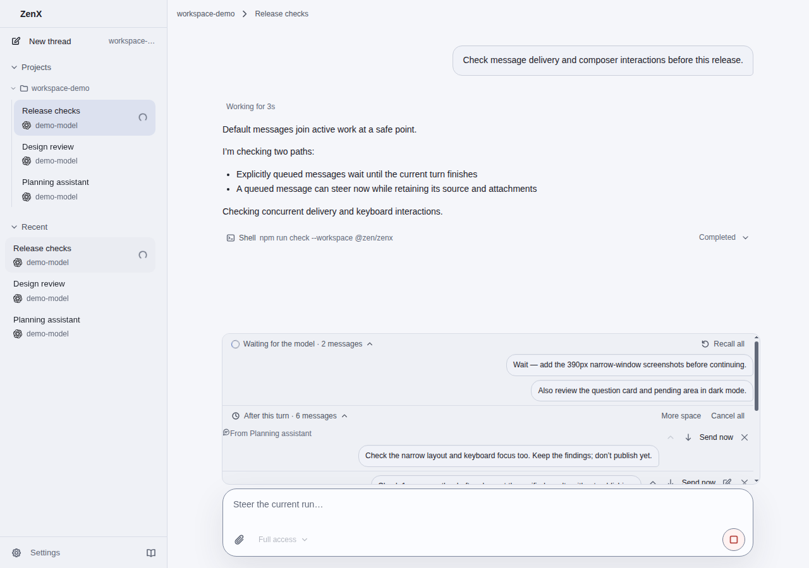 | 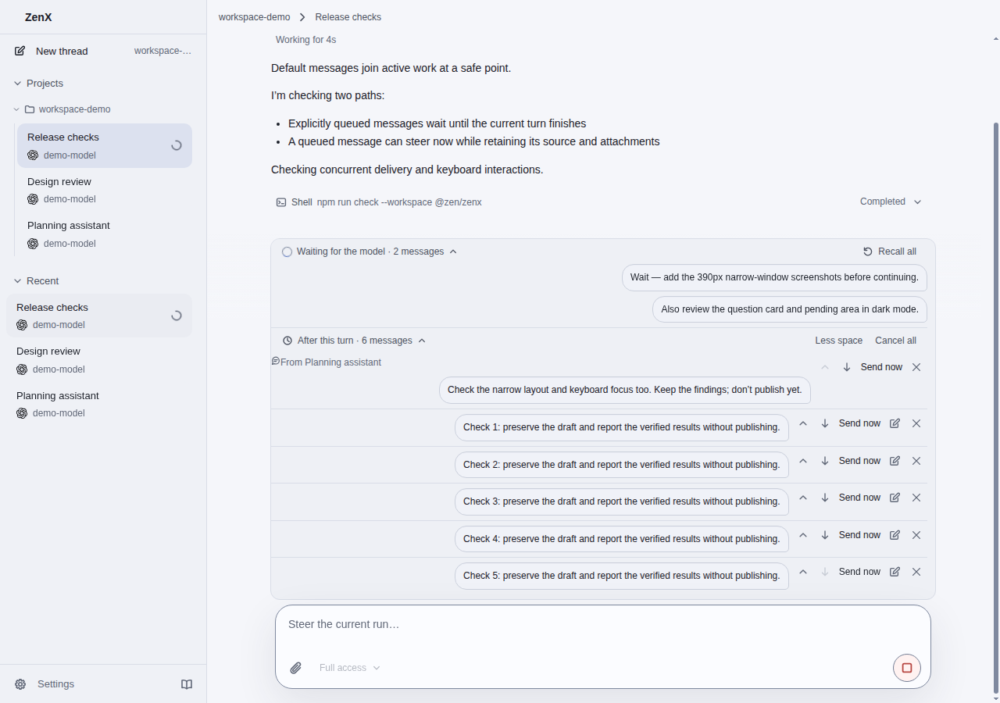 |

**浅色：Composer 焦点与 Less space 焦点，保留可达性成本而非只报通过。**

| Composer 焦点                                                                                                                                                                                                             | Less space 焦点                                                                                                                                                                                                                    |
| ------------------------------------------------------------------------------------------------------------------------------------------------------------------------------------------------------------------------- | ---------------------------------------------------------------------------------------------------------------------------------------------------------------------------------------------------------------------------------- |
| 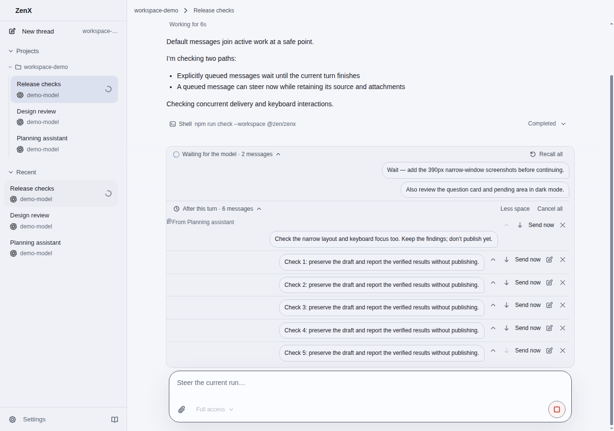 |  |

**深色：静息 → 展开。**

| 静息                                                                                                                                                                                                       | 展开                                                                                                                                                                                                           |
| ---------------------------------------------------------------------------------------------------------------------------------------------------------------------------------------------------------- | -------------------------------------------------------------------------------------------------------------------------------------------------------------------------------------------------------------- |
| 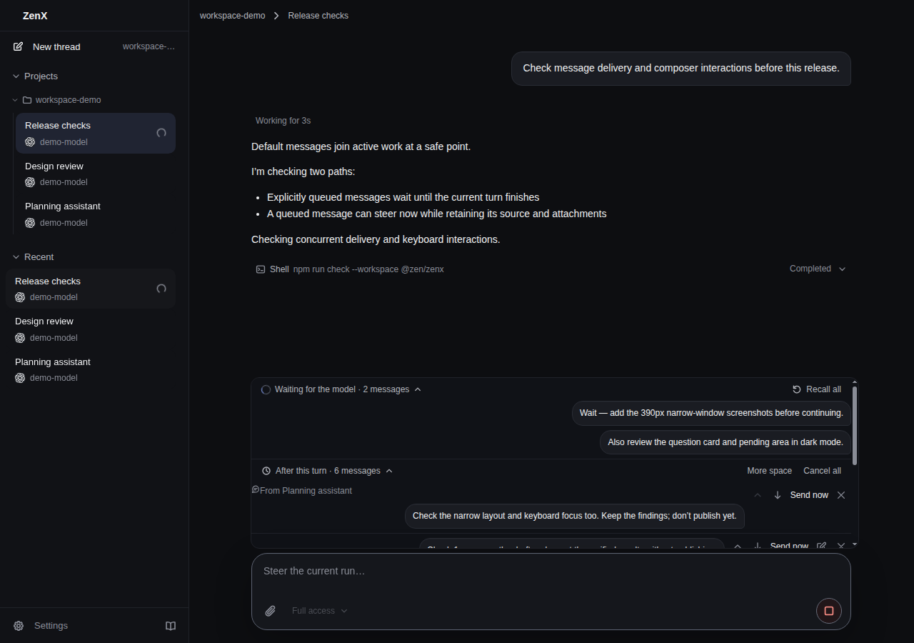 | 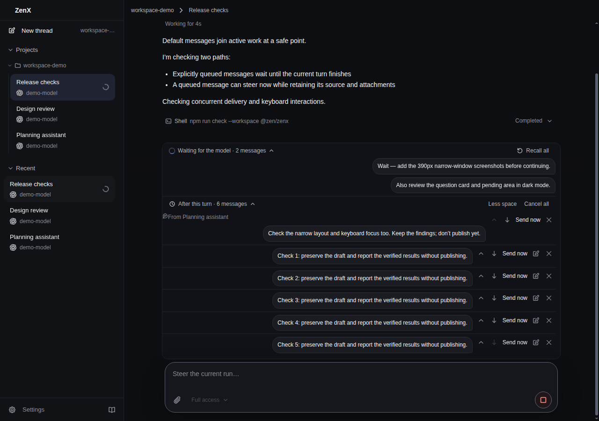 |

**深色：Composer 焦点与 Less space 焦点，保留可达性成本而非只报通过。**

| Composer 焦点                                                                                                                                                                                                            | Less space 焦点                                                                                                                                                                                                                   |
| ------------------------------------------------------------------------------------------------------------------------------------------------------------------------------------------------------------------------ | --------------------------------------------------------------------------------------------------------------------------------------------------------------------------------------------------------------------------------- |
|  | 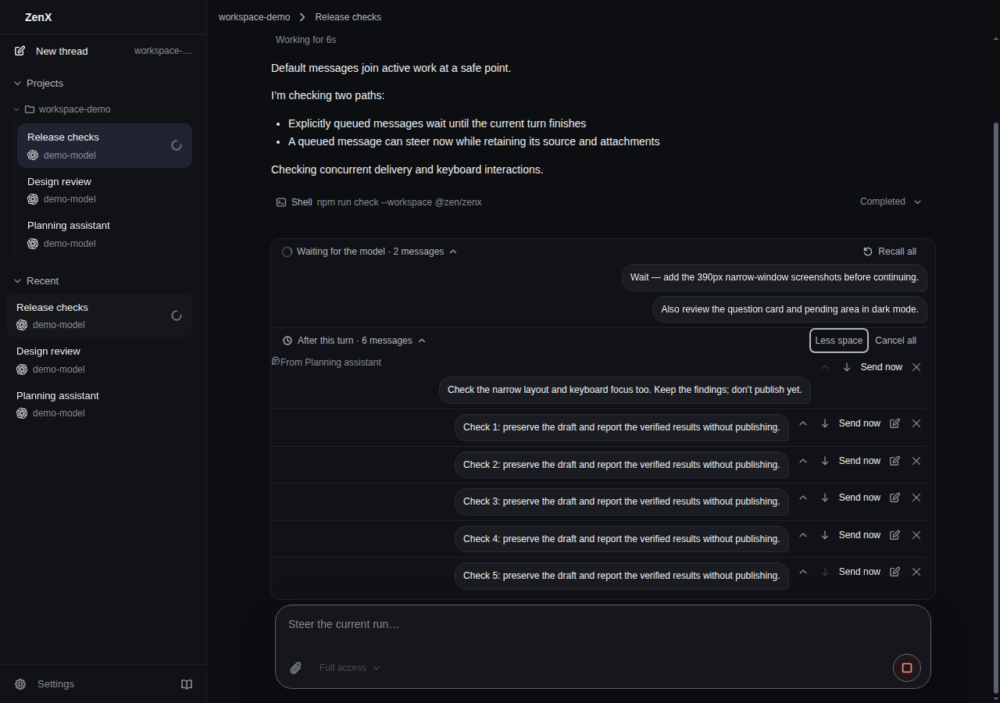 |

[准确源码、截图 SHA256 与边界清单](https://github.com/albert-zen/zen/blob/60ddca31666f2c3e43481d707df7312f74f0aea4/docs/ui-quality/evidence/desktop-queue-reading-446b8bd4/manifest.json)。Edit 焦点与收回的其余 4 张已评原图见顶部完整 12 图包；不得将静息／展开当成版本 A/B。

**446b 当时实际观察（不是32e全程结果）：**完整可读消息由 **3→8**（2 Waiting＋1 After→2＋6），不是记录字段 readableRows 所写的 4→8，后者把半行算入。12 步中 Composer 均为 840×108、y=774–882，没有被挤走；展开会让上方部分对话／用户原消息移出视野，这是真实取舍，不隐去。

**交互范围：**指针展开、Enter 收回有匹配脚本和状态记录；展开后到 Edit 要 10 次 Tab，再到 Composer 21 次，反向回 Less space 31 次，可达但成本高。键盘打开、编辑提交和其它真实消息动作未测，不声称全面键盘或发送验收。

主对话／资料卡的既有分数和五家参考图分保留。旧版 [navigation 43009644565](https://github.com/albert-zen/zen/actions/runs/43009644565) 为 failure；后续 2e 首次 navigation 已成功，且独立评审已完成（见2e节）。旧版浅色部分证据及当时 dark／最终恢复缺口保留在下方历史记录，不把队列专项成功写成全套通过。

**此前 6e6 已确认的变化，仅限无标题栏合成宿主中的资料卡：**面板整体下移 40px，Close information 不再被浮动按钮遮挡；正文、长名换行、Archived 强背景未变。浅／深色均为 **7／7／6／7／6 → 7／7／7／7／7**，只提升注意力与可见交互线索。主对话及队列分数不变。不能宣称修复正常 App 的普遍问题。

**后续补证：**2e 已完成浅深限定导航闭环及独立评审，含 Projects 折叠／恢复、Recent 回退、资料打开／关闭回焦；未覆盖事项详见最新导航节。旧 6e6 正常标题栏图仍未打开面板，不将后续场景分套回旧图。

[6e6c6bbd 资料卡修复轮原图包及来源](https://github.com/albert-zen/zen/actions/runs/42998240757/artifacts/13845445908) · [306b7029 匹配基线图包](https://github.com/albert-zen/zen/actions/runs/42991175084/artifacts/13841254473)。并排打开 `information-desktop-light.png` 与 `information-desktop-dark.png`，不要把正常标题栏未打开面板的图当成资料卡验收。图包可能需登录，保留至 2026-11-18。**6e6 资料卡浅／深原图与 T3 静息队列图已发布，现直接显示于对应评分旁。**下方主对话／队列直显图仍标 306b7029，首个五维表已更新为 6e6→d332 静息匹配对照；不等待完整 CI 才做视觉反馈。PR 仍 Draft，不等于全应用验收。

### 最新正常标题栏导航独立评审：2e9396d7，浅深 16 图

准确源码 `2e9396d7cd45415e44b9f9dbc795a423a750bf83`，1280×900、fine pointer／hover、浏览器沙箱开启，生产标题栏／Information／Sidebar＋只读合成 bridge。不是完整原生 Electron、真实 Host 或真实账号验收。

[16 张原图与证据包](https://github.com/albert-zen/zen/actions/runs/43014523256/artifacts/13851524272)（可能需登录，保留至 2026-11-18）。以下链接指向完整包，文件名标在场景后。**七张匹配浅色图与 376 字节完全相同，原分不变；新深色／恢复场景只有现态分，不编造前后提升。**

| 实际截图／评价区域                                                                                                                                                                                                                                                                                               | 信息层级 | 可读性 | 注意力 | 一致性 | 交互线索 |
| ---------------------------------------------------------------------------------------------------------------------------------------------------------------------------------------------------------------------------------------------------------------------------------------------------------------- | -------: | -----: | -----: | -----: | -------: |
| [浅色projects-current：完整主窗，有合成草稿（navigation-desktop-light-projects-current.png）](https://github.com/albert-zen/zen/actions/runs/43014523256/artifacts/13851524272)                                                                                                                                  |        8 |      8 |      8 |      8 |        7 |
| [浅色information-open：右资料区域（navigation-desktop-light-titlebar-information-open.png）](https://github.com/albert-zen/zen/blob/258042b03f7aa4e33dd447936bda901f4176f945/docs/ui-quality/evidence/desktop-navigation-2e9396d7/navigation-desktop-light-titlebar-information-open.png?raw=true)               |        7 |      8 |      8 |      8 |        7 |
| [浅色information-close-focus：同资料区域＋Close焦点（navigation-desktop-light-information-close-focus.png）](https://github.com/albert-zen/zen/blob/258042b03f7aa4e33dd447936bda901f4176f945/docs/ui-quality/evidence/desktop-navigation-2e9396d7/navigation-desktop-light-information-close-focus.png?raw=true) |        7 |      8 |      8 |      8 |        8 |
| [浅色escape-return-focus：完整主窗＋入口可见焦点（navigation-desktop-light-escape-return-focus.png）](https://github.com/albert-zen/zen/actions/runs/43014523256/artifacts/13851524272)                                                                                                                          |        8 |      8 |      8 |      8 |        7 |
| [浅色close-return-focus：指针Close后完整主窗（navigation-desktop-light-close-return-focus.png）](https://github.com/albert-zen/zen/actions/runs/43014523256/artifacts/13851524272)                                                                                                                               |        8 |      8 |      8 |      8 |        7 |
| [浅色recent-fallback：折叠后Sidebar局部（navigation-desktop-light-recent-fallback.png）](https://github.com/albert-zen/zen/actions/runs/43014523256/artifacts/13851524272)                                                                                                                                       |        8 |      8 |      8 |      8 |        8 |
| [浅色recent-keyboard-focus：Sidebar焦点局部（navigation-desktop-light-recent-keyboard-focus.png）](https://github.com/albert-zen/zen/actions/runs/43014523256/artifacts/13851524272)                                                                                                                             |        8 |      8 |      8 |      8 |        8 |
| [浅色projects-restored：恢复展开的Sidebar局部（navigation-desktop-light-projects-restored.png）](https://github.com/albert-zen/zen/blob/258042b03f7aa4e33dd447936bda901f4176f945/docs/ui-quality/evidence/desktop-navigation-2e9396d7/navigation-desktop-light-projects-restored.png?raw=true)                   |        8 |      8 |      8 |      8 |        8 |
| [深色projects-current：完整主窗，有合成草稿（navigation-desktop-dark-projects-current.png）](https://github.com/albert-zen/zen/actions/runs/43014523256/artifacts/13851524272)                                                                                                                                   |        8 |      7 |      8 |      8 |        7 |
| [深色information-open：右资料区域（navigation-desktop-dark-titlebar-information-open.png）](https://github.com/albert-zen/zen/blob/258042b03f7aa4e33dd447936bda901f4176f945/docs/ui-quality/evidence/desktop-navigation-2e9396d7/navigation-desktop-dark-titlebar-information-open.png?raw=true)                 |        7 |      7 |      8 |      8 |        7 |
| [深色information-close-focus：同资料区域＋Close焦点（navigation-desktop-dark-information-close-focus.png）](https://github.com/albert-zen/zen/blob/258042b03f7aa4e33dd447936bda901f4176f945/docs/ui-quality/evidence/desktop-navigation-2e9396d7/navigation-desktop-dark-information-close-focus.png?raw=true)   |        7 |      7 |      8 |      8 |        8 |
| [深色escape-return-focus：完整主窗＋入口可见焦点（navigation-desktop-dark-escape-return-focus.png）](https://github.com/albert-zen/zen/actions/runs/43014523256/artifacts/13851524272)                                                                                                                           |        8 |      7 |      8 |      8 |        7 |
| [深色close-return-focus：指针Close后完整主窗（navigation-desktop-dark-close-return-focus.png）](https://github.com/albert-zen/zen/actions/runs/43014523256/artifacts/13851524272)                                                                                                                                |        8 |      7 |      8 |      8 |        7 |
| [深色recent-fallback：折叠后Sidebar局部（navigation-desktop-dark-recent-fallback.png）](https://github.com/albert-zen/zen/actions/runs/43014523256/artifacts/13851524272)                                                                                                                                        |        8 |      7 |      8 |      8 |        8 |
| [深色recent-keyboard-focus：Sidebar焦点局部（navigation-desktop-dark-recent-keyboard-focus.png）](https://github.com/albert-zen/zen/actions/runs/43014523256/artifacts/13851524272)                                                                                                                              |        8 |      7 |      8 |      8 |        8 |
| [深色projects-restored：恢复展开的Sidebar局部（navigation-desktop-dark-projects-restored.png）](https://github.com/albert-zen/zen/blob/258042b03f7aa4e33dd447936bda901f4176f945/docs/ui-quality/evidence/desktop-navigation-2e9396d7/navigation-desktop-dark-projects-restored.png?raw=true)                     |        8 |      7 |      8 |      8 |        8 |
| 浅色recent-keyboard-focus图里的**Thread one元资料预览卡局部**                                                                                                                                                                                                                                                    |        7 |      8 |      7 |      8 |        7 |
| 深色recent-keyboard-focus图里的同一元资料预览卡局部                                                                                                                                                                                                                                                              |        7 |      7 |      7 |      8 |        7 |

### 2e9396d7 导航实际原图：对应上表场景，非最新 footer 评分

**正常标题栏资料打开**

| 浅色                                                                                                                                                                                                                                  | 深色                                                                                                                                                                                                                                 |
| ------------------------------------------------------------------------------------------------------------------------------------------------------------------------------------------------------------------------------------- | ------------------------------------------------------------------------------------------------------------------------------------------------------------------------------------------------------------------------------------ |
|  | 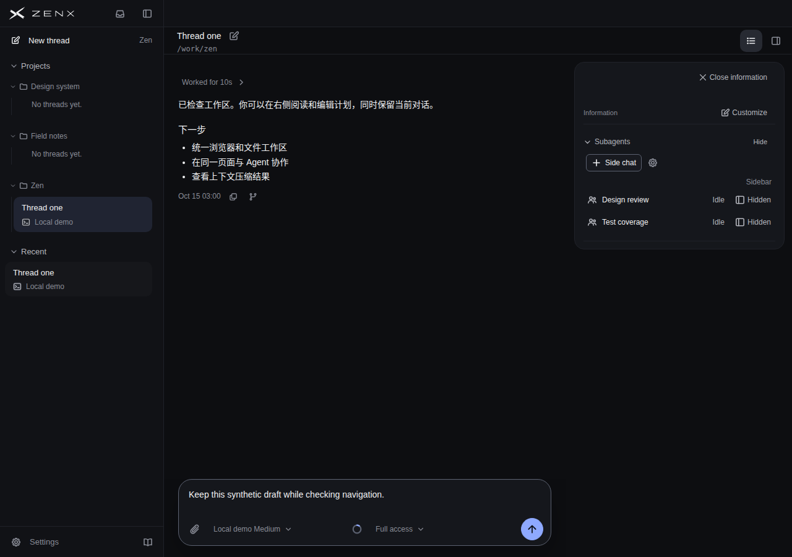 |

**Close 键盘聚焦**

| 浅色                                                                                                                                                                                                                            | 深色                                                                                                                                                                                                                           |
| ------------------------------------------------------------------------------------------------------------------------------------------------------------------------------------------------------------------------------- | ------------------------------------------------------------------------------------------------------------------------------------------------------------------------------------------------------------------------------ |
|  | 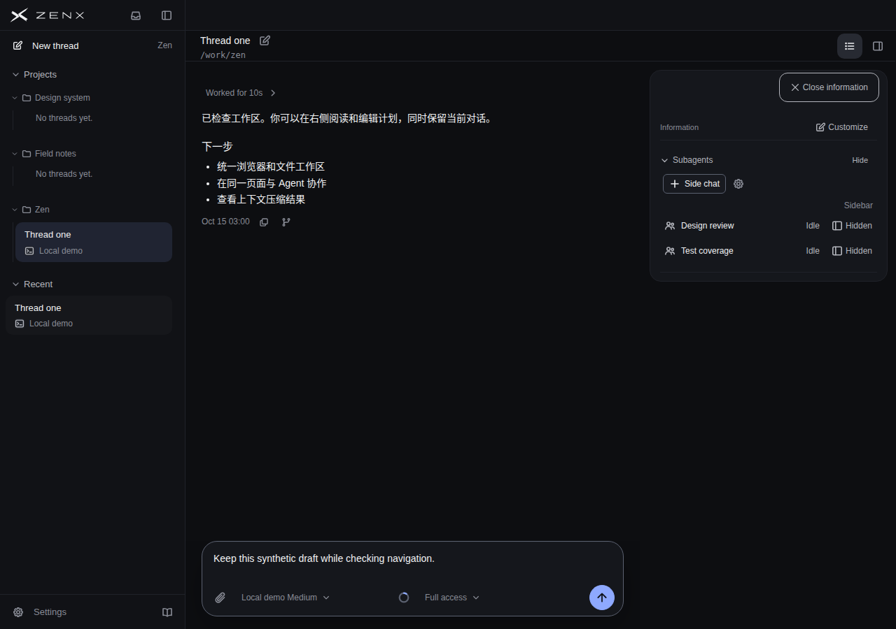 |

**Projects 焦点与 Enter 恢复展开**

| 浅色                                                                                                                                                                                                                                      | 深色                                                                                                                                                                                                                                     |
| ----------------------------------------------------------------------------------------------------------------------------------------------------------------------------------------------------------------------------------------- | ---------------------------------------------------------------------------------------------------------------------------------------------------------------------------------------------------------------------------------------- |
| 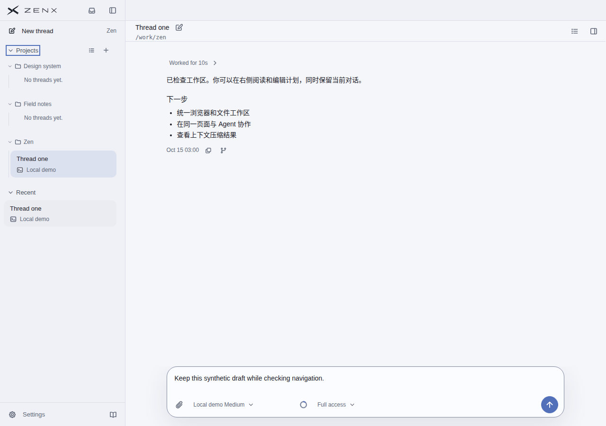 | 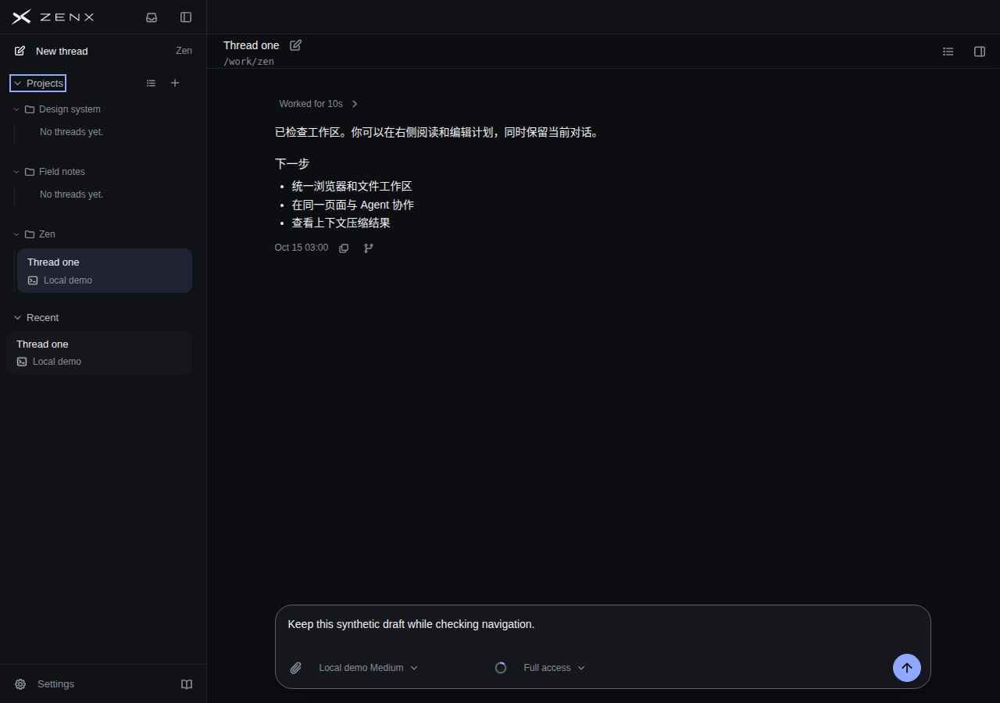 |

[精确源码、运行、原图哈希与范围清单](https://github.com/albert-zen/zen/blob/258042b03f7aa4e33dd447936bda901f4176f945/docs/ui-quality/evidence/desktop-navigation-2e9396d7/manifest.json)。生产组件＋只读合成 bridge。这里的 Close 图是键盘焦点，不是指针点击后的 focus-visible；Projects 恢复为实际 Enter 目标正确且 expanded false→true。匹配旧浅色图没有像素改善，不以新发布图片宣称涨分。其余 10 张原图见完整 16 图包。

**已验证限定路径，两主题：**pointer 开资料 → Tab 到 Close → Escape 回入口 → 入口 Enter 重开 → pointer Close → Projects Enter 折叠 → Recent Tab → 回 Projects 后 Enter 恢复。末次 Enter 真实目标为 Projects，expanded false→true；16 步合成草稿保持，无写入／线程或 side chat 创建。Recent 上的 Enter 激活当前同一会话，**不是其它会话切换**。Close 点击后入口 focused=true 但 focusVisible=false，与键盘 Close 焦点图区分。

**未测：**Close Enter／Space、入口 Space、完整反向 Shift+Tab、Recent 分组自身折叠、单个项目折叠、其它线程切换、元资料编辑／保存／读屏、正常标题栏长名压力及真实 Host／native。两个位置仍记录 aria-current=page，视觉主次已看见，不等于读屏唯一当前位置已验证。

Recent 焦点图实际有 Thread one 元资料浮层（不是 Information），部分属性为合成 Unavailable；不能推断真实资料缺失。Projects 恢复时该浮层消失。恢复成功新增了行为证据，**不倒写 376 的最后 Enter 落在 Recent 的历史失败**。

376c 与 30952 历史部分失败导航证据（保留原图与当时结论）

### 正常标题栏与折叠回退：376c3d95（7 张浅色图，末步失败）

[本轮 7 张实际原图与 source／evidence](https://github.com/albert-zen/zen/actions/runs/43005902871/artifacts/13848047798)（可能需登录，保留至 2026-11-18）。独立逐图评审且 SHA 一致；不是把新场景分数套回 6e6 长名卡，也不是将夹具修正写作生产设计改善。

| 实际场景／评分区域                                       | 信息层级 | 可读性 | 注意力 | 一致性 | 交互线索 |
| -------------------------------------------------------- | -------: | -----: | -----: | -----: | -------: |
| 初始含草稿完整主窗                                       |        8 |      8 |      8 |      8 |        7 |
| Escape 关闭并回焦完整主窗                                |        8 |      8 |      8 |      8 |        7 |
| 正常标题栏右资料区，无 Loading 错误                      |        7 |      8 |      8 |      8 |        7 |
| Close 聚焦的右资料区域                                   |        7 |      8 |      8 |      8 |        8 |
| Projects 折叠后 Recent 主选中，Sidebar 局部              |        8 |      8 |      8 |      8 |        8 |
| 同一回退项 Tab 聚焦，Sidebar 局部                        |        8 |      8 |      8 |      8 |        8 |
| 最后画面 Thread one 元资料预览卡局部（不是 Information） |        7 |      8 |      7 |      8 |        7 |

**本轮确认：**初始与 Escape 图和 30952 字节相同，主窗分不变。Enter 重开有可信状态记录，但没有单独第八张图；Close 点击后返回焦点 `focused=true`、`focusVisible=false`，不能称该点击后截图出现焦点环。Projects 折叠后 Recent 回退选中及 Tab 聚焦已实测；有焦点的 Close 图与点击后的焦点样式不能混为一谈。

**尚未通过：**末步 Enter 实际落在 Recent，而非 Projects，弹出 Thread one 元资料预览，遮住部分主对话且出现两项 Unavailable；尽管状态字段 `navigationCases.popover=null`，可见图片确实有该卡，不忽略像素事实。最终恢复断言失败，不能称 Projects 已重新展开；dark／其他折叠路径未覆盖。Loading failed 消失是合成响应修正，不能宣称真实资料加载和完整 App 行为因此通过。

376c 七张已发布原图（浅色部分旅程，最后恢复失败）

**初始Projects展开、当前项与草稿**

**正常标题栏资料打开**

**Close聚焦**
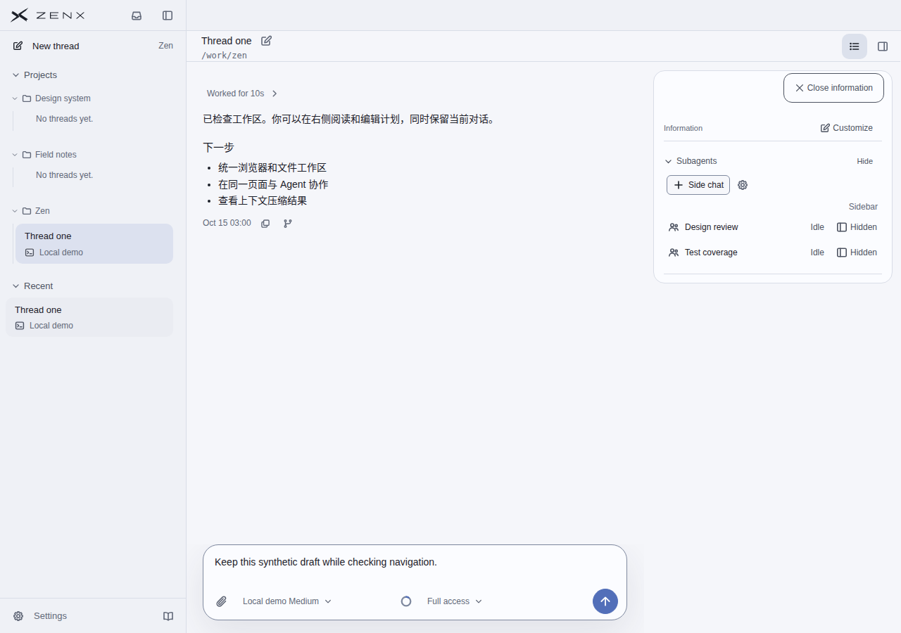

**Escape关闭返回焦点**

**Close点击返回焦点，非focus-visible**
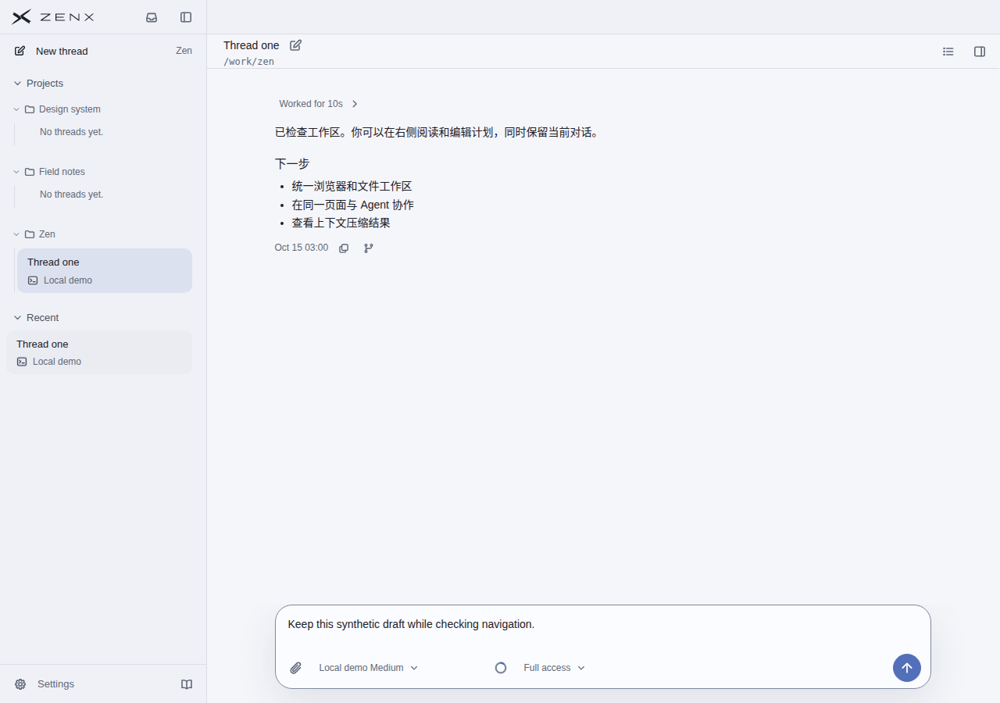

**Projects折叠后Recent回退**
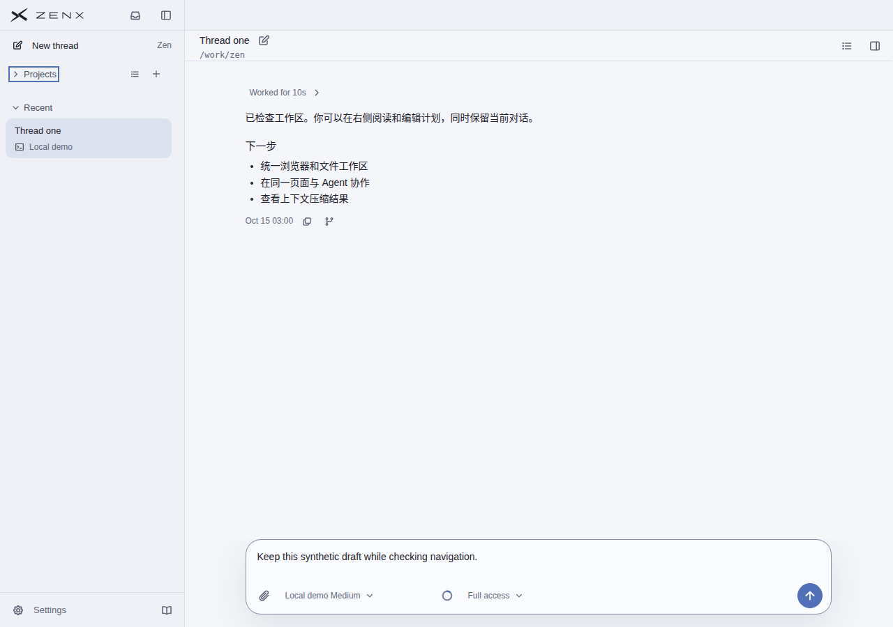

**Recent Tab聚焦及末步元资料预览**
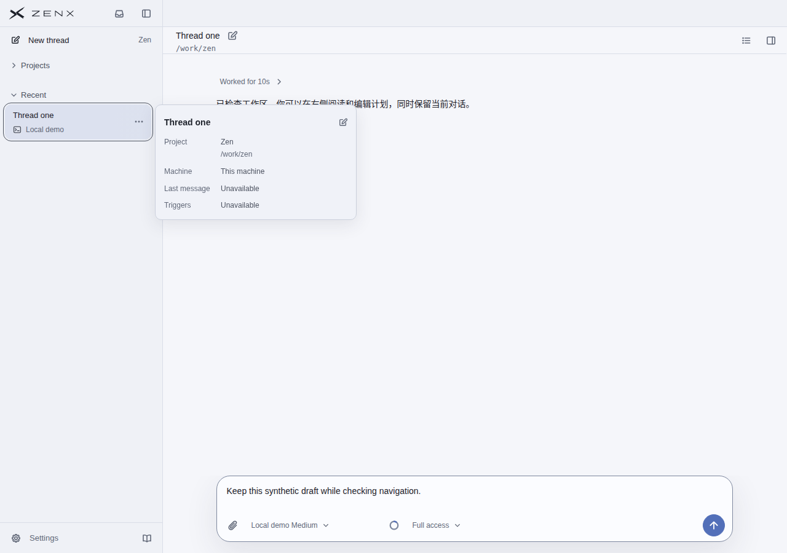

[原图、源码与失败边界清单](https://github.com/albert-zen/zen/blob/809c8665ed64f7d1c5c010e980c9635752d9bb2d/docs/ui-quality/evidence/desktop-navigation-376c3d95/manifest.json)。Enter 重开有状态记录，没有额外第八张图；不把这批部分证据称为全通过。

30952 首轮失败的历史部分证据（不代表376c当前结果）

### 新增正常标题栏部分证据：30952dba（整体失败，不是旧长名卡加分）

[4 张实际原图及证据包](https://github.com/albert-zen/zen/actions/runs/43004064563/artifacts/13847147997)（可能需登录，保留至 2026-11-18）。已逐张查看并核对 SHA；下表是**新实际场景单独评分**，不能与 6e6 无标题栏长名卡直接求差。

| 正常标题栏浅色实际场景／评分范围     | 信息层级 | 可读性 | 注意力 | 一致性 | 交互线索 |
| ------------------------------------ | -------: | -----: | -----: | -----: | -------: |
| projects-current，含草稿全窗         |        8 |      8 |      8 |      8 |        7 |
| 已打开右资料区：短名＋Loading failed |        7 |      8 |      7 |      8 |        7 |
| Close 聚焦：右资料区域               |        7 |      8 |      8 |      8 |        8 |
| Escape 关闭并回焦：全窗              |        8 |      8 |      8 |      8 |        7 |
| Sidebar 局部                         |        8 |      8 |      8 |      8 |        7 |

**已观察／验证：**标题栏与 dock 间隔 12px，无可见叠压；Close 焦点环可见；Escape 后面板关闭、焦点返回且草稿保留。**未通过或未覆盖：**图中明确 Loading failed／Retry，不能说资料加载成功；Close 仅聚焦，未证明激活关闭；Enter 复开等待超时导致整体失败；dark 与 Projects／当前项目／Recent 折叠场景未拍。不会隐藏失败图来声称交互全通过。

### Zen 桌面产品截图（1280×900，源码 306b7029 的本轮原图）

**主对话与 Sidebar · 浅色：对应本轮整体层级 7→8。**
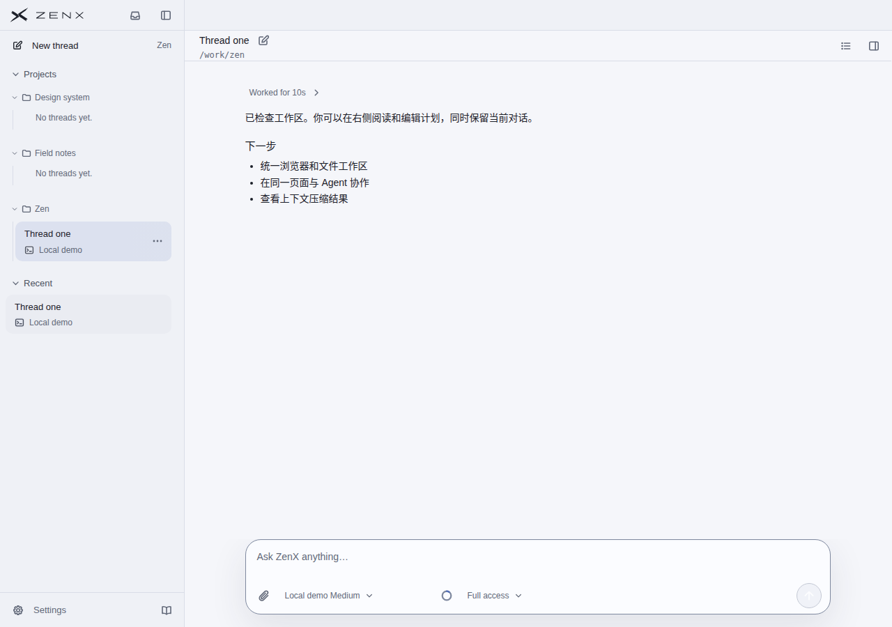

**主对话与 Sidebar · 深色：对应本轮整体层级 7→8。**
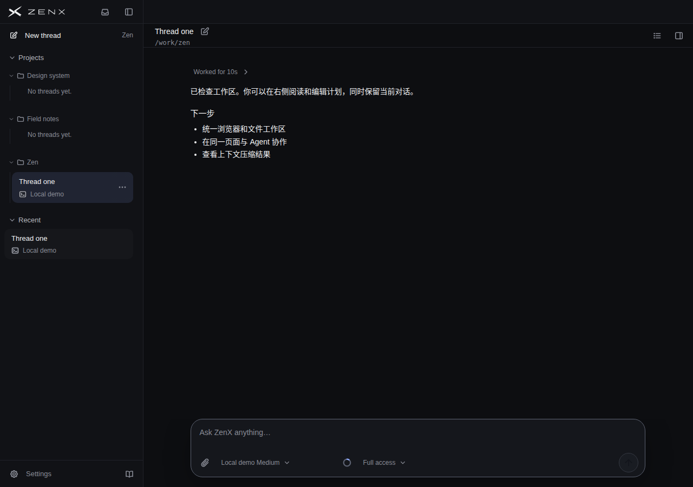

**队列键盘焦点 · 浅色：五维 8／8／8／8／8，与基线持平。**
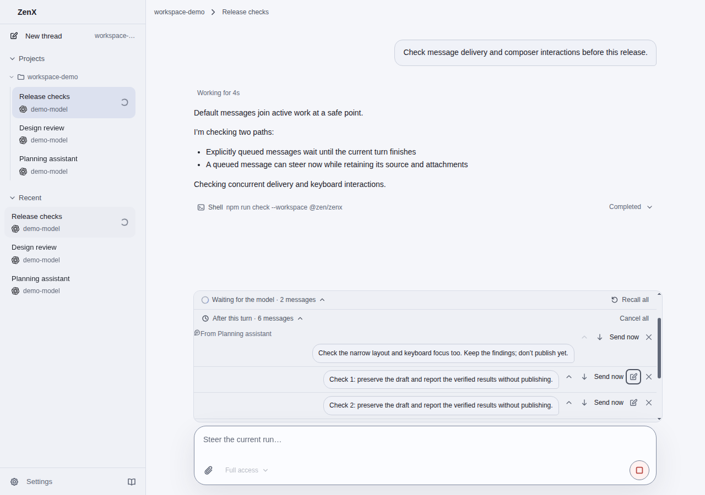

**队列键盘焦点 · 深色：五维 8／7／8／8／8，与基线持平。**
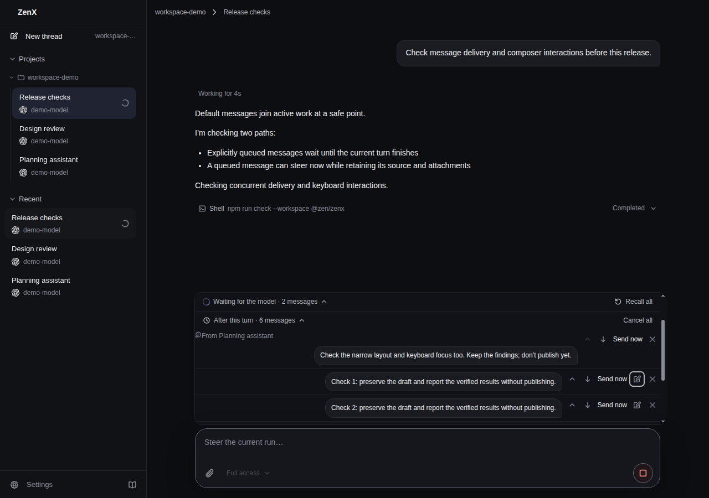

[本轮原图、准确源码与 SHA256 清单](https://github.com/albert-zen/zen/blob/4ebdb869899269f2e309609073de11fdd0b15e27/docs/ui-quality/evidence/main-desktop-306b7029/manifest.json)。生产组件＋合成数据，不是完整原生应用验收；仅展开态经过本组视觉验证。默认队列及资料卡本轮图可在上方 306b7029 原图包中打开对应文件。

保留的旧版 4e856526 图（不是本轮侧栏证据）

### Zen 桌面产品截图（1280×900，4e856526 已公开原图；非本轮新图）

**主对话与侧边栏**
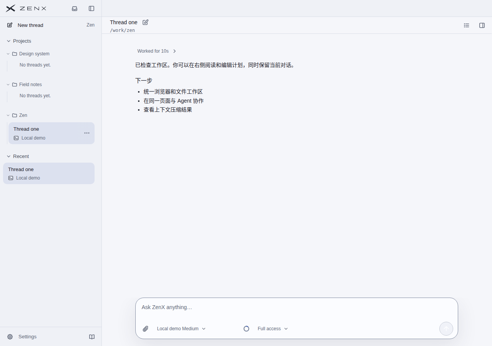

**队列默认状态**
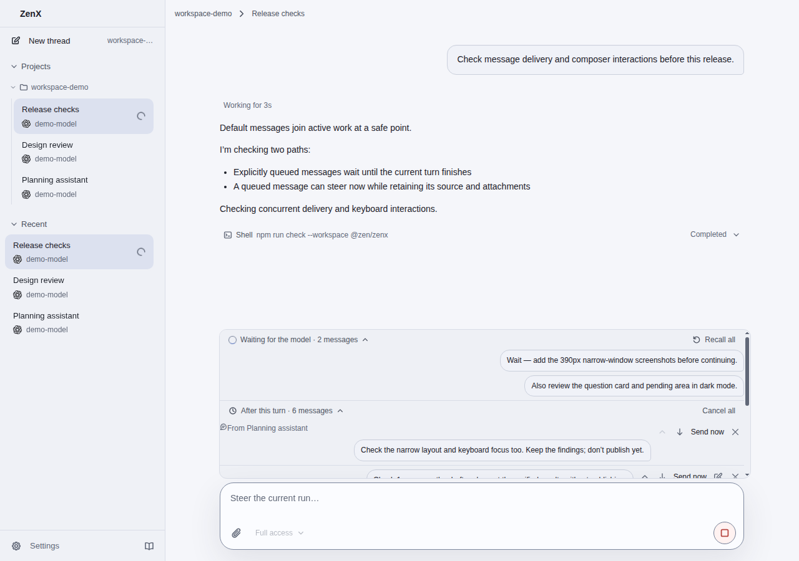

**队列键盘焦点状态**
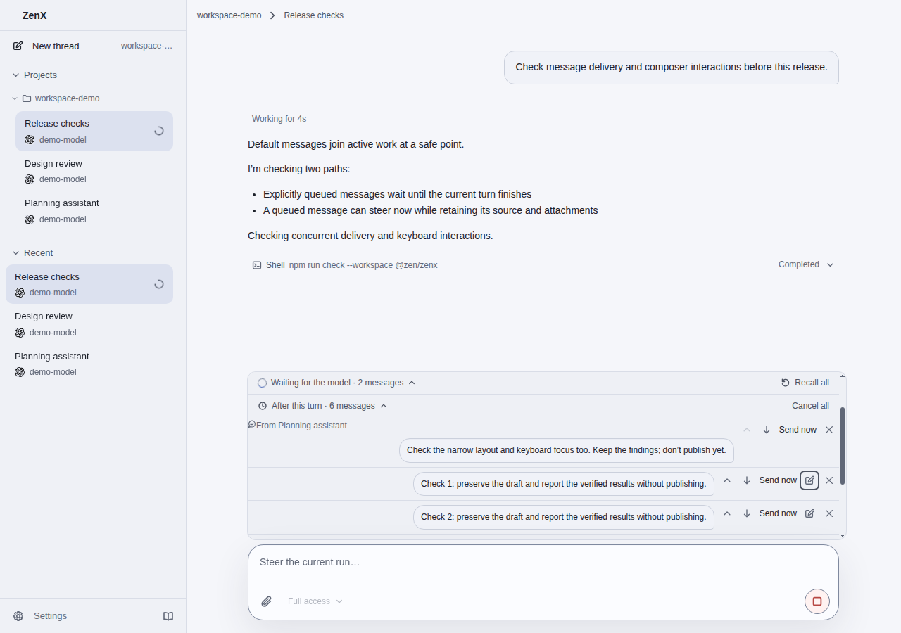

**对话资料卡：生产信息组件＋合成外框**
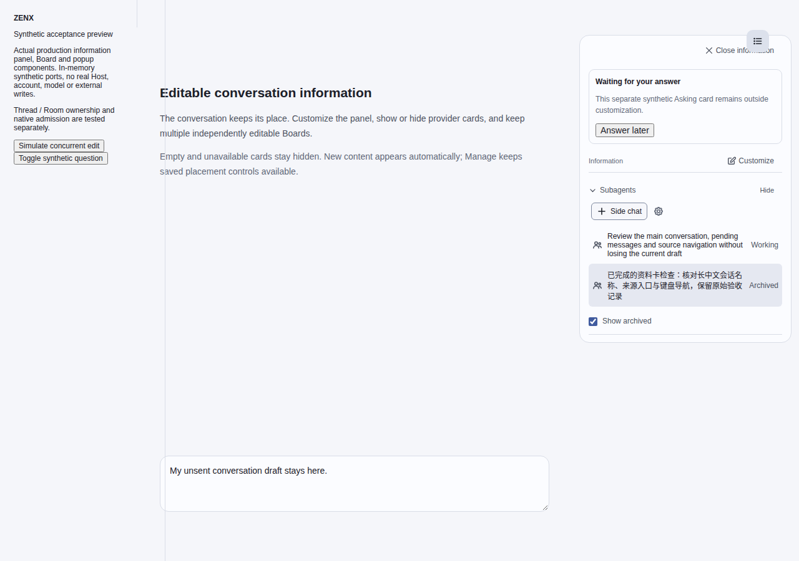

资料卡外框、左侧说明和测试按钮属于合成宿主，不计作真实 App 外观；右上关闭入口叠压单列为宿主集成问题。[原图与 SHA256 来源清单](https://github.com/albert-zen/zen/blob/d2a24f878a8086f804db6cd8f15bed40983df98b/docs/ui-quality/evidence/main-desktop-4e856526/manifest.json)。

### 本轮资料卡匹配原图：6e6c6bbd

**浅色，无标题栏合成宿主：五维 7／7／7／7／7。**
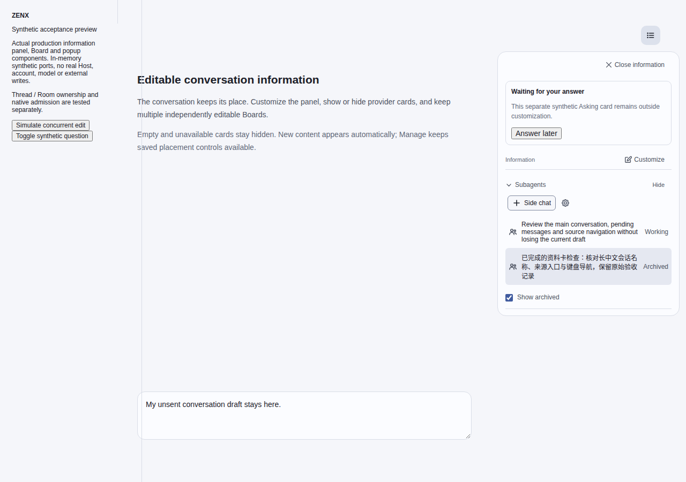

**深色，同一宿主条件：五维 7／7／7／7／7。**
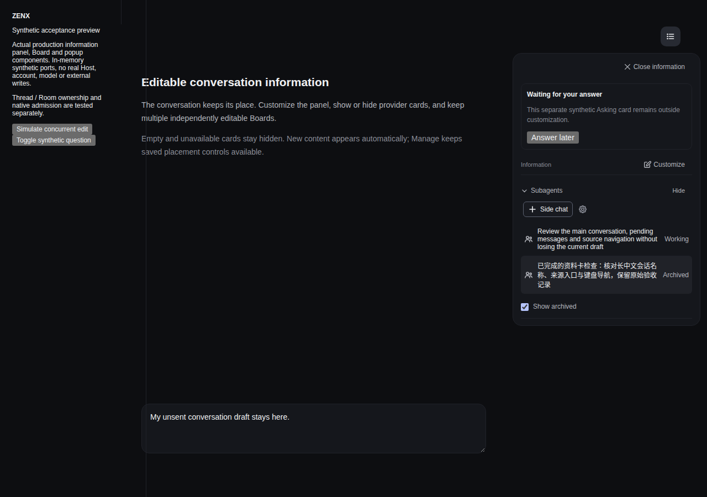

[本轮捕获、源码与原图哈希清单](https://github.com/albert-zen/zen/blob/d60206bbd715950a8606d4a944c626b09c0aa288/docs/ui-quality/evidence/information-desktop-6e6c6bbd/manifest.json)。与 306b 同场景相比，仅注意力和可见交互线索各加 1 分；正常标题栏打开态、关闭行为与 Tab 未观察，不能扩大此结论。

### Zen 每项评分：10 分制，五维独立

下表保留 **6e6c6bbd → d332d163** 的同场景静息独立复评，10 张桌面图分数持平。资料卡只限无标题栏合成宿主；后续 446b 的展开／收回补证已在顶部独立逐状态表列出，不更改这张历史匹配表。分数为主观视觉设计判断，不是测试通过率；评审未给目标分数，不合并总分。

| 桌面场景                     | 信息层级 | 可读性 | 注意力 | 一致性 | 交互线索 |
| ---------------------------- | -------- | ------ | ------ | ------ | -------- |
| 主对话／Sidebar，浅色        | 8→8      | 8→8    | 8→8    | 8→8    | 6→6      |
| 主对话／Sidebar，深色        | 8→8      | 7→7    | 8→8    | 8→8    | 6→6      |
| 队列默认，浅色               | 7→7      | 8→8    | 7→7    | 8→8    | 8→8      |
| 队列默认，深色               | 7→7      | 7→7    | 7→7    | 8→8    | 8→8      |
| 队列 hover，浅色             | 7→7      | 8→8    | 7→7    | 8→8    | 7→7      |
| 队列 hover，深色             | 7→7      | 7→7    | 7→7    | 8→8    | 7→7      |
| 队列 focus，浅色             | 8→8      | 8→8    | 8→8    | 8→8    | 8→8      |
| 队列 focus，深色             | 8→8      | 7→7    | 8→8    | 8→8    | 8→8      |
| 资料卡，无标题栏合成宿主浅色 | 7→7      | 7→7    | 7→7    | 7→7    | 7→7      |
| 资料卡，无标题栏合成宿主深色 | 7→7      | 7→7    | 7→7    | 7→7    | 7→7      |

桌面下一步：补侧栏折叠回退态证据；资料卡 Archived 视觉权重；队列默认阅读容量及完整上下文。展开态双强高亮已降权，不再列为未改动。

### 参考产品逐对象、逐项评分

所有对象均用 1–10 五维。**V＝已查看官方像素；D＝仅官方文档；N/O＝缺对应像素或证据不足，不是 0 分。** 各行只评价注明的场景／区域，一致性指画面内，交互线索只指可见线索。官方图的状态、内容和分辨率不一致，下面不是同条件排行榜，不求跨产品总分。深色或 hover 图若未单独公开，链接打开完整原始图包，文件名随链接标出。

## B. Sidebar：同维度、限导航区域的评分

这一表只评价各图中的导航局部，不是沿用上表整个主界面的分数。T3是运行会话导航，Codex是历史新会话空态旁的导航，Linear是官方局部放大对照图。任务类型类似，但不是同数据压力测试。

| 对象、实际场景与证据                                                                                                                                                                                      | 信息层级 | 可读性 | 注意力 | 一致性 | 交互线索 |
| --------------------------------------------------------------------------------------------------------------------------------------------------------------------------------------------------------- | -------: | -----: | -----: | -----: | -------: |
| Zen 306b7029，浅色Sidebar局部，[本轮原图](https://github.com/albert-zen/zen/blob/4ebdb869899269f2e309609073de11fdd0b15e27/docs/ui-quality/evidence/main-desktop-306b7029/main-desktop-light.png?raw=true) |        8 |      8 |      8 |      8 |        7 |
| Zen 306b7029，深色Sidebar局部，[本轮原图](https://github.com/albert-zen/zen/blob/4ebdb869899269f2e309609073de11fdd0b15e27/docs/ui-quality/evidence/main-desktop-306b7029/main-desktop-dark.png?raw=true)  |        8 |      7 |      8 |      8 |        7 |
| Codex，历史新会话图左栏，V，[官方原图](https://developers.openai.com/images/blog/long-horizon-4.jpeg)、[出处](https://developers.openai.com/blog/run-long-horizon-tasks-with-codex)                       |        8 |      7 |      8 |      8 |        7 |
| Codex，官方演示视频20秒帧Sidebar，V，[官方视频](https://cdn.openai.com/devhub/videos-learn/proactive-teammate-v2-1080p-v1.mp4)、[出处](https://learn.chatgpt.com/docs/app)                                |        8 |      8 |      8 |      8 |        7 |
| Claude Code，官网解释演示的Sidebar局部，V，[原图见下方](#claude-官方交互演示现场截图)、[官网出处](https://claude.com/product/claude-code)                                                                 |        8 |      7 |      8 |      8 |        7 |
| Linear，官方对照图右侧导航局部，V，[设计说明含原图](https://linear.app/now/behind-the-latest-design-refresh)                                                                                              |        8 |    N/O |      8 |      8 |        7 |
| T3 Code，运行会话左栏，V，[官方原图](https://t3.codes/_astro/app-desktop.BHuzLVLF.webp)、[出处](https://t3.codes/)                                                                                        |        8 |      7 |      7 |      8 |        7 |
| DeepSeek Harness，官方网页完成态演示Sidebar，V，[出处](https://www.deepseek.com/en/harness/)                                                                                                              |        8 |      7 |      8 |      8 |        7 |

### 实际用于评分的官方参考原图

下列图与本轮评审所看图片一致，不换图套分。均保留原作者归属及官方出处；未发现单独开放图片许可，**不声明可自由再分发，也不以 Zen 软件许可证覆盖这些第三方素材**。通过官方图片 URL 嵌入，仅用于有限设计比较与评论。若外站图片不加载，可打开其原图／出处链接。

**Codex · OpenAI：历史新会话空态及 Sidebar。** 只对图中空态和左栏打分，不推断运行对话、队列或资料卡。与上方 Zen 主对话图比较的是导航／输入区组织，而非相同任务结果。

[官方出处](https://developers.openai.com/blog/run-long-horizon-tasks-with-codex)

**Linear：Sidebar before／after 官方对照。** 评分只针对右侧新版导航上部；底部展示渐隐且为放大局部，可读性 N/O。对应上方 Zen 主对话图的 Sidebar 区域。

[Linear 官方设计说明](https://linear.app/now/behind-the-latest-design-refresh)

**T3 Code：官网四 agent 运行营销图，资产更新 2026-10-29；原生 App 版本未标。** 左栏、中央运行对话、右侧环境／Changes／Lineage 分别对应本页三个评分区域；子任务状态不是待发送消息队列，不拿它补队列分数。原图内容与 Zen 不同，不作同条件排行榜。

[T3 Code 官方出处](https://t3.codes/)

评分依据：

- **Zen 306b7029**：展开态 Projects 主高亮保留、Recent 同会话副本背景降权，两主题均已确认；入口分组与图标规则保持。对应前版该局部层级 7→8、注意力 7→8。深色元信息仍较弱；未取得折叠态证据，不推断回退高亮通过。
- **Codex**：全局动作、最近任务、Threads项目树分区清楚；新会话入口易找。官方图1200×673、实际App只占其中一部分，文字细小，部分标题省略，故可读性7仅指此参考图，不推断真实设备字号。隐藏导航等图标缺少展开提示，交互线索7。
- **Linear**：只评右侧新版图的上部可见区域：一个Inbox当前项明确，非当前导航退后，图标/缩进规律稳定。**图中底部有展示用渐隐且是放大局部，无法可信评价实际窗口文字可读性，因此可读性N/O。** 不用该图的像素尺寸推算实际点击目标。
- **T3 Code**：Working/Settled数量与当前整块背景明确，项目/分支/时间有固定位置；多处长名省略，且当前项在大量历史条目下方，注意力仍需跨较长导航扫描。不能从此图断言搜索、过滤或分组动作已实际可用。
- **Claude Code**：本次已独立查看官网交互演示截图，Pinned／Scheduled／Recents 分组清楚，当前项单独突出；长标题仍截断或渐隐。只评演示中的产品区域，不评官网顶部导航，不称为登录后的原生应用。
- **DeepSeek Harness**：新取得并独立查看官网完成态主对话／Sidebar 演示，已据该图更新两项五维评分，不再整体 N/O。唯一当前会话、Workspace 树与全局入口清楚，次要灰字及 placeholder 较弱，小图标动作依赖惯例。此图是官方 HTML 演示，2026-11-11 捕获，应用版本未标，不能绑定 0.2.2-rc.1。此前构建暂停后现已取得同版生产预览，已在独立章节按实际区域打分；官网图与生产图各自保留来源和版本，不互相替代。待发队列／长名会话资料卡／实际键盘仍 N/O。

### T3 Code 未合并 UI 改进提案：本次实跑独立参考

**不是官网发布产品，也不是 main 或完整原生 App。** 本节来自官方开源提案 [PR #28840](https://github.com/pingdotgg/t3code/pull/28840) 的 [`6f13f36fab31131917f178a904985f638913b26c`](https://github.com/pingdotgg/t3code/commit/6f13f36fab31131917f178a904985f638913b26c)，本次 Windows Edge 1280×900、DPR 1、暗色运行，使用官方 Replay 合成场景。未合并方案仍可学习，以下将实现阶段、场景和限制写清楚；不替换上面的官网营销图，也不拿不同场景的新分解释成官网分数下降。

| 实际图／评分区域                                   | 信息层级 | 可读性 | 注意力 | 一致性 | 交互线索 |
| -------------------------------------------------- | -------: | -----: | -----: | -----: | -------: |
| 主图：单项目单会话 Sidebar                         |        7 |      7 |      7 |      8 |        6 |
| 主图：完成态 showcase 对话＋代码／结果表＋Composer |        8 |      7 |      8 |      8 |        7 |
| Question：问答集成卡                               |        8 |      7 |      8 |      8 |        8 |
| Question：两会话 Input／Approval 侧栏              |        8 |      7 |      8 |      8 |        7 |
| 三条折叠 Agent 队列局部                            |        7 |      7 |      7 |      8 |        7 |
| 第二条展开＋真实 Tab 到 Steer 的队列局部           |        8 |      7 |      8 |      8 |        8 |

主图 Done→要点→代码→结果表清楚，但灰字与代码较小，单会话不能证明长列表导航。队列三行与操作均完整在视野，展开向上占空间而保留 Composer；默认长文本截断、缺明确队列标题／总数，展开后来源摘要与正文重复，tooltip 遮盖部分摘要但正文仍可读。**Edit 禁用是 Agent 来源状态，未验证编辑，不作为编辑故障。** 实际按 Tab 聚焦 Steer，未执行 Steer，不声称发送结果通过。

与 Zen 306b 暗色图虽同为 1280×900，但 Zen 是 2 waiting＋6 after-turn、用户／agent 混合且 focus Edit；T3 是问答暂停＋3 条 Agent 队列、focus Steer，**不是同条件胜负比较**。可学习的是完整行与动作同时可见、展开时保留输入区；仍需在 Zen 的真实状态语义中验证，而非照抄外观。

**完成态主对话：对应本节单会话 Sidebar 与主对话两行评分。**

**Question 场景：问答卡与 Input／Approval 侧栏。**
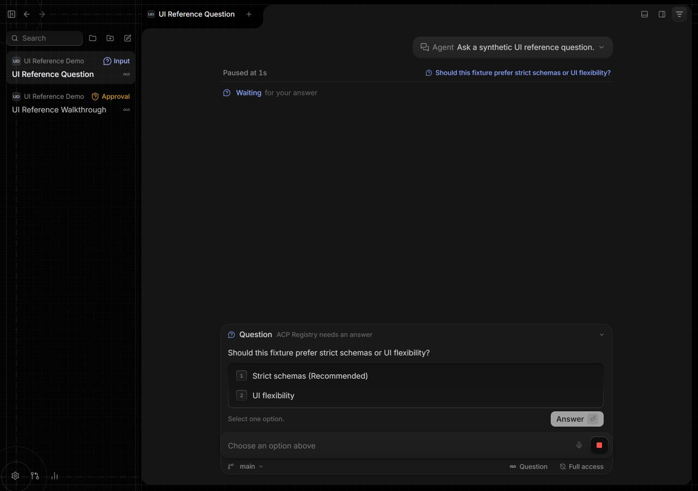

**三条 Agent 队列静息基线：指针已移开，独立评分仍为 7／7／7／8／7。**
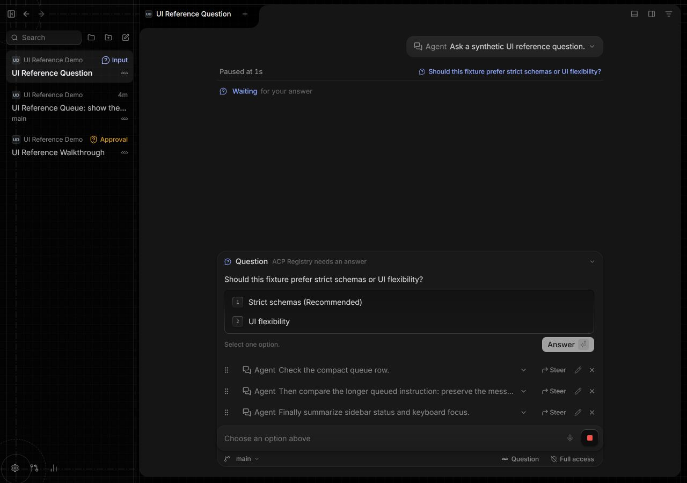
[静息图来源与哈希](https://github.com/albert-zen/zen/blob/d60206bbd715950a8606d4a944c626b09c0aa288/docs/ui-quality/references/t3-runtime-6f13f36f/pointer-away-manifest.json)。此前带 Sidebar hover 的 queue-three 原图保留为历史证据，不再作为本节静息主图。

**第二条展开与真实 Tab 的 Steer 焦点：未执行 Steer。**
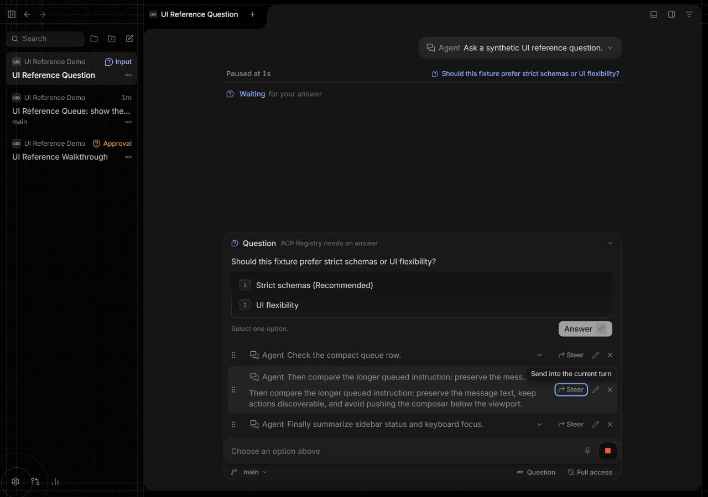

[来源、场景与原图哈希清单](https://github.com/albert-zen/zen/blob/4f0b8708566a5529daab33e5f6b4647d44448b15/docs/ui-quality/references/t3-runtime-6f13f36f/manifest.json) · [源项目 MIT 许可原文](https://github.com/albert-zen/zen/blob/4f0b8708566a5529daab33e5f6b4647d44448b15/docs/ui-quality/references/t3-runtime-6f13f36f/LICENSE.source.txt)。图片为本次官方 Replay 合成运行，不包含私人浏览器标签、账号或含私人路径的审批尝试。折叠队列和展开焦点图状态不同，**不是单变量 A/B**；不从图推断未执行动作结果。

### 新增实际评分参考：Codex 完成态与 DeepSeek Harness 官网主屏

**Codex · OpenAI：官方演示视频 20 秒原帧。** 对应上表新增 Sidebar 8／8／8／8／7，以及下方完成态 CSV 清理结果＋Composer 8／8／8／8／8。这是完成态，不是运行中；官网页面当前使用的视频，不称最新原生 build，模型名也不是应用版本。

[官方 Learn 出处](https://learn.chatgpt.com/docs/app) · [原视频](https://cdn.openai.com/devhub/videos-learn/proactive-teammate-v2-1080p-v1.mp4)

**DeepSeek Harness：官方网页演示，2026-11-11 捕获，应用版本未标。** 对应 Sidebar 和完成态自我介绍＋Composer，两项均 8／7／8／8／7。主对话和侧栏可见并已实际评审，不能因非本地构建而忽略；同样不能据此声称真实模型运行、hover、键盘或消息队列通过。图来自干净官网演示，不使用用户含私人浏览器标签的原截图。

[DeepSeek 官方出处](https://www.deepseek.com/en/harness/) · [两张参考图来源、日期与归属](https://github.com/albert-zen/zen/blob/00b9c3f54844ef13567f9ec6c2e702d4fc04b3b9/docs/ui-quality/references/official-desktop-demos-20261111/sources.json)

这些第三方图片仅用于比较评论，分别归 OpenAI 与 DeepSeek，不受 Zen 软件许可证覆盖。Harness 同版生产预览及独立评审已完成，见紧接的独立章节；**与上述官网演示分开，不倒绑版本**。

### DeepSeek Harness 同版生产 UI 预览（不是官网营销演示）

来源官方源码 `fcc0ad462172522aaf5c93a7b2e01f6b9f0b0159`，UI 版本 **0.2.2-rc.1-fcc0ad4**，1234×675、暗色、中文、DPR 2。实际渲染生产 UI，使用官方 source-owned 合成 fixture，无真实账号或 live 模型任务；不称为真实模型执行验收。以下三图已逐张独立评阅，不复用官网演示的分数。

| 实际可见场景／区域                                   | 信息层级 | 可读性 | 注意力 | 一致性 | 交互线索 |
| ---------------------------------------------------- | -------: | -----: | -----: | -----: | -------: |
| main-conversation-dark：左侧导航                     |        8 |      7 |      8 |      8 |        7 |
| main-conversation-dark：完成回答＋任务摘要＋Composer |        8 |      8 |      8 |      8 |        7 |
| subagents-dark：仅顶栏子智能体 popover               |        7 |      7 |      7 |      8 |        6 |
| subagent-sidebar-dark：双栏父／子对话整体            |        7 |      7 |      7 |      8 |        7 |

主对话、任务摘要和输入区分工清楚；popover 标题与 identifier 可读，但灰点未标状态、双侧箭头仍依赖推断；双栏父子关系明确，但母对话变窄、两条历史权重相近，tab 标题截断。popover 只评该局部，**不套作 Zen 完整资料卡评分**；待发消息队列、长名会话资料卡、真实键盘焦点仍 N/O。图片归属 DeepSeek，合成 fixture 内容不是用户私人数据。

**主对话、左侧导航与 Composer：对应表中前两行。**

**顶栏子智能体 popover：仅对应该局部分数。**

**父／子双栏对话：对应整体布局评分，不是待发队列。**

[捕获与 SHA256 清单](https://github.com/albert-zen/zen/blob/4a1e1d8d4bf1510d08c379fe1bbce85a6dec0757/docs/ui-quality/references/deepseek-harness-production-fcc0ad4/capture-manifest-public.json) · [来源及归属](https://github.com/albert-zen/zen/blob/4a1e1d8d4bf1510d08c379fe1bbce85a6dec0757/docs/ui-quality/references/deepseek-harness-production-fcc0ad4/README.md) · [精确源码](https://github.com/deepseek-ai/deepseek-harness/tree/fcc0ad462172522aaf5c93a7b2e01f6b9f0b0159)。仅发布这三张已验证原图，未采用失败空白图、Cookie 遮挡图或用户私人浏览器截图。

### Claude 官方交互演示现场截图

**两张实际评审的官网演示现场截图现已按用户明确批准发布并内嵌，未用历史静态图替代。** 可打开 [Claude Code 官方产品演示](https://claude.com/product/claude-code) 查看来源。下列分数来自 2026-11-11 实际查看的两张演示现场图，不是仅按官网文字推断；网站顶部导航不计分，非已登录原生 App，也没有可确认的原生版本号。

| 实际评审画面及区域                  | 信息层级 | 可读性 | 注意力 | 一致性 | 交互线索 |
| ----------------------------------- | -------: | -----: | -----: | -----: | -------: |
| 解释演示：Sidebar 局部              |        8 |      7 |      8 |      8 |        7 |
| 解释演示：解释回答区域              |        8 |      8 |      8 |      8 |        7 |
| 代码变更演示：diff＋结果区域        |        8 |      7 |      7 |      8 |        8 |
| 代码变更演示：PR 状态条（非会话卡） |        7 |      7 |      7 |      8 |        6 |

**解释演示：对应上表 Sidebar 局部与解释回答两行评分。**

**代码变更演示：对应上表 diff＋结果及 PR 状态条评分，不是长名会话资料卡。**

[官方演示来源](https://claude.com/product/claude-code) · [捕获与第三方归属说明](https://github.com/albert-zen/zen/blob/fe8a6b1a8fc3dd7a525248e5659796ad7d74e1b2/docs/ui-quality/references/claude-official-demo-20261111/README.md)。这两张是实际用于评分的现场图，仅用于设计比较与评论；不是已登录原生 App 截图。

解释区层级清楚；长标题截断／渐隐限制导航可读性；展开 diff 增加视觉占用；PR 条中的编号、分支和 CI 可辨，但缺明确文字动作。长名会话资料卡、待发消息队列、hover／focus／Tab 均 N/O。图片及演示归 Anthropic／Claude；未发现单独开放图片许可，不属于 Zen 软件许可证覆盖范围。

## C. 桌面对话与输入区：按实际状态评分

Zen的运行态包含消息队列，T3为等待四个子任务，Codex是空态。表中列明差异，**不能将它们当作同一个用例的胜负**。队列本身另列在D。

| 对象、实际场景与证据                                                                                                                                                                                       | 信息层级 | 可读性 | 注意力 | 一致性 | 交互线索 |
| ---------------------------------------------------------------------------------------------------------------------------------------------------------------------------------------------------------- | -------: | -----: | -----: | -----: | -------: |
| Zen，运行中浅色默认，含队列，[本轮原图](https://github.com/albert-zen/zen/blob/d2a24f878a8086f804db6cd8f15bed40983df98b/docs/ui-quality/evidence/main-desktop-4e856526/pending-desktop-light.png?raw=true) |        7 |      8 |      7 |      8 |        8 |
| Zen，运行中深色默认，含队列，[本轮原图 · pending-desktop-dark.png](https://github.com/albert-zen/zen/actions/runs/42982034742/artifacts/13837573080)                                                       |        7 |      7 |      7 |      8 |        8 |
| Codex，**历史新会话空态，不是运行态**，V，[原图](https://developers.openai.com/images/blog/long-horizon-4.jpeg)、[出处](https://developers.openai.com/blog/run-long-horizon-tasks-with-codex)              |        8 |      7 |      8 |      8 |        7 |
| Codex，官方视频20秒帧：完成态CSV清理结果＋Composer，V，[视频](https://cdn.openai.com/devhub/videos-learn/proactive-teammate-v2-1080p-v1.mp4)、[出处](https://learn.chatgpt.com/docs/app)                   |        8 |      8 |      8 |      8 |        8 |
| Claude Code，官网演示解释回答区域，V，[原图见下方](#claude-官方交互演示现场截图)、[出处](https://claude.com/product/claude-code)                                                                           |        8 |      8 |      8 |      8 |        7 |
| Claude Code，官网演示代码变更＋结果区域，V，[原图见下方](#claude-官方交互演示现场截图)、[出处](https://claude.com/product/claude-code)                                                                     |        8 |      7 |      7 |      8 |        8 |
| Linear，未取得agent对话对等场景，[官方设计资料](https://linear.app/now/behind-the-latest-design-refresh)                                                                                                   |      N/O |    N/O |    N/O |    N/O |      N/O |
| T3 Code，**四子agent运行态中间区域**，V，[原图](https://t3.codes/_astro/app-desktop.BHuzLVLF.webp)、[出处](https://t3.codes/)                                                                              |        8 |      8 |      8 |      8 |        8 |
| DeepSeek Harness，官方网页完成态自我介绍＋Composer，V，[出处](https://www.deepseek.com/en/harness/)                                                                                                        |        8 |      7 |      8 |      8 |        7 |

- **Zen**：正文与composer分开，Waiting与After this turn双分组和Send now文字动作可理解；默认态下方目标行正文/动作被tray底边裁切，不能只靠“中心可命中”证明体验完整。
- **Codex空态**：主行动区留白充分，建议任务卡和composer形成入口；Open/Commit是带文字动作，执行位置紧邻输入区。缺少运行正文、过程展开及停止态，所以它的**运行对话五维均N/O**，上表分数不可拿来填运行态。
- **T3运行态**：子任务总量、运行量、正在等待及Stop文字建立“总览→状态→动作”的顺序；输入区独立且统一。该官方图2880×1800，内容量与Zen不同。长运行描述是次要灰文字，实际动态变化、Stop结果、hover/focus均N/O。

## D. 队列：同一功能证据不足时不借其它场景补分

| 对象、队列场景及证据                                                                                                                                                                                                             | 信息层级 | 可读性 | 注意力 | 一致性 | 交互线索 |
| -------------------------------------------------------------------------------------------------------------------------------------------------------------------------------------------------------------------------------- | -------: | -----: | -----: | -----: | -------: |
| Zen，浅色默认，[原图](https://github.com/albert-zen/zen/blob/d2a24f878a8086f804db6cd8f15bed40983df98b/docs/ui-quality/evidence/main-desktop-4e856526/pending-desktop-light.png?raw=true)                                         |        7 |      8 |      7 |      8 |        8 |
| Zen，浅色hover，[原图 · pending-desktop-light-hover.png](https://github.com/albert-zen/zen/actions/runs/42982034742/artifacts/13837573080)                                                                                       |        7 |      8 |      7 |      8 |        7 |
| Zen，浅色focus，[原图](https://github.com/albert-zen/zen/blob/d2a24f878a8086f804db6cd8f15bed40983df98b/docs/ui-quality/evidence/main-desktop-4e856526/pending-desktop-light-focus.png?raw=true)                                  |        8 |      8 |      8 |      8 |        8 |
| Zen 446b，浅色展开阅读／Edit焦点／Composer焦点／Less space焦点（四图各自同分），[专项原图](https://github.com/albert-zen/zen/actions/runs/43009644920/artifacts/13850565488)                                                     |        8 |      8 |      8 |      8 |        8 |
| Zen 446b，深色展开阅读及三种焦点（四图各自同分），[专项原图](https://github.com/albert-zen/zen/actions/runs/43009644920/artifacts/13850565488)                                                                                   |        8 |      7 |      8 |      8 |        8 |
| Zen 32e，浅／深 Composer焦点、footer焦点及收回回Composer（六图各自同分），[本轮原图](https://github.com/albert-zen/zen/actions/runs/43018417117/artifacts/13854006397)                                                           |        7 |      7 |      7 |      8 |        8 |
| Codex，公开图未展示消息队列，[出处](https://developers.openai.com/blog/run-long-horizon-tasks-with-codex)                                                                                                                        |      N/O |    N/O |    N/O |    N/O |      N/O |
| Claude Code，未查看对应队列像素，[出处](https://code.claude.com/docs/en/desktop)                                                                                                                                                 |      N/O |    N/O |    N/O |    N/O |      N/O |
| Linear，无对应agent消息队列材料，[出处](https://linear.app/now/behind-the-latest-design-refresh)                                                                                                                                 |      N/O |    N/O |    N/O |    N/O |      N/O |
| T3 Code 官网图：子任务状态不是待发队列；未合并提案实跑另见本页独立章节，[官网原图](https://t3.codes/_astro/app-desktop.BHuzLVLF.webp)                                                                                            |      N/O |    N/O |    N/O |    N/O |      N/O |
| T3 Code #28840 实跑：三条折叠 Agent 队列局部，[静息原图](https://github.com/albert-zen/zen/blob/d60206bbd715950a8606d4a944c626b09c0aa288/docs/ui-quality/references/t3-runtime-6f13f36f/queue-pointer-away-dark.jpg?raw=true)    |        7 |      7 |      7 |      8 |        7 |
| T3 Code #28840 实跑：展开＋Tab Steer 焦点局部，[原图](https://github.com/albert-zen/zen/blob/4f0b8708566a5529daab33e5f6b4647d44448b15/docs/ui-quality/references/t3-runtime-6f13f36f/queue-expanded-tab-focus-dark.jpg?raw=true) |        8 |      7 |      8 |      8 |        8 |
| DeepSeek Harness，未查看对应队列像素，[出处](https://github.com/deepseek-ai/deepseek-harness/blob/master/packages/client/ui-chat/README.md)                                                                                      |      N/O |    N/O |    N/O |    N/O |      N/O |

Zen 静息队列仍高 240px，完整可读 2 Waiting＋1 After；446b 专项已补展开态完整 8 条与收回验证，见顶部逐图表。静息密度没有改变，展开增加可读容量但使上方部分对话移出视野。不同状态不跨主题平均，也不把状态差值当版本涨分。

## E. 资料卡／当前任务信息

| 对象、实际场景与证据                                                                                                                                                                                                          | 信息层级 | 可读性 | 注意力 | 一致性 | 交互线索 |
| ----------------------------------------------------------------------------------------------------------------------------------------------------------------------------------------------------------------------------- | -------: | -----: | -----: | -----: | -------: |
| Zen 6e6，无标题栏合成宿主浅色长名卡，[本轮原图](https://github.com/albert-zen/zen/blob/d60206bbd715950a8606d4a944c626b09c0aa288/docs/ui-quality/evidence/information-desktop-6e6c6bbd/information-desktop-light.png?raw=true) |        7 |      7 |      7 |      7 |        7 |
| Zen 6e6，无标题栏合成宿主深色长名卡，[本轮原图](https://github.com/albert-zen/zen/blob/d60206bbd715950a8606d4a944c626b09c0aa288/docs/ui-quality/evidence/information-desktop-6e6c6bbd/information-desktop-dark.png?raw=true)  |        7 |      7 |      7 |      7 |        7 |
| Codex，公开图未展示对应资料卡，[出处](https://developers.openai.com/blog/run-long-horizon-tasks-with-codex)                                                                                                                   |      N/O |    N/O |    N/O |    N/O |      N/O |
| Claude Code，长名会话资料卡未观察，[出处](https://claude.com/product/claude-code)                                                                                                                                             |      N/O |    N/O |    N/O |    N/O |      N/O |
| Claude Code，官网演示 PR 状态条（不是会话卡），V，[原图见下方](#claude-官方交互演示现场截图)、[出处](https://claude.com/product/claude-code)                                                                                  |        7 |      7 |      7 |      8 |        6 |
| Linear，已有图为项目属性/团队选择器，非当前会话卡，[出处](https://linear.app/docs/projects)                                                                                                                                   |      N/O |    N/O |    N/O |    N/O |      N/O |
| T3 Code，环境/Changes/Lineage右侧区域，V，[原图](https://t3.codes/_astro/app-desktop.BHuzLVLF.webp)、[出处](https://t3.codes/)                                                                                                |        8 |      8 |      8 |      8 |        7 |
| DeepSeek Harness，只有右侧栏规则文档，D，[出处](https://github.com/deepseek-ai/deepseek-harness/blob/master/docs/subsystems/sidebar-right.md)                                                                                 |      N/O |    N/O |    N/O |    N/O |      N/O |

- **Zen**：长中英文名称完整换行，状态列保持；Archived行比Working更强的背景让注意力语义不清。不能仅凭截图断定这是归档样式错误，也可能是选中态。6e6 已消除无标题栏合成宿主的 Close information 叠压；正常标题栏打开态及关闭／Tab 行为仍未验证。
- **T3**：环境、版本变化、子任务各自分组，名称与时间能逐行对应；图标与行高统一。多个折叠箭头、文件夹、更多菜单没有展开，准确动作与键盘仍N/O，因此交互线索7。该图没有Zen同样长度的中文名，不能宣称其长名处理优于Zen。

## 本轮桌面最优先改进

1. **队列目标正文与动作一起完整进入视野**。优先修默认/hover的底部裁切，保持分组和来源可追踪；不是仅压缩字体或只测试按钮中心命中。
2. **导航与任务状态的主次明确**。Projects/Recent 展开态重复项已区别权重，下一步补折叠回退验证；资料卡仍需明确 Working、Archived 和选中态各自语义。
3. **限定导航闭环后的剩余覆盖**。2e 浅深路径及 Projects 恢复已验证；补 Close 键盘激活、反向遍历、其它分组／会话及元资料编辑，不把限定路径成功写成全部交互通过。

完整原生Tab路径、焦点进入/退出所有桌面控件、真实发送/取消/排序结果、真实Host资料状态更新和对比度测量：**N/O**。本轮30张细指针捕获通过不等于完整交互验收；粗指针后续Tab断言失败属于历史范围，未因本次转向桌面而改写成通过，也不据此要求继续窄屏适配。

---

历史轮次、旧CI快照和旧评分（非最新状态；含已停止推进的窄屏范围）

以下完整保留历史记录。当前head、范围和评审以正文顶部为准；历史待办及运行状态不代表现在。0–4分量表不换算、不与当前10分制直接比较。

## 最新状态与主界面评分（10 分制，五维分开）

2026-11-11 核验：当前 head 为 [`4e856526`](https://github.com/albert-zen/zen/commit/4e8565269e883600127af60996e599969b56b645)。**最新完成的独立视觉评审对应 `07daf1aa`；当前 head 已有部分新截图，但粗指针检查失败，独立评分尚待完成，不沿用旧分冒充新结果。** PR 仍为 Draft。

### 已发布与待验证

- `012e109b`：队列主动作改为明确的 `Send now`，滚动时保留分组语境。已有匹配基线逐图复评，见下表。
- `07daf1aa`：桌面／760px 普通行动作更紧凑，取消回到同行；已查看全部 24 张图。修复真实存在，但整数评分持平，不人为涨分。
- **`4e856526`：本轮源码已发布**，窄屏正文与操作分行、仅高窗口扩大队列；新增 390×600 精细／粗指针真实输入及 Composer 可达检查。此处是实现和测试范围，不是已验收结论。[本轮快速截图](https://github.com/albert-zen/zen/actions/runs/42982034742) 已结束且整体失败：[Fast feedback](https://github.com/albert-zen/zen/actions/runs/42982034909) 成功。精细指针 30 图采集完成（含 390×600），粗指针产出 3 图后在 Composer 原生 Tab 再次可达断言失败，粗指针深色尚未执行；已保留 33 图及诊断，不能称为完整视觉或触控验收通过。当前 head 的独立视觉评分：**待评，不填推算值**。
- 反馈采用生产组件构建 → 合成截图 → 独立逐图评审 → 改进，**不等待全量 CI**。首轮实测约 58 秒可下载截图（构建 12.47 秒、采集 20.39 秒），不是每轮时限保证。完整 CI 独立判断回归，不绑住视觉反馈。

### 10 分制匹配对照：c771207c → 012e109b → 07daf1aa

每格按上述三个版本顺序列出分数；五维是**信息层级、可读性、注意力、一致性、交互线索**。主观设计评审，不是通过率，不汇总总分。各轮独立评审未提供目标分数；这些不是服务后端模型身份认证。没有提升的格子保持不变。

| 同名匹配截图／场景           | 层级      | 可读性 | 注意力    | 一致性 | 交互线索  |
| ---------------------------- | --------- | ------ | --------- | ------ | --------- |
| 主对话 + Sidebar，桌面浅色   | 7→7→7     | 8→8→8  | 8→8→8     | 8→8→8  | 6→6→6     |
| 主对话 + Sidebar，桌面深色   | 7→7→7     | 7→7→7  | 8→8→8     | 8→8→8  | 6→6→6     |
| 主对话 + Sidebar，760px 浅色 | 6→6→6     | 7→7→7  | 7→7→7     | 8→8→8  | 6→6→6     |
| 队列桌面浅色，默认           | 7→7→7     | 8→8→8  | 7→7→7     | 8→8→8  | **6→8→8** |
| 队列桌面浅色，hover          | **6→7→7** | 8→8→8  | 7→7→7     | 8→8→8  | **6→7→7** |
| 队列桌面浅色，focus          | **6→8→8** | 8→8→8  | **7→8→8** | 8→8→8  | **7→8→8** |
| 队列桌面深色，默认           | 7→7→7     | 7→7→7  | 7→7→7     | 8→8→8  | **6→8→8** |
| 队列桌面深色，hover          | **6→7→7** | 7→7→7  | 7→7→7     | 8→8→8  | **6→7→7** |
| 队列桌面深色，focus          | **6→8→8** | 7→7→7  | **7→8→8** | 8→8→8  | **7→8→8** |
| 队列760px浅色，默认          | 7→7→7     | 8→8→8  | 7→7→7     | 7→7→7  | **6→8→8** |
| 队列760px浅色，hover         | **6→7→7** | 8→8→8  | 7→7→7     | 7→7→7  | **6→7→7** |
| 队列760px浅色，focus         | **6→8→8** | 8→8→8  | **7→8→8** | 7→7→7  | **7→8→8** |
| 资料卡桌面浅色               | 7→7→7     | 7→7→7  | 6→6→6     | 7→7→7  | 6→6→6     |
| 资料卡桌面深色               | 7→7→7     | 7→7→7  | 6→6→6     | 7→7→7  | 6→6→6     |
| 资料卡760px浅色              | 7→7→7     | 7→7→7  | 7→7→7     | 7→7→7  | 7→7→7     |

比较条件：桌面 1280×900、窄窗 760×900，相同主题／合成会话／focus 目标；三版均记录 fine pointer、hover 与开启浏览器沙箱。主对话和资料卡六图逐像素相同，**没有本轮提升证据**。9fdd 的输入媒体记录不足，不用于这张表的提升归因。

实际取舍：012e 的文字主动作和固定分组更清楚，但行末换行与标题占位减少可见容量；07daf 将普通行动作由约 61px 步距压到 47.59px，focus 第三条后续消息动作由部分裁切变完整，但默认队列仍为 240px，首屏容量未明显增加，尚不足以跨整数评分档。

### 07daf 新增场景：只评现状，没有匹配旧基线

| 场景                                        | 层级 | 可读性 | 注意力 | 一致性 | 交互线索 |
| ------------------------------------------- | ---: | -----: | -----: | -----: | -------: |
| 队列760px深色，默认                         |    7 |      7 |      7 |      7 |        8 |
| 队列760px深色，hover                        |    7 |      7 |      7 |      7 |        7 |
| 队列760px深色，focus                        |    8 |      7 |      8 |      7 |        8 |
| 队列390px浅色，默认                         |    6 |      7 |      6 |      7 |        6 |
| 队列390px浅色，hover／focus（两图各自同分） |    7 |      7 |      7 |      7 |        7 |
| 队列390px深色，默认                         |    6 |      6 |      6 |      7 |        6 |
| 队列390px深色，hover／focus（两图各自同分） |    7 |      6 |      7 |      7 |        7 |

390px 图是精细指针窄窗口，不是触屏验收。07daf 默认首条后续消息被底缘截断、操作分三行，这是后续 4e856526 改进所针对的问题，**新改动是否解决须待新图复评**。

### 可打开、可复核的原始截图来源

下载包包含原始 PNG、`source.json`、`evidence.json`，可核对源码、视口、输入媒体和焦点。以下 GitHub artifact 本次均核验未过期；下载可能要求登录，保留至 2026-11-18，不冒充永久图片地址。

- [c771207c 匹配基线，15 图](https://github.com/albert-zen/zen/actions/runs/42971893124/artifacts/13833348856)
- [012e109b 第一轮，15 图](https://github.com/albert-zen/zen/actions/runs/42975191341/artifacts/13834883647)
- [07daf1aa 最新完成评审，24 图](https://github.com/albert-zen/zen/actions/runs/42978038101/artifacts/13835713817)
- [4e856526 部分截图与失败诊断，33 图，未完成全套](https://github.com/albert-zen/zen/actions/runs/42982034742/artifacts/13837573080)

优先并排打开同名 `pending-desktop-light.png`、`pending-desktop-light-focus.png`、`pending-narrow-light-focus.png`，同时看默认与焦点态，不只展示较好的滚动状态。主对话看 `main-desktop-light.png`／`main-narrow-light.png`，资料卡看 `information-desktop-light.png`／`information-narrow-light.png`。07daf 新场景为 `pending-compact-light.png`、`pending-compact-light-focus.png`、`pending-compact-dark-focus.png`。

**尚未完成：**主 Sidebar 双强高亮、资料卡 Archived 权重与预览宿主关闭入口叠压仍待处理；最新已评版本的 main／information 390px 和760px深色未观察。生产组件＋合成数据不是完整 App／Host／原生端验收；截图不证明真实发送、持久化、完整 Tab 路径、读屏或 WCAG。

**下方 0–4 分是保留的历史设置评审，不是当前主界面的分数。量表和维度不同，不换算为 10 分、不直接比较、不做平均。**

---

历史附录：Appearance 原图与 0–4 分评分（非当前主界面）

## 实际 UI 前后对照：已公开 Appearance 轮次

隔离 Electron 中生产 SettingsView 的合成数据原始截图，不是设计稿或全应用验收。**这是历史已公开轮次，不代表当前 head 的新截图验收。**

| Q：403584e4                                                                                                                                                           | 后续 R：292a768e                                                                                                                                                      |
| --------------------------------------------------------------------------------------------------------------------------------------------------------------------- | --------------------------------------------------------------------------------------------------------------------------------------------------------------------- |
|  |  |
|   |   |

变化：保留选中项边框及勾选，增强未选项文字，降低“可用却像禁用”的视觉风险；不是大幅重排布局。

### 分项分数变化（0–4）

| 维度         | Primary Q→R | Challenge Q→R |
| ------------ | ----------- | ------------- |
| 信息层级     | 3→3         | 3→3           |
| 可读性/密度  | 3→3         | 3→3           |
| 色彩用途     | 3→3         | 3→3           |
| 材质一致性   | 3→3         | 3→3           |
| 注意力分配   | 3→3         | 3→3           |
| 固定宽度布局 | 3→3         | 3→3           |

局部改进没有跨评分档，不人为涨分。两份历史记录缺可靠模型身份，不冒称 Sol/Terra；R 是同评审者补评，非全新盲评。未计算全应用总分。

[Primary 原文](https://github.com/albert-zen/zen/blob/tod/ui-quality-contrast-followup/docs/ui-quality/reviews/appearance-primary.md) · [Challenge 原文](https://github.com/albert-zen/zen/blob/tod/ui-quality-contrast-followup/docs/ui-quality/reviews/appearance-challenge.md) · [截图来源清单](https://github.com/albert-zen/zen/blob/ddc9f32ead745125c616b42f9f4c22ac26e16448/docs/ui-quality/evidence/appearance-followup-20261109/capture-manifest.json)

Information、Models、Plugins 的较新源码已同步。已公开的安全合成原图、逐项评分和来源见下方历史证据；Information 含环境标识的完整原图未公开。Context 仅为基线。

---

## 状态：工作中草稿，不是最终验收版本

已通过官方连接器将批准的恢复版本发布到本分支。恢复源码检查点为 [`d41a36c58ceb5fb1400396b4f135412cfce91c52`](https://github.com/albert-zen/zen/commit/d41a36c58ceb5fb1400396b4f135412cfce91c52)，其完整内容树 `719cf122280d8d1b26fc6b6726aa7c80aa361ba2` 与本地冻结提交 `c0d632badc9cacab8883ce854dd6ca8c9d8dfd01` 完全一致。相对此前公开的 `ddc9f32e`，同步了 20 个源码、测试及评审账本文件，保留既有公开证据；非强制更新，没有覆盖历史。

**恢复源码已发布；当前进度及 CI 请以上方 2026-11-11 核验为准。历史截图和测试不能替代当前 head 的完整验收。**

2026-11-11 d41a36c5 恢复检查点的历史核验（不是当前分支差距）：相对当时 main `b3565098e35ea9c182b462c39a9c0f7d59cd6e45`，分支 ahead 36 / behind 27，共同基线 `d7f93b83f54ba873b61f19bd72ac3a6f6010aa4a`。本 PR 保持 Draft，尚未完成与当前 main 的最终整合，也未证明可直接合并。

## 已在本分支的工作

- 对话任务层级、Fork 分界与来源入口、agent 信息卡和通信来源导航。
- 发送/准备/排队/错误反馈，草稿、召回和 Side chat 的状态可读性。
- 项目房间、侧栏、模型/账号/外观等设置布局和辅助文字可读性。
- 对应组件及交互测试、UI 规范、合成验收脚本与历史评审记录。

## 逐轮记录与多模型评分

现有公开入口：

- [工作流、覆盖范围与限制](https://github.com/albert-zen/zen/blob/tod/ui-quality-contrast-followup/docs/ui-quality/README.md)
- [逐维评审标准](https://github.com/albert-zen/zen/blob/tod/ui-quality-contrast-followup/docs/ui-quality/rubric.md)
- [评分历史证据账本（未完成全量对账）](https://github.com/albert-zen/zen/blob/tod/ui-quality-contrast-followup/docs/ui-quality/reviews/score-history-evidence-ledger.md)
- [原始报告及证据索引](https://github.com/albert-zen/zen/blob/tod/ui-quality-contrast-followup/docs/ui-quality/reviews/score-history-evidence-index.json)
- [各模型原始报告](https://github.com/albert-zen/zen/tree/tod/ui-quality-contrast-followup/docs/ui-quality/reviews)
- [冻结版本与验收检查点](https://github.com/albert-zen/zen/tree/tod/ui-quality-contrast-followup/docs/ui-quality/checkpoints)

保留每位评审模型自己的分项分数、参考项目的独立分项分数和原始理由，不做平均或推算。每轮须对应冻结版本、截图来源、模型身份、可比性与未观察项。历史没有直接参考证据的单元格保持空白。评审不提供目标分数，也不以得分替代功能验收。

| 证据阶段                                         | 目前公开状态                            | 限制                                                              |
| ------------------------------------------------ | --------------------------------------- | ----------------------------------------------------------------- |
| 历史基线、分段实现、Sol/Terra 与 Astra/Luna 报告 | 已有原始记录和部分索引                  | 不是完整、统一且可直接求差的时间序列                              |
| Appearance A/B、P/Q/R                            | 账本与合成图已在分支                    | A/B 极近；R 是补评；重复图片、未观察焦点/窄屏等限制已在原记录说明 |
| qa6/qa7 及后续旅程                               | 部分检查点已在分支                      | 不应从代码或邻近截图推定全部旅程通过                              |
| Information、Models、Plugins 后续源码            | 已包含在 d41a36c5，与 c0d632ba 内容一致 | 安全历史截图及原始评审已在 ec7abf03，不能视为当前全应用验收       |
| Context                                          | 独立基线评分与安全原图已在 ec7abf03     | 只有基线，不能给出前后分数变化或新改动验收结论                    |

## 两项后续候选已发布

- 队列操作图标对比度与禁用色调整。
- 资料面板中已归档子代理名称换行。

两项已在 `9fdddf7c` 发布，不再是未发布本地候选；`c771207c` 补充明确指针 hover 条件、耗时记录与长名交互回归测试。快速生产组件截图已产出，完整原生应用验收仍独立进行。

## 合并前必须补齐

- [x] 将批准的 c0d632ba 源码与恢复备份对账，并以同内容树 d41a36c5 同步到本分支。
- [x] 发布两项候选，并完成合成生产组件截图与专项交互检查；不等于全应用验收。
- [ ] 补齐每轮、每模型、本项目及参考项目逐维评分，并保留原始报告与不可比项。
- [x] 发布已授权且核查无私人信息的 9 张历史合成原图、评分与来源清单；不发布真实私人截图。
- [ ] 补齐其他未观察场景及每轮匹配前后证据。
- [ ] 对当前 main 重新整合并验证；既有 #748 联合候选验证不能替代此项。
- [ ] 完成剩余桌面真实旅程、键盘等未覆盖验证；未完成项明确标为未观察。窄屏适配不再是当前目标。
- [ ] 复核持续流式、Stop、切页、草稿、错误恢复和来源导航语义无回归。

历史测试和截图只证明其记录的冻结版本与范围，**不等于当前 main 上的全应用通过，不构成 WCAG 达标声明**。此草稿不请求合并。

---

历史 0–4 分设置评审：固定版本原图、逐项表与原始报告

此历史量表为0–4，与当前主界面10分制维度不同，不换算、不平均、不当当前head验收。Models／Information配对分数未提高，Plugins部分维度提高，Context只有基线。保留原始逐项分、评审理由与比较限制，详情使用以下已公开固定版本，不删除唯一证据：

- [完整逐维表（含参考对象各自分数）](https://github.com/albert-zen/zen/blob/ec7abf031f52f5827fda7c83bce335fa2e1d4491/docs/ui-quality/evidence/pr755-settings-20261110/SCORES.md)
- [原始评审逐文件目录](https://github.com/albert-zen/zen/tree/ec7abf031f52f5827fda7c83bce335fa2e1d4491/docs/ui-quality/reviews/pr755-settings-20261110)
- [Models／Plugins／Context历史安全原图](https://github.com/albert-zen/zen/tree/ec7abf031f52f5827fda7c83bce335fa2e1d4491/docs/ui-quality/evidence/pr755-settings-20261110)
- [机器可读评分](https://github.com/albert-zen/zen/blob/ec7abf031f52f5827fda7c83bce335fa2e1d4491/docs/ui-quality/evidence/pr755-settings-20261110/scores.json) · [原图与来源哈希](https://github.com/albert-zen/zen/blob/ec7abf031f52f5827fda7c83bce335fa2e1d4491/docs/ui-quality/evidence/pr755-settings-20261110/manifest.json)

Sol／Terra是原评审任务标签，不作后端身份独立认证；Models v2是原评审者匹配展开态补评，不冒充新盲评。Plugins底部对齐图不是相同滚动偏移因果A/B；Information含环境标识的完整原图未公开。历史静态图不证明安装、权限、持久化、键盘或WCAG达标。

