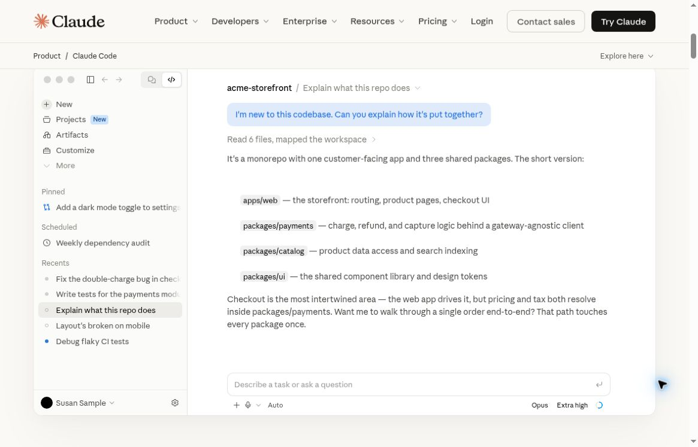
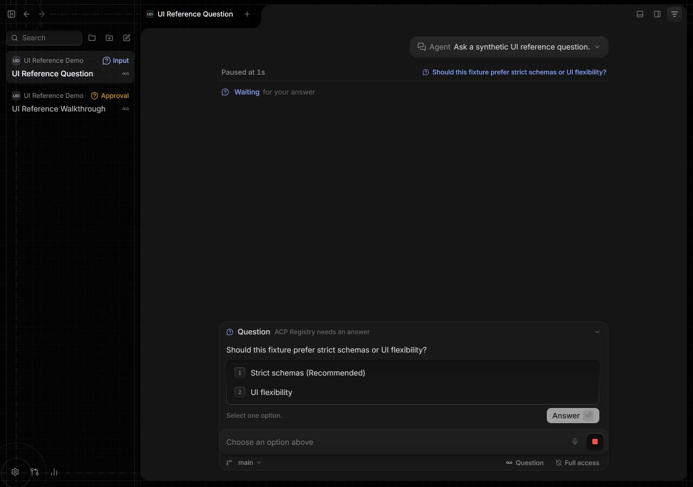
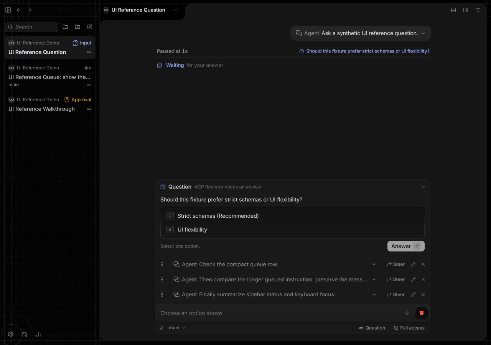
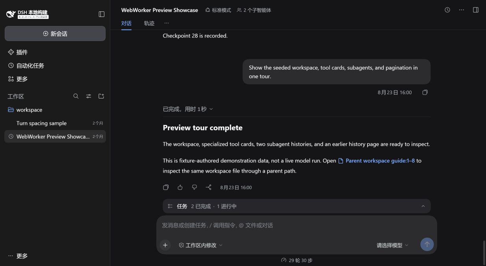
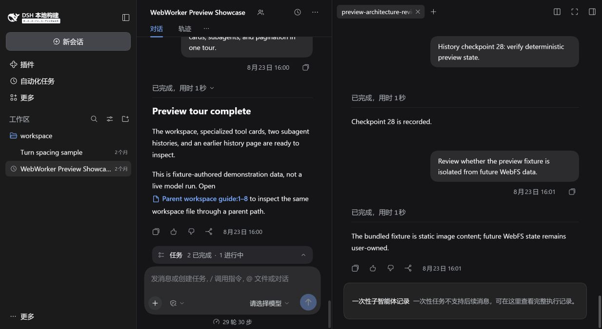

# 独立参考复评：2026-11-11

五维均为10分制：信息层级／可读性／注意力管理／一致性／交互可发现性。以下为此次查看已核验原图后的独立参考复评，不是运行交互验收、同数据压力测试或与Zen的同条件排名。不向评审员提供目标分数。

|参考对象|层级|可读|注意|一致|交互|
|---|---:|---:|---:|---:|---:|
|Codex|9|9|9|9|8|
|Claude Code|8|7|9|9|7|
|T3 Code|8|7|8|8|8|
|DeepSeek Harness|8|8|8|9|8|
|Linear|未评|未评|未评|未评|未评|

Linear官方对应图本轮无法读取；不沿用旧分冒充复评、不推断缺失画面。历史Linear原图与旧评分在PR保留，标明历史版本。

## Codex：官方视频20秒帧

官方演示帧，不是此轮实际运行的Codex应用；不推断未展示的交互状态。

## Claude Code：官网交互演示两图

官方演示截图，解释回答与代码变更/结果场景，不代表原生应用全流程验收。

## T3 Code：6f13f36f未合并提案的实际UI、合成数据

官方Replay合成数据，非已发布稳定版；仅评分实际图，不把源码实现当作已经验证的交互体验。

## DeepSeek Harness：fcc0ad4生产UI、合成数据

实际生产UI预览，合成数据，非真实账号/模型工作负载。图中主对话、popover和父子双栏为不同场景。
