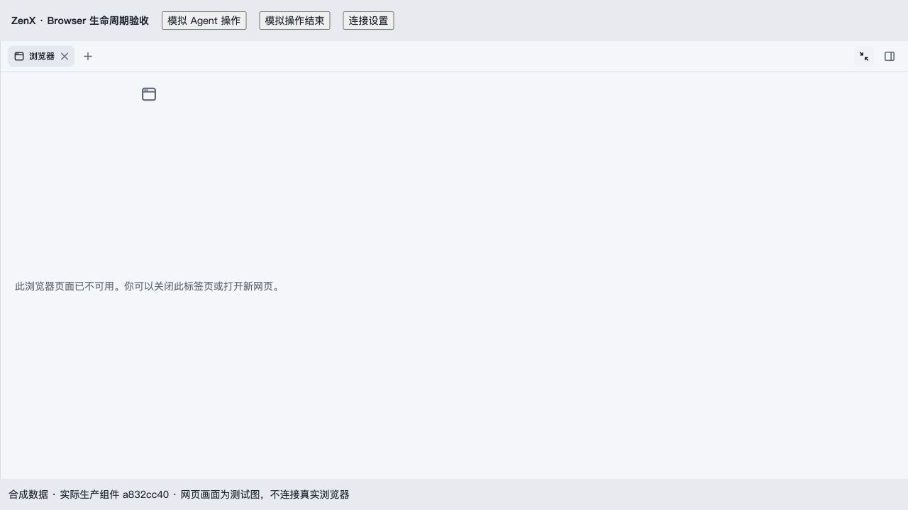
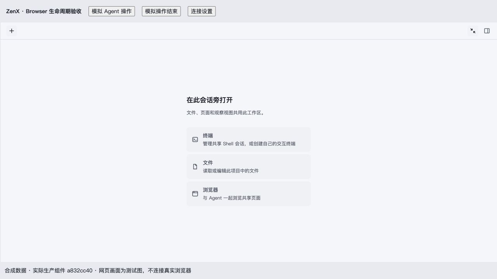
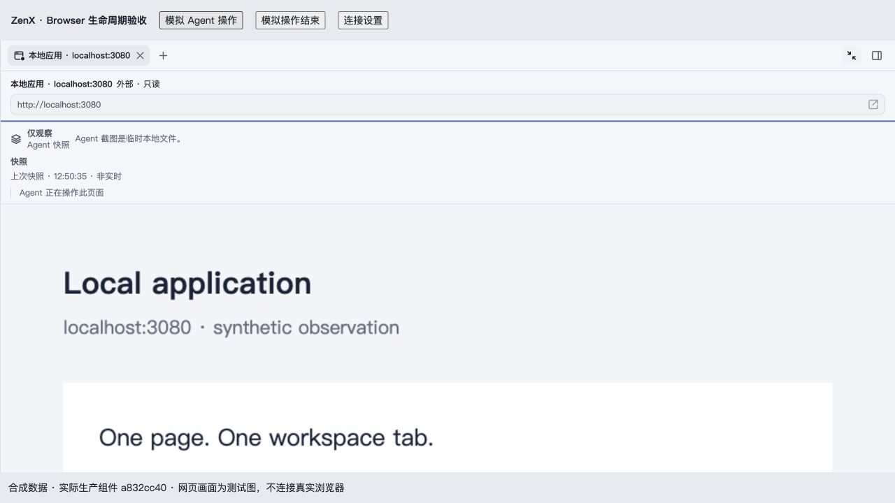
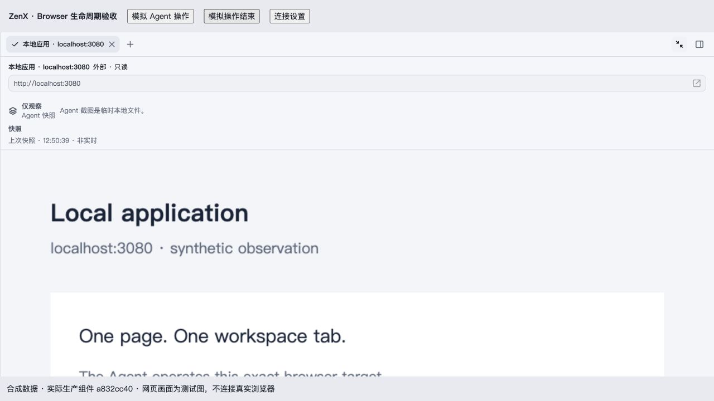
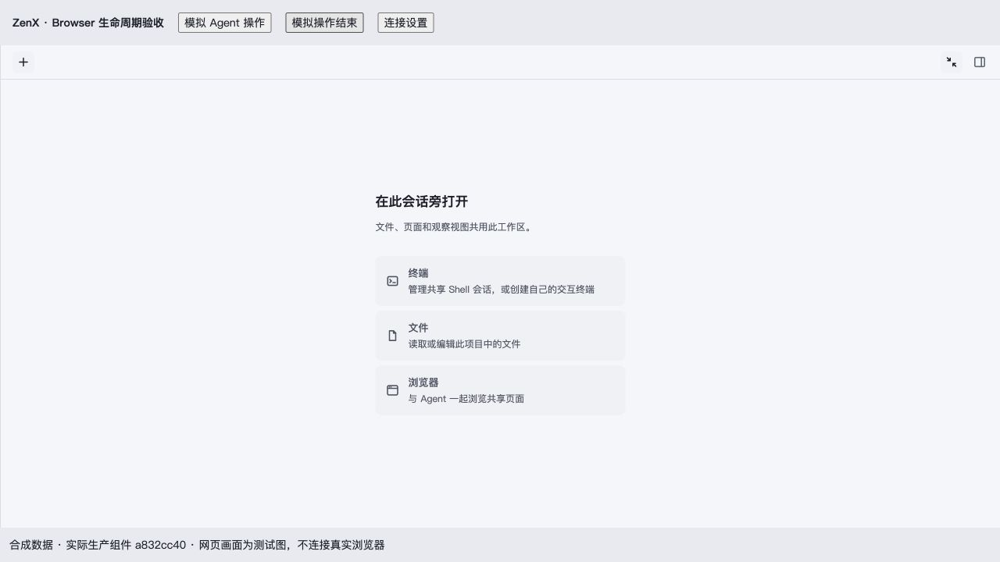
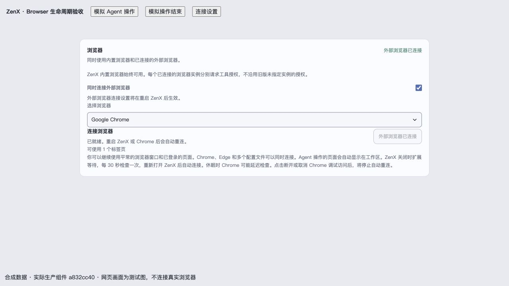

# Browser lifecycle verification

Runtime source: `a832cc40d0b8605fa9e0bf3c22adc13b528ffe27`, including main `831404a1`. Browser source independently reviewed at `8991a2ea`; the integration preserves those Browser components and lifecycle paths. Captured 2026-11-02 from the production AuxiliaryPanel, observer, settings and product styles in Chromium. All ports, page frames, titles, URLs and connection responses are synthetic. No real conversation or browser profile is included.

- An expired persisted page explains its unavailable state and Close dismisses it without a native page command.
- The launcher has one Browser type. Connected Chrome discovery adds no second type or empty placeholder.
- Actual operation metadata automatically selects one exact preview in the same tab rail, without a model UI command or moving keyboard focus. The test page image is synthetic, not evidence of native Chrome capture.
- Completion briefly replaces the tab glyph with a check, then removes the temporary preview. Failure is tested separately and does not show a success check. Existing workspace selection is preserved behind this presentation.
- Settings use one connection action. The synthetic connection response below verifies rendering only; real restart reconnection still requires installed-app acceptance.

At the integrated runtime revision, 483 related/integration tests ran: 481 passed and 2 skipped. Typecheck, the official portable app build and strict/deep signature verification passed. Three source-review rounds addressed immediate debugger-cancel persistence and the Computer launcher regression; the last round had no blocking finding. The earlier broad local check was not green. After fixing this change's regressions, nine remaining failures reproduced on prepared main `831404a1`; CI and real desktop acceptance are separate gates.

A subsequent Windows CI failure exposed delayed target-destroy notification after a successful created-page close. The final backend fix retires only that exact owner's attachment after the confirmed close receipt, retaining unknown-effect evidence and issuing no second detach. A real CDP regression test was red before the fix and green afterward. The final related suite ran 484 tests: 482 passed and 2 skipped; typecheck passed. This final CI fix came after the three source-review rounds and was not independently reviewed again. It does not change the rendered components captured above.

The development extension is 3.3.0. It starts a fresh connection at worker/browser startup and on its reconnect alarm, without replaying tab operations. Explicit disconnect and debugger cancellation stop reconnection. First installation still needs Chrome's installation confirmation; a public Chrome Web Store listing does not yet exist. This verification does not claim store distribution, rejected Chrome storage writes, native compositor behavior, or sleep/wake timing.
