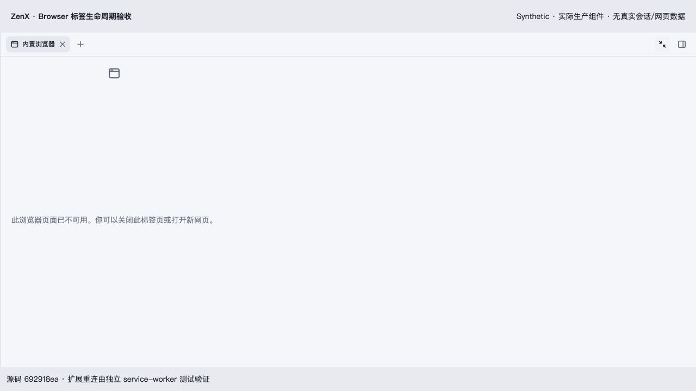
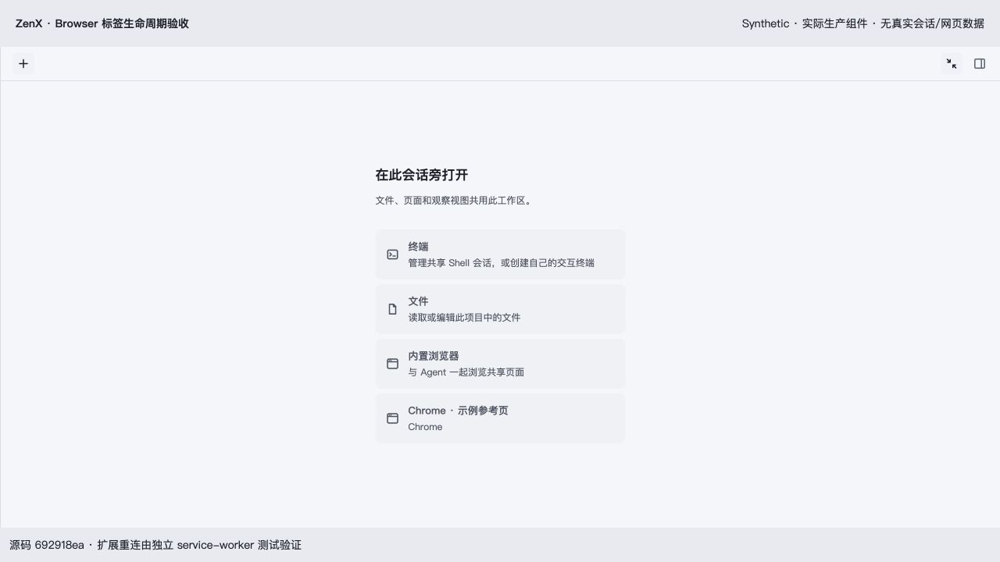
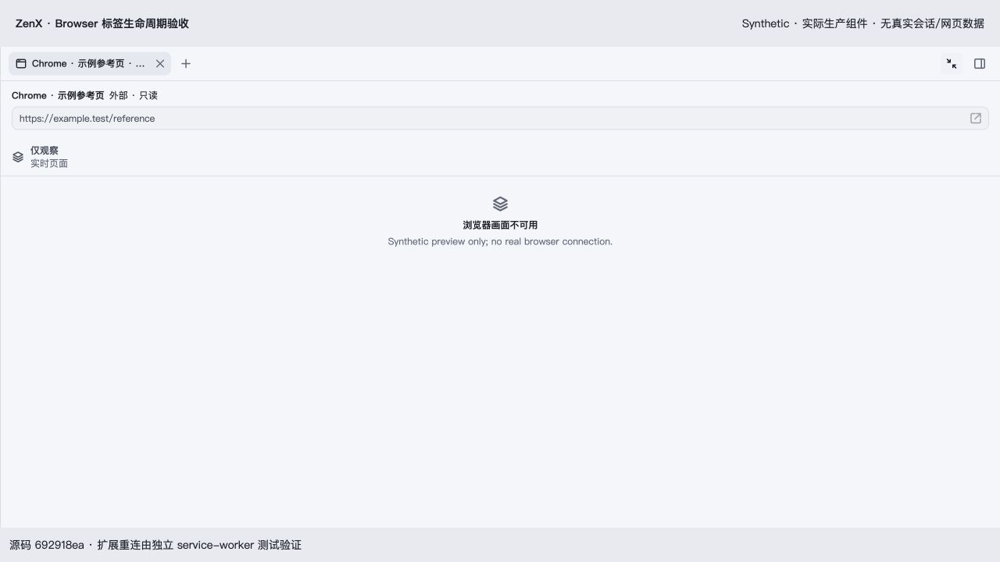

# Browser tab lifecycle verification

Production component source: `692918ea36f86a6174642e252fa04dc777667645`. Captured 2026-11-02 with the real AuxiliaryPanel, browser observer component and product styles in a Chromium browser. All resource ports, titles and URLs are synthetic. No real conversation, browser profile or learner data is included. The final documentation commit changes only these screenshots and this note.

- Restored expired native page shows its unavailable state. Clicking Close removes its persisted presentation without a native page operation.
- External target discovery leaves the tab strip empty; the workspace launcher offers the built-in browser and external Chrome preview separately.
- Choosing Chrome opens exactly one read-only preview. Closing it leaves an empty strip, and the page is still available to explicitly reopen.

These captures verify production component presentation and interaction with synthetic ports. They do not establish native Electron compositor behavior, installed Chrome reconnection, or sleep/wake alarm timing. Extension service-worker tests separately verify remembered opt-in, startup/alarm reconnection without replay, explicit disconnect and debugger cancellation.
