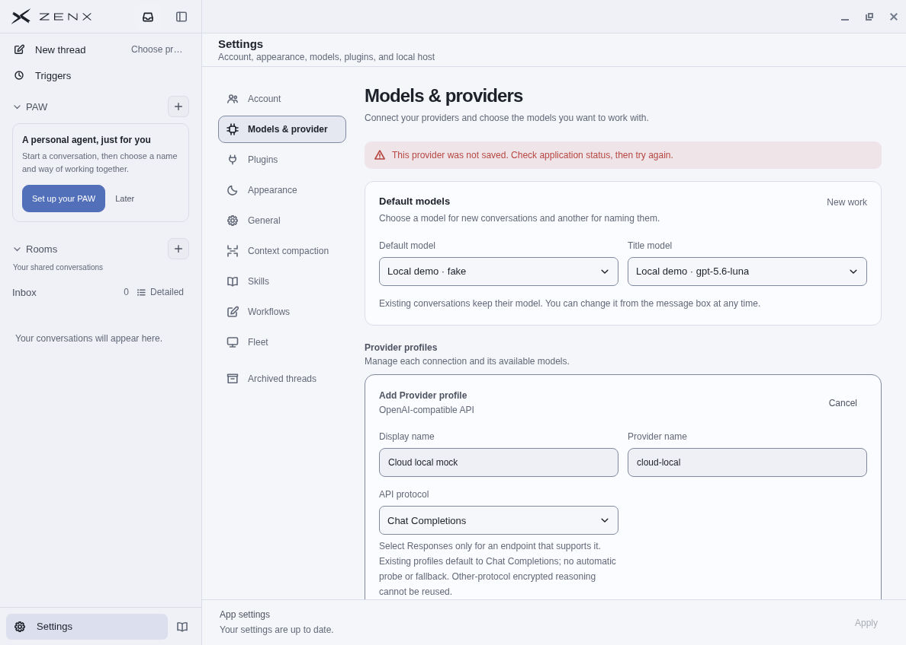
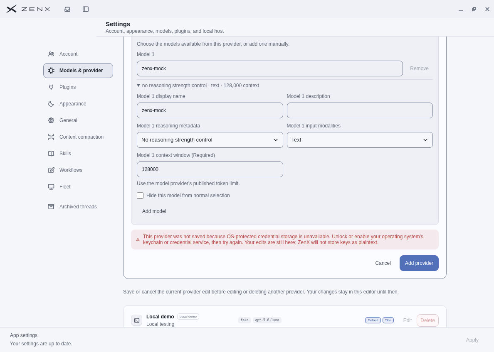

# Provider-save credential failure — synthetic native acceptance

PR: https://github.com/albert-zen/zen/pull/546

## Scope and identities

- Before source: `54fc490fb3216ff00c122f46e35985253e457be2`; tree `821c1fdf474f72d192d51a2c45acd52f9d4f0605`.
- Accepted after source: `4a25d49d77e9841a26adf0e7622fde7299358421`; tree `c8ad1851952a3df97fd2ca1c087a59f70172371f`.
- Local production build is from clean `9bc44f2f9600c2656a7c3f57412589155b74da18`, whose tree is identical to the published after source.
- Manual after acceptance: 2026-10-27 08:38:22 UTC, cloud Linux/Xfce, actual production-compiled Electron app with development identity.
- Same isolated synthetic profile, localhost mock configuration, dummy key, model `zenx-mock`, context window `128000`.

## Actual observations

Before: Add custom provider failed without saving, and the generic page-top error offered no credential-storage cause. The screenshot shows the top of Settings after scrolling up to find that error; it is not the form's Save viewport.

After: the same public Settings flow reports **OS-protected credential storage unavailable** beside the Add provider button, explains how to retry and explicitly refuses plaintext key storage. The operator observed that edits remain available. The after screenshot shows the actual Save viewport and retained synthetic model fields.

The new typed observation establishes the credential boundary's unavailable result. It does not prove a specific native keyring exception, identify the OS service's underlying failure, or show successful credential persistence.

## Evidence boundaries

These are real native screenshots, not a mocked renderer or JSDOM screenshot. They use synthetic data only. Visual review found no real user data, account identity, secret, personal path or token. Metadata inspection found only JFIF density/version information and no EXIF. No redaction or image editing was necessary.

The source files were named `.png` locally but contain JPEG/JFIF bytes; these copies use truthful `.jpg` names without re-encoding. Bytes and SHA-256 remain unchanged.

This was a production-compiled development-identity app, not a portable packaged release. No paid HTTP inference occurred. This manual evidence is not packaged Windows acceptance; Windows/macOS package checks are separate CI evidence. No user computer was accessed or changed.

## File hashes

| File | SHA-256 |
| --- | --- |
| before.jpg | c90c1c3c992c1f75d7e9cf4042430fb72dd1c5095df443bb8e8b86a854a8c2f5 |
| after.jpg | 210abfdeca7af2d9e773f8a862f163d531dab82220aa5b00d6916a5a9b2a849d |

Both images are 1188 × 848. This evidence-only branch is separate from the implementation branch; runtime profiles, credential stores and raw logs are not published.

## CI

Exact implementation head `4a25d49d77e9841a26adf0e7622fde7299358421` passed:
- CI: https://github.com/albert-zen/zen/actions/runs/40471366196 (all eight jobs)
- Durable Trace UI acceptance: https://github.com/albert-zen/zen/actions/runs/40471365911

Local focused checks: 209 passed, 2 existing Windows-only skips; typecheck, production build and formatting passed. Native manual acceptance above complements, rather than replaces, those checks.

## Before

## After

